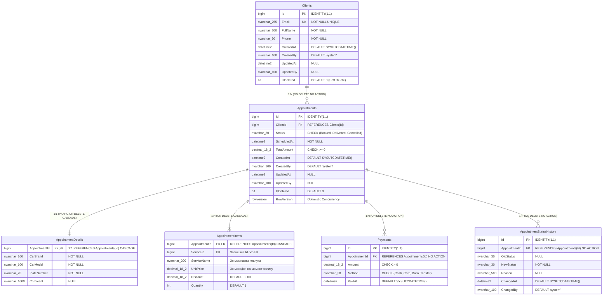
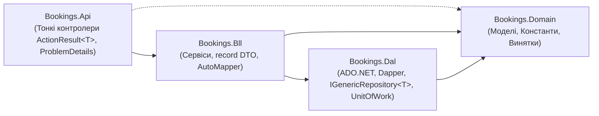
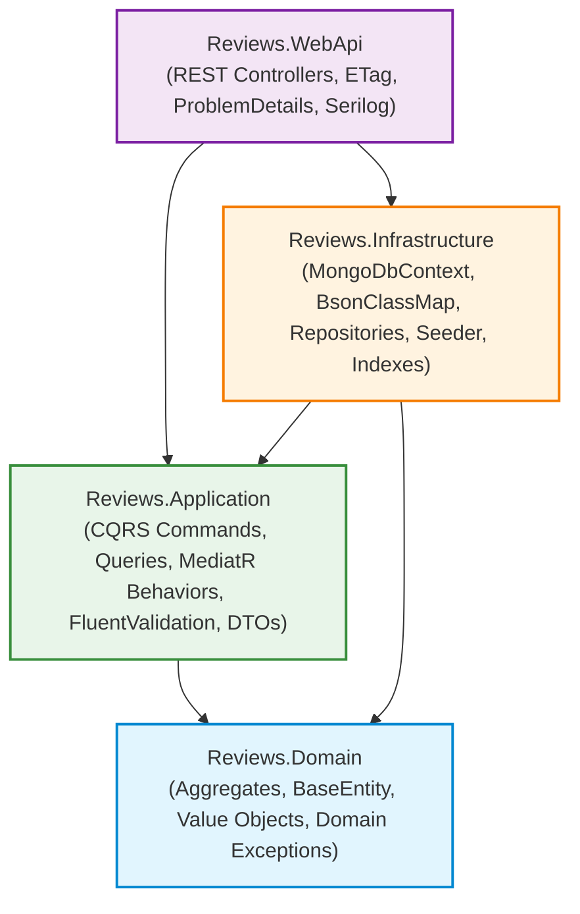
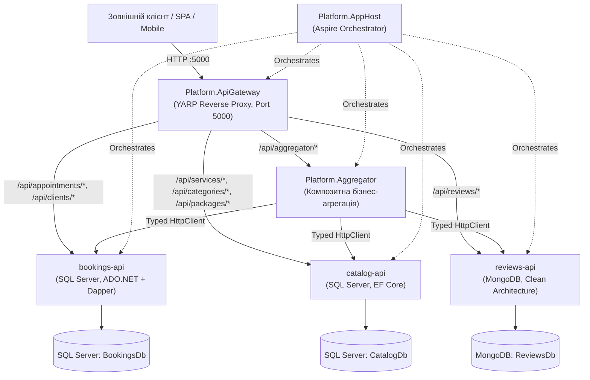
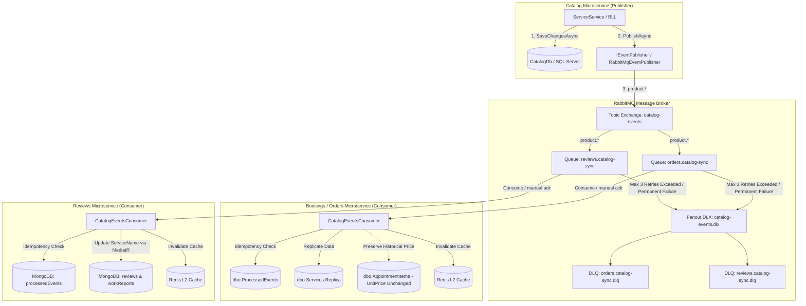

# Практичне заняття №01: Проєктування баз даних для мікросервісної архітектури

Навчальний проєкт із проєктування незалежних баз даних за патерном **Database per Service** для предметної області **«Детейлінг-студія»**.

---

## 1. Предметна область та три незалежні контексти (Bounded Contexts)

### Короткий опис домену
Детейлінг-студія надає професійні послуги з комплексного догляду за автомобілями: багатофазна мийка, відновлювальне та абразивне полірування кузова, нанесення захисних керамічних покриттів і хімчистка салону. Адміністратори студії приймають попередні записи клієнтів, фіксують прийом авто, ведуть автомобіль через етапи робіт та контролюють розрахунки. Клієнти обирають послуги або комплексні пакети з каталогу, а після завершення візиту залишають відгуки та переглядають звіти майстрів.

### Три незалежні контексти (кожен — окрема БД) та їхні сутності
Кожна сутність у системі належить **рівно одному контексту** (єдине джерело істини — *System of Record*):

1. **Контекст «Записи» (`Bookings`)** — база даних `DetailingBookings` (SQL Server, ADO.NET + Dapper):
   - **Сутності контексту:** `Clients`, `Appointments`, `AppointmentDetails`, `AppointmentItems`, `Payments`, `AppointmentStatusHistory`.
   - *Примітка:* каталог `Services` належить Каталогу; у `AppointmentItems` зберігається лише зовнішній `ServiceId` (без FK) та знімок цін.
2. **Контекст «Каталог послуг» (`Catalog`)** — база даних `DetailingCatalog` (SQL Server, EF Core Code First):
   - **Сутності контексту:** `ServiceCategories`, `Services`, `ServiceSpecs`, `ServiceImages`, `Packages`, `PackageServices`.
3. **Контекст «Відгуки та звіти» (`Reviews`)** — база даних `detailing_reviews` (MongoDB, MongoDB.Driver):
   - **Сутності контексту:** `reviews`, `workReports`, `discussions`, `messages`.

| № | Контекст | СКБД та назва БД | Майбутній стек у .NET | Зона відповідальності |
| :-: | :--- | :--- | :--- | :--- |
| **1** | **Записи (`Bookings`)** | SQL Server: `DetailingBookings` | ADO.NET + Dapper | Клієнти, записи на візит (`Appointments`), деталі авто (1:1), позиції замовлення зі знімками цін (M:N), платежі, історія переходів між статусами та 6 збережених процедур. |
| **2** | **Каталог послуг (`Catalog`)** | SQL Server: `DetailingCatalog` | EF Core (Code First) | Категорії послуг (`ServiceCategories`), послуги (`Services`), технічні специфікації (1:1 `ServiceSpecs`), фотогалерея (1:N `ServiceImages`) та пакетні пропозиції (M:N `Packages` $\leftrightarrow$ `PackageServices`). |
| **3** | **Відгуки та звіти (`Reviews`)** | MongoDB: `detailing_reviews` | MongoDB.Driver | Відгуки клієнтів з гнучкою схемою (`reviews`), поліморфні технологічні звіти майстрів (`workReports`), теми обговорень (`discussions`) та потік повідомлень (`messages`). |

### Жорсткі архітектурні принципи проєкту
- **Жодних міжбазових `FOREIGN KEY`**, спільних таблиць або міжбазових `JOIN`. Посилання на сутність іншого контексту зберігається як звичайний стовпець/поле з її Id (`ServiceId`, `AppointmentId`) без фізичного зовнішнього ключа на іншу базу.
- **Кожна сутність належить рівно одному контексту** (жодна сутність не дублюється між контекстами як власна таблиця чи колекція).
- **Повна ідемпотентність усіх скриптів**: повторне виконання будь-якого скрипту (`00_create_db.sql`, `schema.sql`, `procedures.sql`, `seed.sql`, `collections.js`, `seed.js`) не призводить до помилок і не створює дублікатів.

### Структура репозиторію (Лаб. 01 + Лаб. 02)

```text
<корінь репозиторію>/
├── README.md                   ★ опис домену, запуск, розгортання БД, таблиця дублювання, Лаб. 01–02
├── .gitignore                  ★ ігнорування службових файлів та артефактів збірки (bin/, obj/, .vs/)
├── docker-compose.yml          ★ середовище SQL Server 2022 + MongoDB
├── Platform.slnx               ★ єдиний файл рішення (.NET 9 XML Solution)
├── Platform.AppHost/           ★ оркестрація .NET Aspire (AppHost.cs, ресурс "BookingsDb")
├── Services/                   ★ мікросервіси платформи
│   └── Bookings/               ★ Проєкт №1: Тришарова архітектура (ADO.NET + Dapper)
│       ├── Bookings.Api/       ★ презентаційний рівень (тонкі контролери, IExceptionHandler -> ProblemDetails, Serilog)
│       ├── Bookings.Bll/       ★ бізнес-логіка (сервіси, DTO, AutoMapper BookingProfile, транзакції UoW)
│       ├── Bookings.Dal/       ★ доступ до даних (ClientRepository на чистому ADO.NET, Dapper-репозиторії, TVP, UnitOfWork)
│       ├── Bookings.Domain/    ★ доменні сутності, константи переходів статусів та доменні винятки
│       └── Bookings.Tests/     ★ модульні та інтеграційні тести (xUnit, NSubstitute, WebApplicationFactory)
├── docs/                       ★ ERD-діаграми, опис контекстів, ADR, приклади документів
│   ├── domain.md               ★ опис домену (2-3 речення), 3 контексти, сутності, агрегати
│   ├── duplication-policy.md   ★ детальна таблиця політики дублювання даних між сервісами
│   ├── decisions.md            ★ архітектурні рішення (ADR-01..ADR-09)
│   ├── erd/                    ★ ERD-діаграми (DBML та Mermaid Markdown)
│   └── samples/                ★ приклади документів MongoDB (JSON)
└── db/                         ★ SQL- і MongoDB-скрипти (Лаб. 01)
    ├── p1/                     ★ Проєкт №1: schema.sql · procedures.sql · seed.sql · tests.sql
    ├── p2/                     ★ Проєкт №2: schema.sql · seed.sql · tests.sql
    └── p3/                     ★ Проєкт №3 (MongoDB): collections.js · seed.js · queries.js
```

---

## 2. Вимоги до середовища (Prerequisites)

Для розгортання баз даних (Лаб. 01) та запуску мікросервісу `Bookings` через `.NET Aspire` (Лаб. 02) необхідні:

- **.NET SDK 9.0** (`net9.0`, перевірено на версії `9.0.318` — див. [`docs/decisions.md`](file:///d:/detailing-db/docs/decisions.md))
- **SQL Server 2019 / 2022** (Developer, Express або LocalDB) **або Docker**
- **Docker Desktop** (для роботи контейнерного оркестратора `.NET Aspire` та `docker compose`)
- **`sqlcmd`** (клієнт командного рядка SQL Server)
- **`mongosh`** (MongoDB Shell для розгортання бази `detailing_reviews`)

### Запуск СКБД через Docker Compose (опціонально)
У корені репозиторію міститься файл [`docker-compose.yml`](file:///d:/detailing-db/docker-compose.yml), який піднімає контейнери **SQL Server 2022** (порт `1433`) та **MongoDB 7.0** (порт `27017`).

> [!NOTE]
> Згідно з політикою відсутності секретів у репозиторії, пароль адміністратора SQL Server передається через змінну оточення `MSSQL_SA_PASSWORD`.

Запуск контейнерів у PowerShell:
```powershell
$env:MSSQL_SA_PASSWORD = "ChangeMe_StrongPass123!"
docker compose up -d
```

Запуск контейнерів у Bash / Linux / macOS:
```bash
MSSQL_SA_PASSWORD="ChangeMe_StrongPass123!" docker compose up -d
```

---

## 3. Розгортання БД з нуля

### 3.1. Розгортання Проєкту №1: `DetailingBookings` (SQL Server, папка `db/p1/`)

Порядок запуску:
`00_create_db.sql` $\rightarrow$ `schema.sql` $\rightarrow$ `procedures.sql` $\rightarrow$ `seed.sql` ($\rightarrow$ `tests.sql`).

#### Команди для локального SQL Server LocalDB / Express (Windows Authentication):
```powershell
sqlcmd -S "(localdb)\MSSQLLocalDB" -E -f 65001 -i db/p1/00_create_db.sql
sqlcmd -S "(localdb)\MSSQLLocalDB" -E -f 65001 -d DetailingBookings -i db/p1/schema.sql
sqlcmd -S "(localdb)\MSSQLLocalDB" -E -f 65001 -d DetailingBookings -i db/p1/procedures.sql
sqlcmd -S "(localdb)\MSSQLLocalDB" -E -f 65001 -d DetailingBookings -i db/p1/seed.sql
sqlcmd -S "(localdb)\MSSQLLocalDB" -E -f 65001 -d DetailingBookings -i db/p1/tests.sql
```
*(Якщо використовується повноцінний екземпляр SQL Server за замовчуванням, замініть `"(localdb)\MSSQLLocalDB"` на `localhost`).*

#### Команди для SQL Server у Docker (SQL Authentication):
```powershell
sqlcmd -S localhost,1433 -U sa -P "$env:MSSQL_SA_PASSWORD" -C -f 65001 -i db/p1/00_create_db.sql
sqlcmd -S localhost,1433 -U sa -P "$env:MSSQL_SA_PASSWORD" -C -f 65001 -d DetailingBookings -i db/p1/schema.sql
sqlcmd -S localhost,1433 -U sa -P "$env:MSSQL_SA_PASSWORD" -C -f 65001 -d DetailingBookings -i db/p1/procedures.sql
sqlcmd -S localhost,1433 -U sa -P "$env:MSSQL_SA_PASSWORD" -C -f 65001 -d DetailingBookings -i db/p1/seed.sql
sqlcmd -S localhost,1433 -U sa -P "$env:MSSQL_SA_PASSWORD" -C -f 65001 -d DetailingBookings -i db/p1/tests.sql
```

---

### 3.2. Розгортання Проєкту №2: `DetailingCatalog` (SQL Server, папка `db/p2/`)

Порядок запуску:
`00_create_db.sql` $\rightarrow$ `schema.sql` $\rightarrow$ `seed.sql` ($\rightarrow$ `tests.sql`).

#### Команди для локального SQL Server LocalDB / Express (Windows Authentication):
```powershell
sqlcmd -S "(localdb)\MSSQLLocalDB" -E -f 65001 -i db/p2/00_create_db.sql
sqlcmd -S "(localdb)\MSSQLLocalDB" -E -f 65001 -d DetailingCatalog -i db/p2/schema.sql
sqlcmd -S "(localdb)\MSSQLLocalDB" -E -f 65001 -d DetailingCatalog -i db/p2/seed.sql
sqlcmd -S "(localdb)\MSSQLLocalDB" -E -f 65001 -d DetailingCatalog -i db/p2/tests.sql
```

#### Команди для SQL Server у Docker (SQL Authentication):
```powershell
sqlcmd -S localhost,1433 -U sa -P "$env:MSSQL_SA_PASSWORD" -C -f 65001 -i db/p2/00_create_db.sql
sqlcmd -S localhost,1433 -U sa -P "$env:MSSQL_SA_PASSWORD" -C -f 65001 -d DetailingCatalog -i db/p2/schema.sql
sqlcmd -S localhost,1433 -U sa -P "$env:MSSQL_SA_PASSWORD" -C -f 65001 -d DetailingCatalog -i db/p2/seed.sql
sqlcmd -S localhost,1433 -U sa -P "$env:MSSQL_SA_PASSWORD" -C -f 65001 -d DetailingCatalog -i db/p2/tests.sql
```

---

### 3.3. Розгортання Проєкту №3: `detailing_reviews` (MongoDB, папка `db/p3/`)

Порядок запуску:
`collections.js` $\rightarrow$ `seed.js` ($\rightarrow$ `queries.js`).

```powershell
mongosh "mongodb://localhost:27017/detailing_reviews" db/p3/collections.js
mongosh "mongodb://localhost:27017/detailing_reviews" db/p3/seed.js
mongosh "mongodb://localhost:27017/detailing_reviews" db/p3/queries.js
```

---

## 4. Як перевірити індекси, обмеження та відсутність міжбазових FK

### 4.1. Перевірка зовнішніх ключів (відсутність міжбазових посилань у SQL Server)
Системне представлення `sys.foreign_keys` зберігає лише внутрішньобазові ключі (SQL Server навіть синтаксично не підтримує міжбазові FK), а також переконуємося у відсутності тригерів чи синонімів на інші БД:

```sql
-- Виконати по черзі в DetailingBookings та DetailingCatalog:
SELECT
    DB_NAME()                                   AS CurrentDatabase,
    fk.name                                     AS ForeignKeyName,
    OBJECT_NAME(fk.parent_object_id)            AS ParentTable,
    OBJECT_NAME(fk.referenced_object_id)        AS ReferencedTable,
    fk.delete_referential_action_desc           AS OnDeleteAction
FROM sys.foreign_keys fk
ORDER BY ParentTable, ForeignKeyName;

-- Перевірка відсутності синонімів на інші бази даних:
SELECT name, base_object_name FROM sys.synonyms;
```

### 4.2. Перевірка створених індексів (включно з фільтрованими) у SQL Server
```sql
SELECT
    OBJECT_NAME(i.object_id) AS TableName,
    i.name                   AS IndexName,
    i.type_desc              AS IndexType,
    i.is_unique              AS IsUnique,
    i.has_filter             AS IsFiltered,
    i.filter_definition      AS FilterDefinition
FROM sys.indexes i
WHERE OBJECTPROPERTY(i.object_id, 'IsUserTable') = 1
  AND i.name IS NOT NULL
ORDER BY TableName, IndexName;
```

### 4.3. Перевірка обмежень `CHECK`, `UNIQUE` та `DEFAULT` у SQL Server
```sql
SELECT
    OBJECT_NAME(parent_object_id) AS TableName,
    name                          AS ConstraintName,
    type_desc                     AS ConstraintType,
    definition                    AS ConstraintExpression
FROM sys.check_constraints
UNION ALL
SELECT
    OBJECT_NAME(parent_object_id) AS TableName,
    name                          AS ConstraintName,
    type_desc                     AS ConstraintType,
    definition                    AS ConstraintExpression
FROM sys.default_constraints
ORDER BY TableName, ConstraintType, ConstraintName;
```

### 4.4. Перевірка індексів та `$jsonSchema`-валідаторів у MongoDB (`mongosh`)
```javascript
use detailing_reviews;

// Перегляд усіх індексів по колекціях:
db.reviews.getIndexes();
db.messages.getIndexes();
db.workReports.getIndexes();

// Перегляд налаштованих правил $jsonSchema:
db.getCollectionInfos().map(c => ({ name: c.name, options: c.options }));
```

---

## 5. Таблиця політики дублювання даних

Детальний опис наведено у файлі [`docs/duplication-policy.md`](file:///d:/detailing-db/docs/duplication-policy.md).

| Поле | Де зберігається | Джерело | Політика |
| :--- | :--- | :--- | :--- |
| `AppointmentItems.ServiceName, UnitPrice` | БД Записів (`DetailingBookings`) | `Service` (Каталог) | знімок на момент запису, не оновлюється |
| `Services.Name, Price, DurationMin` | БД Записів (`DetailingBookings`) | `Service` (Каталог) | копія для читання, оновлюється подіями з Каталогу |
| `reviews.serviceName` | MongoDB (`detailing_reviews`) | `Service` (Каталог) | копія, оновлюється подіями з Каталогу |
| `discussions.targetName` | MongoDB (`detailing_reviews`) | `Service` / `Package` (Каталог) | копія, оновлюється подіями з Каталогу |
| `reviews.verifiedVisit` | MongoDB (`detailing_reviews`) | `Appointments` (БД Записів) | знімок на момент публікації відгуку |
| `reviews.author.fullName, carInfo` | MongoDB (`detailing_reviews`) | `Clients`, `AppointmentDetails` (БД Записів) | знімок на момент публікації відгуку |
| `workReports.serviceName` | MongoDB (`detailing_reviews`) | `Service` (Каталог) | знімок на момент звіту |
| `workReports.carPlateNumber` | MongoDB (`detailing_reviews`) | `AppointmentDetails` (БД Записів) | знімок на момент звіту |
| `workReports.appointmentId, reviews.appointmentId, reviews.author.clientId` | MongoDB (`detailing_reviews`) | `Appointments`, `Clients` (БД Записів) | лише ідентифікатор, без FK |
| `AppointmentItems.ServiceId, reviews.serviceId, workReports.serviceId, discussions.targetId` | БД Записів (`DetailingBookings`), MongoDB (`detailing_reviews`) | `Service`, `Package` (Каталог) | лише ідентифікатор, без FK |

---

## 6. Обґрунтування вибору первинних ключів (PK)

1. **`BIGINT IDENTITY(1,1)` для основних таблиць SQL Server (`DetailingBookings`, `DetailingCatalog`):**
   - У межах кожного мікросервісного контексту є лише **одне джерело вставки** (єдина точка запису — *Single Writer*), тому централізована генерація ключів засобами СКБД є безпечною й не створює колізій.
   - Тип `BIGINT` займає **8 байтів** (проти 16 байтів у `UNIQUEIDENTIFIER`), що робить кластерний індекс (`Clustered PK`) та всі некластерні індекси (які включають кластерний ключ як покажчик рядка) компактними в оперативній пам'яті (`Buffer Pool`).
   - Послідовне зростання значень `IDENTITY` гарантує додавання нових записів у кінець B-дерева індексу без дорогих операцій поділу сторінок (*Page Splits*) та фрагментації.
2. **`BIGINT` без `IDENTITY` для `DetailingBookings.dbo.Services`:**
   - Ця таблиця є локальною реплікою довідника з `DetailingCatalog`, тому вона повинна зберігати ті самі `Id`, які були згенеровані в Каталозі.
3. **`ObjectId` для колекцій MongoDB (`detailing_reviews`):**
   - Стандартний 12-байтовий тип `_id` у MongoDB (4 байти timestamp + 5 байтів випадкового значення процесу + 3 байти лічильника) може генеруватися на боці клієнтського драйвера без додаткового round-trip до сервера, підтримує природне хронологічне сортування та ідеально підходить для документно-орієнтованої моделі.

---

## 7. Контрольні питання та відповіді

### 1. Що таке Bounded Context (обмежений контекст) у DDD і як він пов'язаний із Database per Service?
**Відповідь:** *Bounded Context* — це чітка семантична та архітектурна межа, всередині якої доменна модель і термінологія (Ubiquitous Language) мають однозначний зміст. Наприклад, сутність «Послуга» (`Service`) у контексті **Catalog** — це маркетингова картка з описом матеріалів, гарантією, пакетами та фотогалереєю, тоді як у контексті **Bookings** — це лише елемент розрахунку вартості й тривалості візиту. Патерн *Database per Service* фізично закріплює межі Bounded Context на рівні сховища даних, щоб жоден сервіс не міг напряму читати або змінювати чужі таблиці в обхід бізнес-логіки власника контексту.

### 2. Чому в мікросервісній архітектурі не роблять міжбазових Foreign Keys та спільних таблиць?
**Відповідь:** Міжбазові зовнішні ключі та спільні таблиці створюють сильне зв'язування (*Tight Coupling*) на рівні схеми та інфраструктури:
1. Неможливо незалежно розгорнути, змінити схему або масштабувати одну базу без блокування іншої.
2. Неможливо розмістити бази на різних фізичних серверах або використати різні СКБД (Polyglot Persistence, як SQL Server + MongoDB у нашому проєкті).
3. Падіння або блокування таблиці в одному сервісі зупинить транзакції в іншому сервісі.

### 3. Чим відрізняється «знімок» (Snapshot) від «копії для читання» (Read-Model Copy)?
**Відповідь:**
- **Знімок (Snapshot)** фіксує стан даних на конкретний момент часу в минулому і **ніколи не оновлюється** після створення. Приклад: `AppointmentItems.ServiceName` та `UnitPrice` фіксують ціну, за якою клієнт оформив замовлення; подальше подорожчання послуги в Каталозі не має змінювати історію замовлень.
- **Копія для читання (Read-Model Copy)** підтримується в актуальному стані шляхом асинхронної синхронізації через інтеграційні події (*Eventual Consistency*). Приклад: локальна таблиця `Services` у БД `DetailingBookings` або поле `reviews.serviceName` у MongoDB оновлюються при зміні послуги в Каталозі.

### 4. Коли в MongoDB слід обирати Embedding (вкладення), а коли Referencing (посилання)?
**Відповідь:**
- **Embedding (вкладення)** обирають, коли дочірні дані мають зв'язок `1:1` або обмежений `1:Few` (їх кількість фіксована і невелика), вони завжди читаються разом із батьківським документом і не потребують окремого оновлення. Приклад: об'єкт `author`, масив `comments[]` (2–3 останні відповіді) у `reviews`, а також `checklist[]` та `materialsUsed[]` у `workReports`.
- **Referencing (посилання)** обирають, коли зв'язок є `1:Many` з необмеженим зростанням (*Unbounded Array*), або коли дочірні елементи активно додаються й пагінуються окремо. Приклад: колекція `messages` посилається на `discussions` через `discussionId`, щоб гілка на тисячі повідомлень не перевищила ліміт BSON-документа (16 МБ).

### 5. Для чого використовується тип `ROWVERSION` у SQL Server і як він працює?
**Відповідь:** `ROWVERSION` (раніше відомий як `TIMESTAMP`) — це 8-байтовий бінарний лічильник у межах бази даних, який SQL Server автоматично змінює при кожному `INSERT` або `UPDATE` рядка. Він використовується для **оптимістичного блокування (Optimistic Concurrency Control)**: застосунок зчитує рядок разом із `RowVersion`, а під час збереження змін додає умову `WHERE Id = @Id AND RowVersion = @OriginalRowVersion`. Якщо інший користувач встиг змінити рядок раніше, `RowVersion` вже інший, `UPDATE` змінить `0` рядків, і застосунок виявить конфлікт без утримання довгих блокувань на час роздумів користувача.

### 6. Порівняйте `GUID (UNIQUEIDENTIFIER)` та `BIGINT IDENTITY` як первинні ключі в SQL Server.
**Відповідь:**
- **`BIGINT IDENTITY` (8 байтів):** компактний, легко читається в логах і URL, монотонно зростає, тому не фрагментує кластерний індекс B-Tree. Ідеальний вибір, коли база має єдину точку генерації ключів (один сервіс-власник БД).
- **`GUID / UNIQUEIDENTIFIER` (16 байтів):** удвічі більший за розміром (роздуває кластерний і всі некластерні індекси), а випадковий `NEWID()` вставляє рядки в довільні місця B-Tree, викликаючи сильні *Page Splits* та фрагментацію (хоча це частково пом'якшується через `NEWSEQUENTIALID()` або UUIDv7 у .NET 9+). Виправданий лише тоді, коли ідентифікатори обов'язково потрібно генерувати офлайн або на багатьох незалежних вузлах до звернення в БД.

---

## 8. ERD-діаграми (Entity Relationship Diagrams)

### 8.1. ER-діаграма Проєкту №1: `DetailingBookings` (SQL Server)



### 8.2. ER-діаграма Проєкту №2: `DetailingCatalog` (SQL Server)

```mermaid
erDiagram
    ServiceCategories ||--o{ Services : "1:N (ON DELETE NO ACTION)"
    Services ||--|| ServiceSpecs : "1:1 (PK=FK, ON DELETE CASCADE)"
    Services ||--o{ ServiceImages : "1:N (ON DELETE CASCADE)"
    Packages ||--|{ PackageServices : "1:N частина M:N (ON DELETE CASCADE)"
    Services ||--o{ PackageServices : "1:N частина M:N (ON DELETE NO ACTION)"

    ServiceCategories {
        bigint Id PK "IDENTITY(1,1)"
        nvarchar_100 Name UK "NOT NULL UNIQUE"
        nvarchar_500 Description "NULL"
    }

    Services {
        bigint Id PK "IDENTITY(1,1) System of Record"
        bigint CategoryId FK "REFERENCES ServiceCategories(Id)"
        nvarchar_200 Name UK "NOT NULL UNIQUE"
        decimal_18_2 Price "CHECK > 0"
        int DurationMin "CHECK > 0"
        datetime2 CreatedAt "DEFAULT SYSUTCDATETIME()"
        nvarchar_100 CreatedBy "DEFAULT 'system'"
        datetime2 UpdatedAt "NULL"
        nvarchar_100 UpdatedBy "NULL"
        bit IsDeleted "DEFAULT 0 (Soft Delete)"
        rowversion RowVersion "Optimistic Concurrency"
    }

    ServiceSpecs {
        bigint ServiceId PK,FK "1:1 REFERENCES Services(Id) CASCADE"
        nvarchar_500 Materials "NOT NULL"
        int WarrantyMonths "CHECK >= 0"
        nvarchar_2000 Description "NOT NULL"
    }

    ServiceImages {
        bigint Id PK "IDENTITY(1,1)"
        bigint ServiceId FK "REFERENCES Services(Id) CASCADE"
        nvarchar_500 Url "NOT NULL"
        bit IsMain "DEFAULT 0"
    }

    Packages {
        bigint Id PK "IDENTITY(1,1)"
        nvarchar_150 Name UK "NOT NULL UNIQUE"
        nvarchar_1000 Description "NULL"
        decimal_18_2 Price "CHECK > 0"
        datetime2 CreatedAt "DEFAULT SYSUTCDATETIME()"
        nvarchar_100 CreatedBy "DEFAULT 'system'"
        datetime2 UpdatedAt "NULL"
        nvarchar_100 UpdatedBy "NULL"
        bit IsDeleted "DEFAULT 0 (Soft Delete)"
        rowversion RowVersion "Optimistic Concurrency"
    }

    PackageServices {
        bigint PackageId PK,FK "REFERENCES Packages(Id) CASCADE"
        bigint ServiceId PK,FK "REFERENCES Services(Id) NO ACTION"
        int SortOrder "DEFAULT 1"
        datetime2 AddedAt "DEFAULT SYSUTCDATETIME()"
    }
```



---

## 9. Додаткова документація у репозиторії
- [`docs/domain.md`](file:///d:/detailing-db/docs/domain.md) — опис предметної області, 3 незалежних контекстів, сутностей, агрегатів та патернів MongoDB (embedding, referencing, hybrid, поліморфізм).
- [`docs/duplication-policy.md`](file:///d:/detailing-db/docs/duplication-policy.md) — детальна таблиця політики дублювання та синхронізації даних між контекстами.
- [`docs/decisions.md`](file:///d:/detailing-db/docs/decisions.md) — архітектурні рішення (ADR): PK, каскади, конкурентність, коди помилок та прийняті припущення.
- ER-діаграми у форматі DBML:
  - Проєкт №1 (`DetailingBookings`): [`docs/erd/project1.dbml`](file:///d:/detailing-db/docs/erd/project1.dbml)
  - Проєкт №2 (`DetailingCatalog`): [`docs/erd/project2.dbml`](file:///d:/detailing-db/docs/erd/project2.dbml)

---

## 10. Практичне заняття №02: Тришарова архітектура на базі ADO.NET та Dapper

### 10.1. Архітектура мікросервісу `Bookings`

Мікросервіс **Записи (`Bookings`)** побудований за класичною тришаровою архітектурою з виділеним ядром домену (`Bookings.Domain`):



1. **`Bookings.Domain` (без зовнішніх NuGet-залежностей):**
   - Доменні сутності (`Client`, `Appointment`, `AppointmentDetails`, `AppointmentItem`, `CatalogService`, `Payment`, `StatusHistoryEntry`, `CreateAppointmentResult`).
   - Матриця дозволених переходів статусів (`AppointmentStatuses.IsAllowedTransition`, `CanBeCancelled`).
   - Доменні винятки (`ValidationException`, `NotFoundException`, `BusinessConflictException`).
2. **`Bookings.Dal` (рівень доступу до даних — ADO.NET + Dapper):**
   - **`ClientRepository` (`IClientRepository`):** реалізований **виключно на чистому ADO.NET** (`SqlCommand`, типізовані `SqlParameter` із `SqlDbType` та довжиною, ручне читання з `SqlDataReader`). Навмисно не спадкує `IGenericRepository<T>`.
   - **`IGenericRepository<T> where T : class` та `BaseDapperRepository<T>`:** узагальнений інтерфейс напряму оголошує 5 асинхронних методів (`GetByIdAsync`, `GetAllAsync`, `AddAsync`, `UpdateAsync`, `DeleteAsync` із `CancellationToken`), а базовий клас реалізує їх на Dapper із підтримкою м'якого видалення (`IsDeleted = 1`).
   - **`AppointmentRepository` (`IAppointmentRepository : IGenericRepository<Appointment>`):** Dapper Multi-Mapping (`splitOn: "AppointmentId"`) для завантаження агрегата `Appointment` + `AppointmentDetails` + `AppointmentItems`, передача табличного параметра (`TVP dbo.AppointmentItemTableType`) зі знімками `ServiceName` та `UnitPrice` через `DataTable.AsTableValuedParameter` та виклик процедур (`usp_CreateAppointment`, `usp_ChangeStatus`, `usp_DeliverCar`, `usp_CancelAppointment`, `usp_GetClientAppointments`).
   - **`PaymentRepository` та `CatalogServiceRepository`:** успадковують `IGenericRepository<T>` без дублювання базових CRUD-методів.
   - **`RepositoryBase`:** спільний базовий клас, який транслює помилки SQL Server (`50001`..`50005`, `2601`/`2627`, `547`, `1205`) у типізовані доменні винятки.
   - **`UnitOfWork` (`IUnitOfWork`):** керує єдиним `SqlConnection` та спільною транзакцією `SqlTransaction` (`IsolationLevel.ReadCommitted`) між ADO.NET та Dapper репозиторіями.
3. **`Bookings.Bll` (рівень бізнес-логіки):**
   - Чисті контракти даних на базі `record` (`ClientDto`, `AppointmentDto`, `CreateAppointmentDto`, `RegisterPaymentDto`, `PagedResult<T>` тощо); атрибути валідації (`[Required]`, `[StringLength]`, `[Range]`, `[EmailAddress]`) розміщені виключно на вхідних DTO.
   - Профіль AutoMapper (`BookingProfile`).
   - Сервіси (`ClientService`, `AppointmentService`, `PaymentService`, `CatalogQueryService`). У `AppointmentService.CreateAsync` всередині транзакції `IUnitOfWork` послуги завантажуються батч-запитом із `_unitOfWork.Services.GetByIdsAsync(...)`, явно формується історичний знімок `ServiceName = service.Name` та `UnitPrice = service.Price`, обчислюється `TotalAmount = sum(UnitPrice * Quantity - Discount)` і зберігається агрегат.
4. **`Bookings.Api` (презентаційний рівень):**
   - Тонкі контролери (`ClientsController`, `AppointmentsController`, `PaymentsController`, `CatalogServicesController`) без бізнес-логіки та SQL, що повертають типізований `Task<ActionResult<TDto>>` для всіх методів із тілом відповіді.
   - Глобальний обробник помилок `DomainExceptionHandler : IExceptionHandler`, що повертає відповіді у форматі **RFC 7807 `ProblemDetails`** (`400`, `404`, `409`, `500`).
   - Структурне логування **Serilog** та документація **Swagger / OpenAPI**.
5. **`Platform.AppHost` (.NET Aspire):**
   - Єдина точка оркестрації рішення, яка підключає ресурс бази даних `"BookingsDb"` та передає його сервісу `Bookings.Api` (`bookings-api`) через `.WithReference(bookingsDb)`.

---

### 10.2. Налаштування підключення та конфігурації (без секретів у репозиторії)

1. **`ConnectionStrings:BookingsDb`:**
   - У файлах [`Platform.AppHost/appsettings.json`](file:///d:/detailing-db/Platform.AppHost/appsettings.json) та [`Services/Bookings/Bookings.Api/appsettings.json`](file:///d:/detailing-db/Services/Bookings/Bookings.Api/appsettings.json) збережено безпечний плейсхолдер `<SET_VIA_ENV_ConnectionStrings__BookingsDb>` без жодних паролів.
   - Для локальної розробки у `appsettings.Development.json` налаштовано підключення до `(localdb)\MSSQLLocalDB` через Windows Authentication (`Trusted_Connection=True`).
   - Перевизначити рядок підключення можна через змінну середовища `ConnectionStrings__BookingsDb` або через `dotnet user-secrets`:
     ```powershell
     # Варіант А: через змінну середовища (PowerShell)
     $env:ConnectionStrings__BookingsDb = "Server=(localdb)\MSSQLLocalDB;Database=DetailingBookings;Trusted_Connection=True;TrustServerCertificate=True;"

     # Варіант Б: через User Secrets для Platform.AppHost та Bookings.Api
     dotnet user-secrets set "ConnectionStrings:BookingsDb" "Server=localhost,1433;Database=DetailingBookings;User Id=sa;Password=ChangeMe_StrongPass123!;TrustServerCertificate=True;" --project Platform.AppHost
     dotnet user-secrets set "ConnectionStrings:BookingsDb" "Server=localhost,1433;Database=DetailingBookings;User Id=sa;Password=ChangeMe_StrongPass123!;TrustServerCertificate=True;" --project Services/Bookings/Bookings.Api
     ```

2. **`AutoMapper:LicenseKey`:**
   - У `Services/Bookings/Bookings.Api/appsettings.json` додано секцію `"AutoMapper": { "LicenseKey": "" }`, яка зчитується в `Program.cs` (`cfg.LicenseKey = builder.Configuration["AutoMapper:LicenseKey"]`).
   - Для некомерційного та навчального використання доступна безкоштовна **Community-редакція** ліцензійного ключа на сайті [automapper.io](https://automapper.io), яку можна встановити через `user-secrets`:
     ```powershell
     dotnet user-secrets set "AutoMapper:LicenseKey" "<YOUR_COMMUNITY_LICENSE_KEY>" --project Services/Bookings/Bookings.Api
     ```
   - **Примітка:** без встановленого ключа застосунок і всі тести повноцінно працюють (у лозі лише виводиться інформаційне попередження AutoMapper).

---

### 10.3. Покроковий запуск через `.NET Aspire` (`Platform.AppHost`)

#### Варіант 1 (за замовчуванням): робота з розгорнутою БД `DetailingBookings` (`AddConnectionString("BookingsDb")`)

1. Відновіть залежності та перевірте збірку і тести рішення:
   ```powershell
   dotnet restore Platform.slnx
   dotnet build Platform.slnx
   dotnet test Platform.slnx
   ```
2. Запустіть оркестратор `.NET Aspire` (`Platform.AppHost`):
   ```powershell
   dotnet run --project Platform.AppHost
   ```
3. У консолі запуску знайдіть і відкрийте посилання на **Aspire Dashboard** (із токеном входу):
   ```text
   Login to the dashboard at https://localhost:17145/login?t=<token>
   ```
4. На сторінці **Resources** переконайтеся, що сервіс **`bookings-api`** та ресурс бази даних **`BookingsDb`** мають статус **`Running`** (або `Active`).
5. Скопіюйте фактичний URL сервісу `bookings-api` із колонки **Endpoints** на панелі Aspire Dashboard (наприклад, `http://localhost:5188`) та збережіть у змінну `$BASE_URL`:
   ```powershell
   # PowerShell:
   $BASE_URL = "http://localhost:5188"
   ```
   ```bash
   # Bash:
   export BASE_URL="http://localhost:5188"
   ```
6. Відкрийте у браузері інтерактивну документацію Swagger UI за адресою `<url>/swagger` (наприклад, `http://localhost:5188/swagger`).

#### Варіант 2 (альтернативний): запуск SQL Server у контейнері через Aspire (`AddSqlServer`)

У файлі [`Platform.AppHost/AppHost.cs`](file:///d:/detailing-db/Platform.AppHost/AppHost.cs) наведено закоментований блок для автоматичного розгортання контейнера SQL Server засобами Aspire:
```csharp
var sql = builder.AddSqlServer("sql").WithDataVolume();
var bookingsDb = sql.AddDatabase("BookingsDb");
```
Якщо розкоментувати цей варіант (замість `builder.AddConnectionString("BookingsDb")`), Aspire автоматично підніме Docker-контейнер SQL Server і передасть згенерований рядок підключення в `bookings-api`. Оскільки контейнер стартує з порожньою базою, після його запуску необхідно один раз застосувати скрипти Лаб. 01 (`db/p1/schema.sql` $\rightarrow$ `db/p1/procedures.sql` $\rightarrow$ `db/p1/seed.sql`) на порт і пароль контейнера, які відображаються в деталях ресурсу `sql` на Aspire Dashboard.

---

### 10.4. Приклади запитів (`curl` та `Bookings.http`)

Готова колекція запитів для IDE (Rider / Visual Studio / VS Code REST Client) зі змінною `{{baseUrl}}` знаходиться у файлі:
- [`Services/Bookings/Bookings.Api/Bookings.http`](file:///d:/detailing-db/Services/Bookings/Bookings.Api/Bookings.http)

Для виконання прикладів `curl` нижче спочатку задайте змінну `$BASE_URL` з URL вашого запущеного `bookings-api` (з Aspire Dashboard або з виводу `dotnet run --project Services/Bookings/Bookings.Api`):
```bash
export BASE_URL="http://localhost:5188"
```
*(У PowerShell використовуйте `$BASE_URL = "http://localhost:5188"` та `curl.exe`).*

#### 1. Створення клієнта (`POST /api/clients` $\rightarrow$ `201 Created` + заголовок `Location`):
```bash
curl -i -X POST "$BASE_URL/api/clients" \
  -H "Content-Type: application/json" \
  -d '{
    "email": "dmytro.detailing@example.com",
    "fullName": "Дмитро Ковальчук",
    "phone": "+380671112233",
    "createdBy": "admin"
  }'
```

#### 2. Створення запису з переліком послуг (`POST /api/appointments` $\rightarrow$ `201 Created` + знімок `ServiceName` і `UnitPrice`):
```bash
curl -i -X POST "$BASE_URL/api/appointments" \
  -H "Content-Type: application/json" \
  -d '{
    "clientId": 1,
    "scheduledAt": "2026-10-25T10:00:00Z",
    "carBrand": "BMW",
    "carModel": "X5",
    "plateNumber": "AA7777XX",
    "comment": "Комплексна детейлінг-мийка та нанесення воску",
    "createdBy": "admin",
    "items": [
      { "serviceId": 1, "quantity": 1, "discount": 0 },
      { "serviceId": 3, "quantity": 1, "discount": 200 }
    ]
  }'
```

#### 3. Отримання запису за Id (`GET /api/appointments/{id}` $\rightarrow$ `200 OK` з `Details` та `Items` із зафіксованими `serviceName` і `unitPrice`):
```bash
curl -i -X GET "$BASE_URL/api/appointments/1"
```

#### 4. Допустима зміна статусу (`PATCH /api/appointments/{id}/status`: `Booked` $\rightarrow$ `CarReceived` $\rightarrow$ `204 No Content`):
```bash
curl -i -X PATCH "$BASE_URL/api/appointments/2/status" \
  -H "Content-Type: application/json" \
  -d '{
    "newStatus": "CarReceived",
    "changedBy": "master_oleg"
  }'
```

#### 5. НЕДОПУСТИМА зміна статусу (`PATCH /api/appointments/{id}/status`: `Booked` $\rightarrow$ `Delivered` $\rightarrow$ `409 Conflict` `ProblemDetails`):
```bash
curl -i -X PATCH "$BASE_URL/api/appointments/1/status" \
  -H "Content-Type: application/json" \
  -d '{
    "newStatus": "Delivered",
    "changedBy": "admin"
  }'
```
Очікувана відповідь (`409 Conflict`, `application/problem+json`):
```json
{
  "type": "https://tools.ietf.org/html/rfc7231#section-6.5.8",
  "title": "Конфлікт бізнес-логіки або стану (Business Conflict)",
  "status": 409,
  "detail": "Недопустимий перехід статусу для запису #1: з [Booked] у [Delivered].",
  "instance": "/api/appointments/1/status",
  "traceId": "00-9b2d4f6a1c3e57890123456789abcdef-123456789abcdef0-00"
}
```

#### 6. Отримання запису за неіснуючим Id (`GET /api/appointments/999999` $\rightarrow$ `404 Not Found` `ProblemDetails`):
```bash
curl -i -X GET "$BASE_URL/api/appointments/999999"
```
Очікувана відповідь (`404 Not Found`, `application/problem+json`):
```json
{
  "type": "https://tools.ietf.org/html/rfc7231#section-6.5.4",
  "title": "Ресурс не знайдено (Not Found)",
  "status": 404,
  "detail": "Запис з ID #999999 не знайдено.",
  "instance": "/api/appointments/999999",
  "traceId": "00-7a1c8e4d9f12b3456789abcdef012345-89abcdef01234567-00"
}
```

#### 7. Невалідне тіло запиту (`POST /api/appointments` $\rightarrow$ `400 Bad Request` `ValidationProblemDetails`):
```bash
curl -i -X POST "$BASE_URL/api/appointments" \
  -H "Content-Type: application/json" \
  -d '{
    "clientId": 0,
    "carBrand": "",
    "carModel": "",
    "plateNumber": "A",
    "items": []
  }'
```

#### 8. Реєстрація оплати (`POST /api/appointments/{appointmentId}/payments` $\rightarrow$ `201 Created` та переплата $\rightarrow$ `409 Conflict`):
Успішна оплата (`201 Created`):
```bash
curl -i -X POST "$BASE_URL/api/appointments/1/payments" \
  -H "Content-Type: application/json" \
  -d '{
    "amount": 500.00,
    "method": "Card"
  }'
```
Спроба переплати понад залишок до сплати (`409 Conflict` `ProblemDetails`):
```bash
curl -i -X POST "$BASE_URL/api/appointments/1/payments" \
  -H "Content-Type: application/json" \
  -d '{
    "amount": 999999.00,
    "method": "Cash"
  }'
```

#### 9. Видача авто клієнту (`POST /api/appointments/{id}/deliver` $\rightarrow$ `204 No Content` або `409 Conflict` при неповній оплаті):
Спроба видачі при неповній оплаті / статусі не `Ready` (`409 Conflict` `ProblemDetails`):
```bash
curl -i -X POST "$BASE_URL/api/appointments/1/deliver?changedBy=admin"
```
Успішна видача повністю оплаченого авто у статусі `Ready` (`204 No Content`):
```bash
curl -i -X POST "$BASE_URL/api/appointments/6/deliver?changedBy=admin"
```

#### 10. Пагінація записів клієнта (`GET /api/appointments/client/{clientId}` $\rightarrow$ `200 OK`):
```bash
curl -i -X GET "$BASE_URL/api/appointments/client/1?status=Booked&pageNumber=1&pageSize=10"
```

---

### 10.5. Місце для знімків екрана (Swagger UI та .NET Aspire Dashboard)

> **Знімок 1 — Інтерфейс Swagger UI (`Bookings.Api`):**
> `<!-- Вставте скріншот Swagger UI: docs/screenshots/swagger-bookings-api.png -->`
>
> **Знімок 2 — Панель ресурсів та розподілених трейсів у `.NET Aspire Dashboard` (`Platform.AppHost`):**
> `<!-- Вставте скріншот Aspire Dashboard: docs/screenshots/aspire-dashboard.png -->`

---

### 10.6. Контрольні питання до Практичного заняття №02

#### 1. У чому полягає різниця між чистим ADO.NET (`SqlCommand` + `SqlDataReader`) та мікро-ORM Dapper? Коли доцільно використовувати кожен підхід?
**Відповідь:**
- **Чистий ADO.NET** надає максимально низькорівневий контроль над командою (`SqlCommand`), параметрами (`SqlParameter` із явним `SqlDbType`, розміром та напрямком `Output`) і потоковим читанням (`SqlDataReader`). Він не має накладних витрат на рефлексію чи кешування делегатів мапінгу, але вимагає значного обсягу шаблонного коду (*boilerplate*) з ручною перевіркою `IsDBNull` та індексів колонок (`GetOrdinal`).
- **Dapper** — це надбудова (розширення до `IDbConnection`) поверх ADO.NET, яка автоматизує прив'язку параметрів та мапінг рядків результату в C#-об'єкти (включно з Multi-Mapping для зв'язків 1:1 / 1:N) за допомогою компіляції IL-емітерів. Dapper зменшує обсяг коду в 3–5 разів за майже ідентичної швидкодії, тому є стандартом для більшості репозиторіїв у цьому мікросервісі, тоді як чистий ADO.NET використано в `ClientRepository` для демонстрації базового контракту драйвера БД.

#### 2. Чому важливо явно вказувати `SqlDbType` та довжину (`Size`) рядкових параметрів у ADO.NET і Dapper замість автоматичного виведення типів?
**Відповідь:** Якщо передавати рядковий параметр без фіксованої довжини, провайдер `Microsoft.Data.SqlClient` може визначити довжину параметра за довжиною конкретного переданого рядка (наприклад, `NVARCHAR(12)`, а наступного разу `NVARCHAR(19)`). Для SQL Server це різні сигнатури запиту, що призводить до **Plan Cache Pollution** (засмічення кешу планів виконання сотнями дублікатів одного й того самого запиту) та додаткових витрат CPU на перекомпіляцію плану. Явне задання `SqlDbType.NVarChar, 255` (або `DbType.String, size: 255` у `DynamicParameters`) гарантує повторне використання єдиного скомпільованого плану виконання.

#### 3. Як патерн Unit of Work (`IUnitOfWork`) забезпечує атомарність операцій між різними репозиторіями (зокрема між ADO.NET та Dapper)?
**Відповідь:** У нашій реалізації `UnitOfWork` створює єдиний екземпляр `SqlConnection` на область видимості HTTP-запиту (`Scoped`) і передає всім репозиторіям (`ClientRepository`, `AppointmentRepository`, `PaymentRepository`, `CatalogServiceRepository`) посилання на це з'єднання та делегат `Func<SqlTransaction?>` для отримання поточної транзакції. Коли сервіс BLL викликає `BeginTransactionAsync()`, усі подальші команди як у `SqlCommand` (ADO.NET), так і в `CommandDefinition` (Dapper) прикріплюються до тієї самої `SqlTransaction`. Якщо будь-який крок завершується помилкою, виклик `RollbackAsync()` скасовує зміни в усіх таблицях одночасно, не потребуючи розподілених транзакцій (`TransactionScope` / MSDTC).

#### 4. Як реалізовано формування історичного знімка послуг та передачу списку замовлених послуг (M:N) у збережену процедуру `usp_CreateAppointment` за один мережевий виклик?
**Відповідь:** У методі `AppointmentService.CreateAsync` всередині транзакції `IUnitOfWork` сервіс завантажує замовлені послуги з локальної репліки `_unitOfWork.Services.GetByIdsAsync(...)`, явно формує сутності `AppointmentItem` зі скопійованими `ServiceName = service.Name` та `UnitPrice = service.Price` (історичний знімок на момент запису) та обчислює `TotalAmount = sum(UnitPrice * Quantity - Discount)`. Замість виконання циклу окремих `INSERT` для кожного рядка замовлення з коду C# (що створювало б $N$ мережевих round-trip'ів до БД), у `AppointmentRepository.CreateViaProcedureAsync` колекція позицій пакується в `DataTable` зі стовпцями `(ServiceId, ServiceName, UnitPrice, Quantity, Discount)` і передається в Dapper через розширення `tvpTable.AsTableValuedParameter("dbo.AppointmentItemTableType")` як **Table-Valued Parameter (TVP)**. Збережена процедура за один раз вставляє запис, деталі авто, всі позиції в `dbo.AppointmentItems` та початковий запис у `dbo.AppointmentStatusHistory`.

#### 5. Чому контролери в `Bookings.Api` не містять блоків `try/catch`, і як клієнт API отримує структуровану інформацію про помилки?
**Відповідь:** Перевірка та перехоплення винятків у кожному методі контролера порушує принцип DRY і захаращує презентаційний шар. Замість цього реалізовано двоступеневий конвеєр обробки помилок:
1. У шарі DAL (`RepositoryBase.TranslateSqlException`) специфічні для СУБД винятки `SqlException` (коди `50001`..`50005`, `2601`, `2627`, `547`) перетворюються на технологічно нейтральні доменні винятки (`NotFoundException`, `BusinessConflictException`, `ValidationException`).
2. У шарі API глобальний сервіс `DomainExceptionHandler : IExceptionHandler` перехоплює ці винятки та серіалізує їх у стандартний формат **RFC 7807 `ProblemDetails`** (`Content-Type: application/problem+json`) із відповідними HTTP-кодами (`400 Bad Request`, `404 Not Found`, `409 Conflict`, `500 Internal Server Error`).

---

## 11. Лабораторна робота №03: Тришарова архітектура на базі EF Core Code-First, Ardalis.Specification та .NET Aspire (Контекст «Каталог послуг»)

У межах Лабораторної роботи №03 реалізовано незалежний мікросервіс **Catalog** (Каталог послуг та пакетів детейлінг-студії, Проєкт №2) із використанням сучасного підходу **Entity Framework Core 9.0 Code-First**.

### 11.1. Архітектура та призначення шарів (`Services/Catalog/`)

```text
Services/Catalog/
├── Catalog.Domain/     ★ Доменний шар: сутності з інкапсульованими бізнес-правилами (DDD-lite)
│   ├── Entities/       ★ ServiceCategory, Service, ServiceSpec, ServiceImage, Package, PackageService
│   └── Exceptions/     ★ DomainException, EntityNotFoundException, ConflictException, ValidationException
├── Catalog.Dal/        ★ Шар доступу до даних (EF Core 9.0.2 + Ardalis.Specification)
│   ├── Configurations/ ★ Окремі IEntityTypeConfiguration<T> для кожної сутності (fluent mapping, check constraints)
│   ├── Migrations/     ★ Початкова міграція InitialCreate та знімок моделі DbContextModelSnapshot
│   ├── Repositories/   ★ GenericRepository<T> зі SpecificationEvaluator, ServiceRepository, PackageRepository
│   ├── Specifications/ ★ Ardalis-специфікації (ServicesFilterSpecification, ServicesWithCategoryAndSpecSpecification)
│   ├── Seeding/        ★ Idempotent DbInitializer.SeedAsync для заповнення початкових даних
│   └── CatalogDbContext.cs ★ Головний контекст із реєстрацією конфігурацій через ApplyConfigurationsFromAssembly
├── Catalog.Bll/        ★ Шар бізнес-логіки
│   ├── DTOs/           ★ Незмінні DTO у вигляді record (ServiceDto, ServiceDetailDto, PackageDto, PagedResult<T>)
│   ├── Interfaces/     ★ Інтерфейси сервісів (IServiceService, IPackageService, IServiceCategoryService)
│   ├── Services/       ★ Реалізація бізнес-сценаріїв з координацією через IUnitOfWork
│   ├── Mapping/        ★ AutoMapper профіль (CatalogProfile)
│   └── Validators/     ★ FluentValidation валідатори (CreateServiceDtoValidator, UpdatePriceDtoValidator тощо)
├── Catalog.Api/        ★ Презентаційний шар (ASP.NET Core Web API)
│   ├── Controllers/    ★ Асинхронні контролери (ServicesController, PackagesController, CategoriesController)
│   ├── Middleware/     ★ CorrelationIdMiddleware (X-Correlation-Id) та DomainExceptionHandler (RFC 7807)
│   ├── Program.cs      ★ Реєстрація DI, конфігурація Serilog SQL логування, автоміграція та сідінг
│   ├── Catalog.http    ★ Сценарії викликів усіх ендпоінтів у форматі VS Code / JetBrains HTTP Client
│   └── Dockerfile      ★ Мультистейдж Dockerfile збірки та публікації контейнера
└── Catalog.Tests/      ★ Модульні та інтеграційні тести
    ├── Domain/         ★ Тести інваріантів конструкторів та методів мутацій сутностей
    ├── Specifications/ ★ Тести фільтрації, сортування та специфікацій на базі InMemory DbContext
    ├── Validators/     ★ Тести валідації вхідних моделей через FluentValidation
    ├── Services/       ★ Тести бізнес-логіки BLL із макетованим IUnitOfWork (NSubstitute)
    └── ControllersIntegrationTests.cs ★ Інтеграційні тести API через WebApplicationFactory<Program>
```

---

### 11.2. Реляційна модель сутностей та інваріанти

1. **Зв'язок 1:1 (`Services` $\leftrightarrow$ `ServiceSpecs`):**
   - Первинний ключ `ServiceSpec.ServiceId` є одночасно зовнішнім ключем (`Shared Primary Key`).
   - Навігаційні властивості: `Service.Spec` та `ServiceSpec.Service`.
   - Каскадне видалення: при видаленні послуги специфікація видаляється автоматично (`DeleteBehavior.Cascade`).
2. **Зв'язок 1:N (`Categories` $\rightarrow$ `Services` та `Services` $\rightarrow$ `ServiceImages`):**
   - Унікальний фільтрований індекс `UX_ServiceImages_ServiceId_MainOnly` `WHERE IsMain = 1` гарантує на рівні СУБД наявність не більше одного головного фото для кожної послуги.
3. **Зв'язок M:N (`Packages` $\leftrightarrow$ `Services` через `PackageServices`):**
   - Явна проміжна сутність зі складеним первинним ключем `(PackageId, ServiceId)`.
   - Власні атрибути: `SortOrder INT` (з CHECK `SortOrder >= 1`) та `AddedAt DATETIME2` (зі значенням за замовчуванням `SYSUTCDATETIME()`).
4. **Інкапсуляція сутностей (Критерій 1):**
   - Усі сетери властивостей мають модифікатор `private set`.
   - Конструктори без параметрів приватні/захищені для EF Core.
   - Публічні конструктори перевіряють усі бізнес-інваріанти (ціна > 0, тривалість > 0, непустий Name).
   - Колекції надаються виключно через `IReadOnlyCollection<T>`.
   - Мутація стану сутностей можлива лише через виклики методів (`UpdatePrice`, `AttachSpec`, `AddImage`, `AddService`, `RemoveService`, `SoftDelete`, `Restore`).
5. **Soft Delete та Concurrency:**
   - Прапорець `IsDeleted BIT` з глобальним фільтром `HasQueryFilter(e => !e.IsDeleted)` для послуг та пакетів.
   - Оптимістичне блокування реалізовано через сурогатний токен версії `byte[] RowVersion` з `IsRowVersion()`.

---

### 11.3. Конфігурація підключень та ліцензії AutoMapper

#### Рядок підключення до БД CatalogDb:
За замовчуванням застосунок налаштовано на роботу з LocalDB:
`Server=(localdb)\mssqllocaldb;Database=DetailingCatalog;Trusted_Connection=True;MultipleActiveResultSets=true;TrustServerCertificate=True`

Перевизначення для віддаленого сервера або Docker:
- Через змінну оточення:
  ```powershell
  $env:ConnectionStrings__CatalogDb = "Server=localhost,1433;Database=DetailingCatalog;User Id=sa;Password=<ВашПароль>;TrustServerCertificate=True;MultipleActiveResultSets=true;"
  ```
- Через .NET User Secrets:
  ```powershell
  dotnet user-secrets set "ConnectionStrings:CatalogDb" "Server=localhost,1433;Database=DetailingCatalog;User Id=sa;Password=<ВашПароль>;TrustServerCertificate=True;MultipleActiveResultSets=true;" --project Services/Catalog/Catalog.Api
  ```

#### Ключ ліцензії AutoMapper (Community / Commercial):
У версії AutoMapper 16+ за потреби можна вказати ключ ліцензії через конфігурацію:
```powershell
dotnet user-secrets set "AutoMapper:LicenseKey" "<YOUR_LICENSE_KEY>" --project Services/Catalog/Catalog.Api
```
*(Примітка: для навчальних та некомерційних цілей бібліотека повноцінно працює і без задання ключа, сигналізуючи лише інформаційним попередженням у журналі).*

---

### 11.4. Міграції та ідемпотентний сідінг

1. **Застосування міграції через `dotnet ef`:**
   ```powershell
   dotnet ef database update --project Services/Catalog/Catalog.Dal --startup-project Services/Catalog/Catalog.Api
   ```
2. **Генерація ідемпотентного SQL-скрипта міграції:**
   ```powershell
   dotnet ef migrations script --idempotent --project Services/Catalog/Catalog.Dal --startup-project Services/Catalog/Catalog.Api -o db/p2/ef-migration.sql
   ```
3. **Автоматична міграція та сідінг при запуску застосунку:**
   У `Program.cs` налаштовано виклик `await db.Database.MigrateAsync()` та `await DbInitializer.SeedAsync(db)`. Сідінг перевіряє `AnyAsync()` і безпечно додає тестовий набір даних (4 категорії через `HasData`, 12 послуг, 12 специфікацій, 3 пакети послуг та 7 фотографій).

---

### 11.5. Спостережуваність: Порівняння Eager vs Explicit Loading у логах Serilog

У `Catalog.Api/Program.cs` налаштовано фільтр логування:
```csharp
Log.Logger = new LoggerConfiguration()
    .MinimumLevel.Override("Microsoft.EntityFrameworkCore.Database.Command", LogEventLevel.Information)
    ...
```

#### 1. Eager Loading (`GET /api/services/{id}`):
- Метод: `_unitOfWork.Services.GetWithDetailsAsync(id)`
- Реалізація: `_context.Services.Include(s => s.Category).Include(s => s.Spec).Include(s => s.Images).Include(s => s.PackageServices).ThenInclude(ps => ps.Package)`
- **Результат у логах:** рівно **1 оптимізований SQL-запит** із `LEFT JOIN` до таблиць `ServiceCategories`, `ServiceSpecs`, `ServiceImages`, `PackageServices`, `Packages`.

#### 2. Explicit Loading (`GET /api/services/{id}/explicit`):
- Метод: `_unitOfWork.Services.GetWithExplicitDetailsAsync(id)`
- Реалізація:
  1. `await _context.Services.Include(s => s.Category).FirstOrDefaultAsync(...)` (1-й SQL-запит: послуга + категорія)
  2. `await _context.Entry(service).Reference(s => s.Spec).LoadAsync(...)` (2-й SQL-запит: специфікація)
  3. `await _context.Entry(service).Collection(s => s.Images).LoadAsync(...)` (3-й SQL-запит: зображення)
  4. `await _context.Entry(service).Collection(s => s.PackageServices).Query().Include(ps => ps.Package).LoadAsync(...)` (4-й SQL-запит: пакети)
- **Результат у логах:** рівно **4 послідовні SQL-запити**, що наочно демонструє механіку відкладеного довантаження пов'язаних сутностей без лінивого проксі.

---

### 11.6. Контракт пагінації, сортування та фільтрації (Критерій 10)

Запит:
```http
GET /api/services?page=1&pageSize=5&sortBy=price&sortOrder=asc&categoryId=1&search=Полірування
```

Відповідь повертає колекцію елементів у тілі:
```json
[
  {
    "id": 1,
    "categoryId": 1,
    "categoryName": "Детейлінг кузова та полірування",
    "name": "Абразивне відновлювальне полірування кузова",
    "price": 6500.00,
    "durationMin": 480,
    "mainImageUrl": "https://storage.detailing-studio.ua/services/body-polishing-1.jpg",
    "createdAt": "2024-01-15T09:00:00Z"
  }
]
```

І обов'язкові метадані пагінації у стандартних HTTP-заголовках відповіді:
- `X-Total-Count`: 1
- `X-Page`: 1
- `X-Page-Size`: 5
- `X-Total-Pages`: 1
- `X-Correlation-Id`: `c8f1e56b-8bf1-4e78-9e63-471f540ea509`

---

### 11.7. Покроковий запуск через .NET Aspire

1. **Відновити залежності та зібрати рішення:**
   ```powershell
   dotnet restore Platform.slnx
   dotnet build Platform.slnx
   ```
2. **Запустити оркестратор Aspire:**
   ```powershell
   dotnet run --project Platform.AppHost
   ```
3. **Відкрити Aspire Dashboard:**
   Посилання на дашборд виводиться у консолі (наприклад, `http://localhost:15042`).
   У дашборді відображаються обидва мікросервіси:
   - `bookings-api`
   - `catalog-api` (порт формується динамічно або зафіксований у `launchSettings.json`, Swagger UI доступний за адресою `/swagger`).

---

### 11.8. Приклади HTTP-запитів до основних ендпоінтів `Catalog.Api`

Всі запити також доступні для одноклацального виконання у файлі [`Catalog.http`](file:///d:/detailing-db/Services/Catalog/Catalog.Api/Catalog.http).

#### 1. Отримати список послуг з фільтрацією та пагінацією (`200 OK`):
```bash
curl -i -X GET "http://localhost:5242/api/services?page=1&pageSize=5&sortBy=price&sortOrder=asc"
```

#### 2. Отримати послугу за ID через Eager Loading (`200 OK`):
```bash
curl -i -X GET "http://localhost:5242/api/services/1"
```

#### 3. Отримати послугу за ID через Explicit Loading (`200 OK`):
```bash
curl -i -X GET "http://localhost:5242/api/services/1/explicit"
```

#### 4. Фільтрація послуг через специфікацію Ardalis за мінімальним терміном гарантії (`200 OK`):
```bash
curl -i -X GET "http://localhost:5242/api/services/by-warranty?minWarrantyMonths=12"
```

#### 5. Отримати нещодавно додані послуги пакету через LINQ-запит до `PackageServices.AddedAt` (`200 OK`):
```bash
curl -i -X GET "http://localhost:5242/api/packages/1/recently-added-services?since=2024-01-01"
```

#### 6. Створити нову послугу (`201 Created` з заголовком `Location`):
```bash
curl -i -X POST "http://localhost:5242/api/services" \
  -H "Content-Type: application/json" \
  -d '{
    "categoryId": 1,
    "name": "Нанокераміка 9H Ceramic Pro",
    "price": 12000.00,
    "durationMin": 480,
    "spec": {
      "warrantyMonths": 24,
      "equipment": "Rupes BigFoot, Polishing pads, IR dryer",
      "materials": "Ceramic Pro 9H, Top Coat",
      "requirements": "Попереднє двокрокове відновлювальне полірування кузова"
    }
  }'
```

#### 7. Перевірка валідації вхідних даних через FluentValidation (`400 Bad Request` + RFC 7807):
```bash
curl -i -X POST "http://localhost:5242/api/services" \
  -H "Content-Type: application/json" \
  -d '{
    "categoryId": 1,
    "name": "",
    "price": -100,
    "durationMin": 0
  }'
```

#### 8. Перевірка конфлікту назви (`409 Conflict` + RFC 7807):
```bash
curl -i -X POST "http://localhost:5242/api/services" \
  -H "Content-Type: application/json" \
  -d '{
    "categoryId": 1,
    "name": "Абразивне відновлювальне полірування кузова",
    "price": 6500.00,
    "durationMin": 480
  }'
```

#### 9. Оновити ціну послуги (`200 OK`):
```bash
curl -i -X PATCH "http://localhost:5242/api/services/1/price" \
  -H "Content-Type: application/json" \
  -d '{"newPrice": 5200.00}'
```

#### 10. М'яке видалення послуги (`204 No Content`):
```bash
curl -i -X DELETE "http://localhost:5242/api/services/1"
```

---

### 11.9. Контрольні питання до Практичного заняття №03

#### 1. У чому полягає фундаментальна різниця між Eager Loading, Explicit Loading та Lazy Loading у Entity Framework Core?
**Відповідь:**
- **Eager Loading (`Include` / `ThenInclude`):** пов'язані дані завантажуються одразу в тому самому SQL-запиті за допомогою реляційних з'єднань `LEFT JOIN`. Це найкращий вибір для відображення детальної картки сутності, оскільки генерує рівно один мережевий запит до СУБД.
- **Explicit Loading (`Entry().Reference().LoadAsync()` / `Entry().Collection().LoadAsync()`):** пов'язані сутності завантажуються явно пізніше за окремими запитами до БД на вимогу коду. Це дозволяє розділити важкі дочірні колекції або завантажувати їх лише за певної умови.
- **Lazy Loading (через проксі `UseLazyLoadingProxies`):** дані підвантажуються неявно під час звернення до навігаційної властивості `virtual`. Небезпечний виникненням антипатерну **N+1 Queries Problem**, блокуванням потоків та ускладненням контролю над транзакціями й життєвим циклом контексту, тому в сучасних високонавантажених мікросервісах його використання уникають на користь Eager/Explicit або специфікацій.

#### 2. Як патерн Specification (`Ardalis.Specification`) допомагає зберегти чистоту доменної моделі та архітектурних шарів?
**Відповідь:** Специфікація інкапсулює бізнес-правило вибірки (фільтри `Where`, критерії сортування `OrderBy`, зв'язки `Include` та пагінацію) в окремому перевірюваному класі. Це запобігає витоку логіки `IQueryable` у шар сервісів BLL і дозволяє `GenericRepository<T>` залишатися універсальним, не розростаючись сотнями специфічних методів на кшталт `GetServicesByPriceAndWarrantyAndCategory(...)`.

#### 3. Чому конфігурації сутностей (`IEntityTypeConfiguration<T>`) слід виносити в окремі класи замість опису всього в тілі методу `OnModelCreating`?
**Відповідь:** Розміщення конфігурацій десятків сутностей в одному методі `CatalogDbContext.OnModelCreating` перетворює його на "God Object" на кілька тисяч рядків коду, який важко читати, підтримувати та вирішувати конфлікти злиття у Git. Винесення конфігурацій у класи `ServiceConfiguration`, `PackageConfiguration` тощо ізолює відповідальність за зіставлення кожної сутності (Single Responsibility Principle) і дозволяє автоматично зареєструвати їх усі одним викликом `modelBuilder.ApplyConfigurationsFromAssembly(typeof(CatalogDbContext).Assembly)`.

#### 4. Як реалізовано захист від Plan Cache Pollution при сортуванні та фільтрації за динамічними полями?
**Відповідь:** У `ServicesFilterSpecification` застосовано суворий **білий список (whitelist)** дозволених полів (`name`, `price`, `duration`, `createdat`). Сортування здійснюється через строго типізовані вирази LINQ (`Query.OrderBy(s => s.Price)` або `Query.OrderByDescending(s => s.Price)`), а не конкатенацію сирих рядків SQL. Це захищає як від SQL Injection, так і від надмірної генерації нестандартних планів запитів у кеші SQL Server.

#### 5. Як працює оптимістичне блокування через `RowVersion` у EF Core і як воно сигналізує про конфлікт?
**Відповідь:** Стовпець `RowVersion` має тип `rowversion` (або `timestamp` у SQL Server), який база автоматично змінює при кожному `UPDATE` рядка. У EF Core він налаштовується як `.IsRowVersion()`. Під час виконання `SaveChangesAsync()` EF Core додає поточне значення версії в умову `WHERE Id = @Id AND RowVersion = @OriginalRowVersion`. Якщо інший процес змінив рядок першим, оновлення не зачіпає жодного рядка (`0 rows affected`), і EF Core генерує виняток `DbUpdateConcurrencyException`, який транслюється в HTTP `409 Conflict`.


---

## 12. Практичне заняття №04: Чиста архітектура (Clean Architecture), CQRS, MediatR та MongoDB для контексту «Відгуки та звіти» (Reviews)

### 12.1. Огляд мікросервісу `Reviews`
Мікросервіс **`Reviews`** реалізує предметну область відгуків клієнтів та звітів дітейлінг-студії (Проєкт №3 з Лаб. 01). Він спроєктований за принципами **Clean Architecture** (Чистої архітектури), патерном **CQRS** (Command Query Responsibility Segregation) за допомогою **MediatR 14**, документно-орієнтованої СУБД **MongoDB 7.0** та оркестрації **.NET Aspire**.



### 12.2. Шари Clean Architecture та правила залежностей

1. **`Reviews.Domain`** — ядро системи:
   - Не залежить від жодного іншого проєкту та зовнішніх бібліотек (за винятком низькорівневого `MongoDB.Bson` виключно для типу `ObjectId`).
   - **Жодних Bson-атрибутів у домені** (`[BsonId]`, `[BsonElement]`, `[BsonIgnore]` суворо заборонені).
   - Містить базові класи:
     - `BaseEntity`: сурогатний `ObjectId Id`, `DateTime CreatedAt`, `DateTime? UpdatedAt`, `int Version = 1`, методи `Touch()` та `BumpVersion()`.
     - `ValueObject`: базовий клас для незмінних об'єктів-значень з перевантаженням `==`, `!=`, `Equals` та `GetHashCode` через `GetEqualityComponents()`.
   - Доменні сутності та об'єкти-значення:
     - `Review` (агрегат): приватні сетери, приватний безпараметричний конструктор для серіалізації, публічний конструктор з валідацією доменних інваріантів, приватні колекції `_comments`, `_photosBefore`, `_photosAfter`, `_pros`, `_cons` з доступом через `IReadOnlyCollection<T>`, мутаційні методи (`UpdateDetails`, `AddComment` з лімітом $\le 3$, `AddPhotos`, `SetVideoUrl`, `AddProsAndCons`, `SetDiscussionId`) з автоматичним викликом `Touch()`.
     - `Discussion`: сутність теми обговорення.
     - `Author`: незмінний Value Object (`ClientId`, `FullName`, `CarInfo?`).
     - `ReviewComment`: незмінний Value Object (`AuthorName`, `Role`, `Text`, `CreatedAt`).
   - Доменні винятки: `DomainException`, `NotFoundException`, `ConflictException`.
   - Доменні інтерфейси: `IReviewRepository`.

2. **`Reviews.Application`** — рівень сценаріїв використання (Use Cases):
   - Залежить виключно від `Reviews.Domain`. Не містить посилань на `MongoDB.Driver`.
   - Реалізує CQRS-маркери: `ICommand`, `ICommand<TResponse>`, `IQuery<TResponse>`.
   - **Команди (Commands):**
     - `CreateReviewCommand` $\rightarrow$ повертає рядковий `ObjectId` нового відгуку.
     - `UpdateReviewCommand` $\rightarrow$ приймає `ExpectedVersion` для контролю конфліктів оновлення.
     - `DeleteReviewCommand` $\rightarrow$ видалення відгуку за його `Id`.
     - Кожен обробник реалізує окремий `IRequestHandler` і взаємодіє із базою **виключно через `IReviewRepository`**.
   - **Запити (Queries):**
     - `GetReviewByIdQuery` $\rightarrow$ повертає `ReviewDetailDto?`.
     - `GetReviewsListQuery` $\rightarrow$ приймає `ServiceId?`, `Page`, `PageSize`, нормалізує межі пагінації `Math.Clamp(PageSize, 1, 100)` та повертає `PagedResult<ReviewListDto>`.
     - Обробники запитів працюють через оптимізований інтерфейс читання `IReviewQueries`.
   - **MediatR Pipeline Behaviors (у строгому порядку реєстрації):**
     1. `LoggingBehavior`: логує ім'я команди/запиту, параметри та час виконання на рівні `Information`.
     2. `ValidationBehavior`: знаходить усі зареєстровані валідатори `FluentValidation`, запускає їх паралельно через `Task.WhenAll`. Якщо є помилки — викидає `ValidationException` і **не викликає `next()`**.
     3. `PerformanceBehavior`: заміряє час виконання і видає `Warning` у разі перевищення порогу 500 мс.
   - Валідатори команд та запитів (включаючи `MustAsync` у `CreateReviewCommandValidator` з перевіркою відсутності повторного відгуку від клієнта через `IReviewRepository.ExistsAsync`).
   - Профіль `ReviewMappingProfile` на AutoMapper для проекції сутностей у DTO.
   - Метод розширення DI: `services.AddApplication(configuration)` з реєстрацією відкритого ліцензійного ключа `LuckyPenny:LicenseKey` для MediatR та AutoMapper.

3. **`Reviews.Infrastructure`** — рівень доступу до даних та інтеграцій:
   - Залежить від `Reviews.Application` та `Reviews.Domain`. Посилається на `MongoDB.Driver`.
   - `MongoDbOptions`: секція конфігурації `MongoDb` (`ConnectionString`, `DatabaseName = "detailing_reviews"`, `RunStartupTasks`).
   - `MongoMappings`: потокобезпечна реєстрація зіставлень `BsonClassMap.RegisterClassMap<T>` без атрибутів у домені (із налаштуванням `CamelCaseElementNameConvention`, `IgnoreExtraElementsConvention`, приватних полів `_comments`, `_photosBefore` тощо).
   - `MongoDbContext`: доступ до типізованих колекцій `Reviews` та `Discussions`.
   - `ReviewRepository`: реалізація `IReviewRepository` з підтримкою оптимістичного блокування (`Version == expectedVersion` $\rightarrow$ `review.BumpVersion()` $\rightarrow$ перевірка `result.MatchedCount == 0` із перевіркою існування документа та генерацією `ConflictException`).
   - `ReviewQueries`: реалізація `IReviewQueries` з `$match`-фільтрацією, сортуванням, `Skip/Limit`-пагінацією та підрахунком `CountDocumentsAsync`.
   - `IndexCreationService`: фонова служба `IHostedService`, що створює індекси:
     - Складений індекс `{ serviceId: 1, createdAt: -1 }`
     - Повнотекстовий індекс `{ title: "text", text: "text" }`
     - Унікальний індекс `{ serviceId: 1, "author.clientId": 1 }`
   - `ReviewSeeder`: ідемпотентний сідінг 9 реалістичних відгуків з `db/p3/seed.js` із фіксованими `ObjectId`.
   - Метод розширення DI: `services.AddInfrastructure(configuration)`.

4. **`Reviews.WebApi`** — презентаційний рівень:
   - Тонкі REST-контролери (успадковані від `ApiController`), які делегують роботу виключно через `Mediator.Send(...)`.
   - Ендпоінти:
     - `GET /api/reviews?serviceId=&page=1&pageSize=20` $\rightarrow$ `200 OK`
     - `GET /api/reviews/{id}` $\rightarrow$ `200 OK` із заголовком `ETag: "{Version}"` (або `404 Not Found`)
     - `POST /api/reviews` $\rightarrow$ `201 Created` із заголовком `Location` та ідентифікатором
     - `PUT /api/reviews/{id}` $\rightarrow$ `204 NoContent` (підтримка заголовка `If-Match: "{Version}"`, при версійному конфлікті повертає `409 Conflict`)
     - `DELETE /api/reviews/{id}` $\rightarrow$ `204 NoContent`
   - `DomainExceptionHandler`: реалізація `IExceptionHandler` для форматування RFC 7807 `application/problem+json` та централізованого логування рівно один раз на кожен виняток:
     - `NotFoundException` $\rightarrow$ `404 Not Found`
     - `ValidationException` $\rightarrow$ `400 Bad Request` (`ValidationProblemDetails`)
     - `DomainException` $\rightarrow$ `400 Bad Request`
     - `ConflictException` $\rightarrow$ `409 Conflict`
     - `MongoWriteException (DuplicateKey)` $\rightarrow$ `409 Conflict`
     - `MongoConnectionException` $\rightarrow$ `503 Service Unavailable`
     - Інші винятки $\rightarrow$ `500 Internal Server Error`
   - Health check: `/health` (перевірка стану підключення до MongoDB через `AspNetCore.HealthChecks.MongoDb`).
   - Структуроване логування через **Serilog**.

---

### 12.3. Запуск мікросервісу `Reviews`

#### 1. Запуск MongoDB через Docker Compose:
```powershell
docker compose up -d mongodb
```
Перевірити стан контейнера:
```powershell
docker ps --filter "name=detailing-mongo"
```

#### 2. Запуск сервісу безпосередньо через .NET CLI:
```powershell
dotnet run --project Services/Reviews/Reviews.WebApi/Reviews.WebApi.csproj
```
Сервіс доступний за адресою:
- Swagger UI: `http://localhost:5004/swagger`
- Health check: `http://localhost:5004/health`

#### 3. Запуск усієї платформи через .NET Aspire AppHost:
```powershell
dotnet run --project Platform.AppHost/Platform.AppHost.csproj
```
Панель керування Aspire автоматично підніме та відобразить усі три мікросервіси:
- `bookings-api`
- `catalog-api`
- `reviews-webapi`

---

### 12.4. Перевірка створених індексів у MongoDB
Після першого запуску сервісу фонова служба `IndexCreationService` автоматично створює всі необхідні індекси. Перевірити їх можна через утиліту `mongosh`:

```bash
mongosh "mongodb://localhost:27017/detailing_reviews" --eval "db.reviews.getIndexes()"
```

Очікуваний результат:
```json
[
  { "v": 2, "key": { "_id": 1 }, "name": "_id_" },
  { "v": 2, "key": { "serviceId": 1, "createdAt": -1 }, "name": "ix_reviews_serviceId_createdAt" },
  { "v": 2, "key": { "_fts": "text", "_ftsx": 1 }, "name": "ix_reviews_title_text" },
  { "v": 2, "key": { "serviceId": 1, "author.clientId": 1 }, "name": "ux_reviews_serviceId_authorClientId", "unique": true }
]
```

---

### 12.5. Приклади HTTP-запитів до основних ендпоінтів `Reviews.WebApi`

Усі запити доступні у файлі [`Reviews.http`](file:///d:/detailing-db/Services/Reviews/Reviews.WebApi/Reviews.http).

#### 1. Отримати список відгуків з пагінацією (`200 OK`):
```bash
curl -i -X GET "http://localhost:5004/api/reviews?page=1&pageSize=10"
```

#### 2. Отримати список відгуків з фільтрацією за послугою (наприклад `serviceId=7` — Кераміка 9H) (`200 OK`):
```bash
curl -i -X GET "http://localhost:5004/api/reviews?serviceId=7&page=1&pageSize=10"
```

#### 3. Отримати детальний відгук за його MongoDB ObjectId (`200 OK` + заголовок `ETag: "1"`):
```bash
curl -i -X GET "http://localhost:5004/api/reviews/670900000000000000000301"
```

#### 4. Створити новий відгук на послугу (`201 Created` + заголовок `Location`):
```bash
curl -i -X POST "http://localhost:5004/api/reviews" \
  -H "Content-Type: application/json" \
  -d '{
    "serviceId": 2,
    "serviceName": "Трифазна детейлінг-мийка",
    "appointmentId": null,
    "discussionId": null,
    "rating": 5,
    "title": "Бездоганна чистота кузова та дисків!",
    "text": "Спробував трифазну мийку преміум-класу. Консервація воском дала неймовірний блиск і водовідштовхувальний ефект на тиждень.",
    "verifiedVisit": false,
    "authorClientId": 99,
    "authorFullName": "Сергій Павленко",
    "authorCarInfo": "Volkswagen Touareg 2022",
    "pros": [
      "Глибоке очищення дисків від металевих вкраплень",
      "Приємний гідрофоб"
    ]
  }'
```

#### 5. Перевірка відхилення невалідних даних (`400 Bad Request` + RFC 7807 `ValidationProblemDetails`):
```bash
curl -i -X POST "http://localhost:5004/api/reviews" \
  -H "Content-Type: application/json" \
  -d '{
    "serviceId": 0,
    "serviceName": "",
    "rating": 10,
    "title": "ab",
    "text": "12"
  }'
```

#### 6. Перевірка повторного відгуку клієнта на ту саму послугу (`400 Bad Request` через `MustAsync`):
```bash
curl -i -X POST "http://localhost:5004/api/reviews" \
  -H "Content-Type: application/json" \
  -d '{
    "serviceId": 7,
    "serviceName": "Керамічне покриття 9H",
    "authorClientId": 1,
    "authorFullName": "Олександр Коваленко",
    "rating": 5,
    "title": "Повторна спроба відгуку",
    "text": "Це спроба залишити дублюючий відгук від того самого користувача."
  }'
```

#### 7. Оновити відгук з контролем версії через заголовок `If-Match` (`204 No Content`):
```bash
curl -i -X PUT "http://localhost:5004/api/reviews/670900000000000000000301" \
  -H "If-Match: \"1\"" \
  -H "Content-Type: application/json" \
  -d '{
    "id": "670900000000000000000301",
    "expectedVersion": 1,
    "rating": 5,
    "title": "Неймовірний дзеркальний блиск на чорному BMW X5 (Оновлено)!",
    "text": "Робив двофазну мийку та двошарову кераміку 9H. Минув місяць — гідрофоб тримається відмінно!"
  }'
```

#### 8. Перевірка виявлення конфлікту паралельного редагування (`409 Conflict` + RFC 7807):
```bash
curl -i -X PUT "http://localhost:5004/api/reviews/670900000000000000000301" \
  -H "If-Match: \"1\"" \
  -H "Content-Type: application/json" \
  -d '{
    "id": "670900000000000000000301",
    "expectedVersion": 1,
    "rating": 4,
    "title": "Застаріла версія запиту",
    "text": "Спроба оновити запис за неактуальною версією."
  }'
```

#### 9. Видалити відгук (`204 No Content`):
```bash
curl -i -X DELETE "http://localhost:5004/api/reviews/670900000000000000000302"
```

#### 10. Перевірка запиту неіснуючого ресурсу (`404 Not Found` + RFC 7807):
```bash
curl -i -X GET "http://localhost:5004/api/reviews/670900000000000000000399"
```

---

### 12.6. Контрольні питання та відповіді до Практичного заняття №04

#### 1. Чому згідно з Clean Architecture сутності Domain не повинні містити жодних Bson-атрибутів (`[BsonId]`, `[BsonElement]`)?
**Відповідь:** Ядро доменної моделі (Domain Layer) має бути абсолютно незалежним від конкретних фреймворків, бібліотек серіалізації та драйверів баз даних (Persistence Ignorance). Якщо розмістити атрибути `[BsonElement]` або `[BsonId]` на властивостях сутності, домен стає жорстко прив'язаним до конкретної СКБД (MongoDB). Будь-яка зміна або заміна сховища (наприклад, перехід на PostgreSQL чи RavenDB) вимагатиме рефакторингу доменного шару. Використання Fluent API конфігурації через `BsonClassMap.RegisterClassMap<T>` у шарі `Reviews.Infrastructure` повністю ізолює інфраструктурні деталі серіалізації від бізнес-правил.

#### 2. У чому полягає перевага патерну CQRS при роботі з документною СУБД MongoDB?
**Відповідь:** Патерн CQRS чітко розділяє операції зміни стану (Commands) та операції отримання даних (Queries):
- **Команди (Write Side):** працюють через багату доменну модель та `IReviewRepository`. Кожна зміна валідує бізнес-правила, контролює версію для оптимістичного блокування та зберігає цілісний агрегат.
- **Запити (Read Side):** оминають створення доменних агрегатів, відстеження змін та накладні витрати на повну матеріалізацію сутності. Через `IReviewQueries` виконується пряма проєкція на рівні СКБД (`$project`, `Find().Project()`) безпосередньо у легковикові DTO. Це суттєво підвищує швидкість відповіді, зменшує навантаження на Garbage Collector та дозволяє масштабувати операції читання і запису незалежно.

#### 3. Як працює конвеєр обробки запитів (Pipeline Behaviors) у MediatR та чому важливий порядок реєстрації?
**Відповідь:** Поведінки MediatR реалізують патерн Decorator / Chain of Responsibility навколо виконання обробника запиту. Кожна поведінка перехоплює виконання до і після виклику наступної ланки `next()`. Порядок реєстрації в DI є вирішальним:
1. `LoggingBehavior` повинен бути першим, щоб зафіксувати вхідний запит ще до валідації та гарантувати фіксацію помилок або загального часу виконання, навіть якщо наступні ланки завершилися винятком.
2. `ValidationBehavior` має виконуватися перед бізнес-логікою: якщо вхідні дані некоректні, валідатор викидає `ValidationException` і **не викликає `next()`**, запобігаючи нецільовому навантаженню на базу даних або виконання мутацій.
3. `PerformanceBehavior` реєструється безпосередньо перед обробником, щоб заміряти чистий час виконання бізнес-логіки без врахування накладних витрат валідації.

#### 4. Як реалізовано оптимістичне блокування (Optimistic Concurrency) у MongoDB без механізму блокування рядків?
**Відповідь:** У документі `Review` визначено цілочисельне поле `version` (початкове значення `1`). Коли клієнт отримує відгук, він отримує заголовок `ETag: "{version}"`. Під час виконання запиту `PUT` передається `ExpectedVersion`. У репозиторії виконується атомарна операція:
```csharp
Builders<Review>.Filter.And(
    Builders<Review>.Filter.Eq(r => r.Id, review.Id),
    Builders<Review>.Filter.Eq(r => r.Version, expectedVersion)
);
```
Перед збереженням версія документа збільшується `review.BumpVersion()`. Завдяки атомарності операції `ReplaceOneAsync` у MongoDB документ оновиться лише тоді, коли його поточна версія у сховищі точно збігається з очікуваною. Якщо `result.MatchedCount == 0`, це свідчить про те, що документ уже було змінено паралельним процесом, і система генерує `ConflictException` (HTTP `409 Conflict`).

#### 5. Як централізований інтерфейс `IExceptionHandler` в ASP.NET Core 8/9 спрощує обробку помилок порівняно з класичними `try-catch` блоками в кожному контролері?
**Відповідь:** `IExceptionHandler` дозволяє контролерам залишатися гранично тонкими (Thin Controllers) і зосереджуватися виключно на маршрутизації та виклику `Mediator.Send(...)`. Жоден метод контролера не потребує конструкцій `try-catch`. Усі винятки з домену (`DomainException`, `NotFoundException`, `ConflictException`), шару валідації (`ValidationException`) або інфраструктури (`MongoWriteException`, `MongoConnectionException`) перехоплюються централізовано в `DomainExceptionHandler`. Це гарантує:
- Суворе дотримання стандарту RFC 7807 (`ProblemDetails`, `ValidationProblemDetails`) та медіа-типу `application/problem+json`.
- Відсутність витоку конфіденційної інформації стек-трейсу в середовищі `Production`.
- Додавання ідентифікатора трасування `traceId` до кожної помилки.
- Усунення дублювання записів у системних журналах (рівно один структурований лог на кожен виняток).


---

## 13. Практичне заняття №05: Мікросервісна платформа на .NET Aspire (YARP Gateway, Aggregator, Serilog, OpenTelemetry)

### 13.1. Архітектура платформи
У Лабораторній роботі №05 три незалежні мікросервіси попередніх робіт інтегровано в єдину розподілену платформу під керуванням **.NET Aspire**:



### 13.2. Таблиця ресурсів AppHost (`Platform.AppHost`)

| Ім'я ресурсу | Тип ресурсу | Проєкт / Контейнер | База даних / Посилання | Залежності запуску (`WaitFor`) |
| :--- | :--- | :--- | :--- | :--- |
| `sql` | SQL Server | Контейнер SQL Server | — | — |
| `BookingsDb` | Database | Ресурс БД у SQL Server | `sql` | `sql` |
| `CatalogDb` | Database | Ресурс БД у SQL Server | `sql` | `sql` |
| `mongo` | MongoDB | Контейнер MongoDB 7.0 | — | — |
| `ReviewsDb` | Database | Ресурс БД у MongoDB | `mongo` | `mongo` |
| `bookings-api` | Project | `Services/Bookings/Bookings.Api` | `BookingsDb` | `WaitFor(BookingsDb)` |
| `catalog-api` | Project | `Services/Catalog/Catalog.Api` | `CatalogDb` | `WaitFor(CatalogDb)` |
| `reviews-api` | Project | `Services/Reviews/Reviews.WebApi` | `ReviewsDb` | `WaitFor(ReviewsDb)` |
| `aggregator` | Project | `Platform.Aggregator` | `bookings-api`, `catalog-api`, `reviews-api` | `WaitFor(bookings)`, `WaitFor(catalog)`, `WaitFor(reviews)` |
| `gateway` | Project | `Platform.ApiGateway` (Порт 5000) | Всі сервіси + Aggregator | `WaitFor(aggregator)` |

### 13.3. Вимоги та передумови (Prerequisites)
- **.NET SDK 9.0** (`9.0.318` або вище)
- **Docker Desktop** (запущений для підтримки контейнерів БД та Aspire DCP)

### 13.4. Налаштування секретів та запуск платформи

Згідно з безпековими правилами платформи, пароль адміністратора SQL Server не зберігається в коді чи файлах конфігурації, а передається через `User Secrets` або змінні оточення:

#### 1. Встановлення пароля SQL Server:
```powershell
dotnet user-secrets set "Parameters:sql-password" "ChangeMe_StrongPass123!" --project Platform.AppHost
```

#### 2. Запуск усієї платформи через Aspire AppHost:
```powershell
dotnet run --project Platform.AppHost/Platform.AppHost.csproj
```

Після запуску у консолі відобразиться посилання на **Aspire Dashboard** (наприклад `http://localhost:15000` або подібне з токеном авторизації), де доступні:
- **Resources:** стан запуску всіх контейнерів, мікросервісів, Aggregator та Gateway (`Running`).
- **Structured Logs:** централізовані логи Serilog у форматі Compact JSON.
- **Traces:** розподілені OTel-траси запитів крізь Gateway $\rightarrow$ Aggregator $\rightarrow$ мікросервіси $\rightarrow$ БД.
- **Metrics:** споживання ресурсів, тривалість запитів та лічильники HTTP.

### 13.5. Адресація та маршрутизація через Gateway (порт 5000)

Усі клієнтські запити надсилаються на єдину вхідну точку — **`http://localhost:5000`**:

#### 1. Перевірка роботи Gateway та отримання кореляційного ID (`X-Correlation-Id`):
```bash
curl -i -X GET "http://localhost:5000/api/appointments/1"
```
У відповіді обов'язково присутній заголовок `X-Correlation-Id`, наприклад:
```http
HTTP/1.1 200 OK
Content-Type: application/json; charset=utf-8
X-Correlation-Id: e1a3b5c7-9876-4321-a1b2-c3d4e5f67890
```

#### 2. Отримання композитної картки замовлення через Aggregator:
```bash
curl -i -X GET "http://localhost:5000/api/aggregator/orders/1/full"
```
Приклад успішної агрегованої відповіді (`200 OK`):
```json
{
  "order": {
    "id": 1,
    "clientId": 1,
    "clientName": "Олександр Коваленко",
    "scheduledAt": "2026-10-15T10:00:00Z",
    "status": "Booked",
    "carInfo": "BMW X5 G05",
    "totalAmount": 12000.00
  },
  "lines": [
    {
      "serviceId": 7,
      "serviceName": "Керамічне покриття кузова 9H",
      "unitPrice": 12000.00,
      "quantity": 1,
      "discount": 0.00,
      "product": {
        "id": 7,
        "categoryId": 2,
        "name": "Керамічне покриття кузова 9H",
        "price": 12000.00,
        "durationMin": 480
      },
      "reviews": [
        {
          "id": "670900000000000000000301",
          "serviceId": 7,
          "serviceName": "Керамічне покриття кузова 9H",
          "rating": 5,
          "title": "Неймовірний дзеркальний блиск на чорному BMW X5!",
          "authorName": "Олександр Коваленко",
          "createdAt": "2026-10-03T09:30:00Z"
        }
      ]
    }
  ],
  "warnings": []
}
```

#### 3. Перевірка стійкості до часткових відмов (Graceful Degradation):
Якщо зупинити мікросервіс `reviews-api` в Aspire Dashboard або через CLI, запит до агрегатора **не повертає помилку 500**. Замість цього клієнт отримує статус `200 OK` з доступними даними замовлення та товару і попередженням у масиві `warnings`:
```json
{
  "order": { "id": 1, ... },
  "lines": [
    {
      "serviceId": 7,
      "product": { "id": 7, ... },
      "reviews": []
    }
  ],
  "warnings": [
    "Сервіс 'reviews-api' тимчасово недоступний або повернув помилку: ..."
  ]
}
```

#### 4. Запити через Gateway до інших сервісів (CRUD):
- **Створення запису (POST):**
  ```bash
  curl -i -X POST "http://localhost:5000/api/appointments" \
    -H "Content-Type: application/json" \
    -d '{
      "clientId": 1,
      "scheduledAt": "2026-11-20T14:00:00Z",
      "carBrand": "Audi",
      "carModel": "Q7",
      "plateNumber": "AA1234BB",
      "items": [{ "serviceId": 1, "quantity": 1, "discount": 0 }]
    }'
  ```
- **Отримання каталогу послуг (GET):**
  ```bash
  curl -i -X GET "http://localhost:5000/api/services?page=1&pageSize=5"
  ```
- **Створення відгуку у MongoDB (POST):**
  ```bash
  curl -i -X POST "http://localhost:5000/api/reviews" \
    -H "Content-Type: application/json" \
    -d '{
      "serviceId": 1,
      "serviceName": "Двофазна мийка",
      "rating": 5,
      "title": "Швидко і чисто",
      "text": "Відмінний результат мийки.",
      "authorClientId": 2,
      "authorFullName": "Марина Шевченко"
    }'
  ```

---

### 13.6. Оновлена структура рішень та проєктів

```text
<корінь репозиторію>/
├── Platform.slnx                ★ Єдине рішення платформи (всі сервіси, шлюз, агрегатор, тести)
├── Platform.AppHost/            ★ Оркестратор .NET Aspire (AppHost.cs, ресурси БД, waitFor, порти)
├── Platform.ServiceDefaults/    ★ Extensions.cs: Serilog, OpenTelemetry, Resilience, Health, CorrelationId
├── Platform.ApiGateway/         ★ YARP Reverse Proxy, фіксований порт 5000, CorrelationId, Dockerfile
├── Platform.Aggregator/         ★ Сервіс агрегації повної картки замовлення, часткові відмови, клієнти
└── Services/
    ├── Bookings/                ★ Сервіс «Записи» (SQL Server + ADO.NET / Dapper)
    ├── Catalog/                 ★ Сервіс «Каталог послуг» (SQL Server + EF Core Code First)
    └── Reviews/                 ★ Сервіс «Відгуки та звіти» (MongoDB + Clean Architecture + CQRS)
```


---

## 14. Лабораторна робота №06: gRPC-виклики та дворівневе кешування (IMemoryCache + Redis) у мікросервісній платформі .NET Aspire

### 14.1. Огляд архітектури та реалізовані компоненти

У Лабораторній роботі №06 мікросервісна платформа дітейлінг-студії розширена двома ключовими оптимізаціями:
1. **Міжсервісна взаємодія через gRPC (HTTP/2 + Protobuf)**:
   - `Platform.Aggregator` переведений на клієнтські виклики до `BookingsService`, `CatalogService` та `ReviewsService` через згенеровані Protobuf-контракти.
   - Створено серверний (`GrpcLoggingInterceptor`) та клієнтський (`GrpcClientLoggingInterceptor`) перехоплювачі, що забезпечують структуроване логування, вимірювання затримок (`Stopwatch`) та прокидання наскрізного заголовка кореляції `x-correlation-id`.
   - Збережено резервний HTTP-ендпоінт `/api/aggregator/orders/{id}/full-http` для порівняльних бенчмарків.
2. **Дворівневе кешування (L1 MemoryCache + L2 Redis Distributed Cache)**:
   - **L1**: Локальний внутрішньопроцесний `IMemoryCache` з обмеженням розміру (`SizeLimit = 10_000`, `CompactionPercentage = 0.25`) та урахуванням розміру кожного запису (`Size`).
   - **L2**: Розподілений `IDistributedCache` на базі контейнера Redis, оркестрованого через Aspire (`builder.AddRedis("redis")`).
   - **Cache Stampede Protection**: Блокування повторних важких звернень до БД за тим самим ключем через локальний пул `SemaphoreSlim`.
   - **Back-propagation**: Автоматичне зворотне заповнення L1 при читанні з L2.
   - **Fault-tolerance**: При недоступності Redis запити не падають, сервіс прозоро переходить у деградований режим L1-кешування, а health check повертає `Degraded`.
   - **Invalidation**: Синхронна інвалідація записів у L1 та L2 при виконанні операцій створення, оновлення чи видалення.
   - **Aggregator Cache**: Кешування повної картки замовлення `FullOrderDto` в Redis на 60 секунд із підтримкою обходу `?noCache=true`. Відповіді з попередженнями (`warnings`) **не кешуються**.
   - **MediatR Pipeline Caching**: У проєкті `Reviews` кешування реалізовано через `CachingBehavior` (`ICacheableQuery`) та `CacheInvalidationBehavior` (`ICacheInvalidatingCommand`).

---

### 14.2. Довідник ключів кешу та TTL (L1 / L2)

| Домен / Сервіс | Призначення | Шаблон ключа | L1 TTL | L1 Sliding | L2 TTL | Механізм інвалідації |
|---|---|---|---|---|---|---|
| **Catalog** | Окрема послуга | `catalog:service:{id}` | 5 хв | 1 хв | 30 хв | Синхронно при `Update`, `UpdatePrice`, `Delete` |
| **Catalog** | Довідник категорій | `catalog:categories` | 10 хв | — | 1 год | Фоновий прогрів + при зміні категорій |
| **Catalog** | Сторінка каталогу | `catalog:services:v{v}:p{p}:s{s}:...` | 30 с | — | 5 хв | При зміні версії каталогу / модифікаціях |
| **Bookings** | Окремий запис | `bookings:appointment:{id}` | 5 хв | 1 хв | 30 хв | Синхронно при `ChangeStatus`, `Cancel`, `Deliver` |
| **Bookings** | Записи клієнта | `bookings:client:{id}:appointments:...` | 1 хв | — | 10 хв | При створенні нового запису |
| **Reviews** | Окремий відгук | `reviews:review:{id}` | 5 хв | 1 хв | 30 хв | MediatR `CacheInvalidationBehavior` |
| **Reviews** | Список відгуків послуги | `reviews:service:{id}:p{p}:s{s}` | 1 хв | — | 10 хв | MediatR `CacheInvalidationBehavior` |
| **Aggregator**| Агрегована картка | `aggregator:order:{id}:full` | — | — | 60 с | Автоматично за TTL (з `?noCache=true` bypass) |

---

### 14.3. Protobuf Контракти (.proto)

Контракти розміщено у кожному мікросервісі в папках `Protos/` та злінковано в `Platform.Aggregator`:
- **Bookings**: `Services/Bookings/Bookings.Api/Protos/bookings.proto` (сервіс `BookingsService`, метод `GetAppointment`)
- **Catalog**: `Services/Catalog/Catalog.Api/Protos/catalog.proto` (сервіс `CatalogService`, методи `GetService`, `GetServicesByIds`)
- **Reviews**: `Services/Reviews/Reviews.WebApi/Protos/reviews.proto` (сервіс `ReviewsService`, методи `GetReviewsForService`, `GetReviewById`)

Всі фінансові суми (ціни, знижки) передаються за допомогою повідомлення високої точності `DecimalValue`:
```protobuf
message DecimalValue {
  int64 units = 1;
  sfixed32 nanos = 2;
}
```

---

### 14.4. Довіра HTTPS-сертифікатів розробника

Для роботи gRPC клієнтів за протоколом HTTP/2 з TLS необхідно переконатися, що сертифікат розробника є довіреним:
```bash
dotnet dev-certs https --trust
```

---

### 14.5. Приклади перевірки та тестування (curl та grpcurl)

#### 1. Агрегована картка замовлення через gRPC + Redis кеш:
```bash
# Звичайний запит (використовує або заповнює Redis L2 кеш):
curl -i -k "https://localhost:7100/api/aggregator/orders/1/full"

# Запит з обходом кешу (noCache=true):
curl -i -k "https://localhost:7100/api/aggregator/orders/1/full?noCache=true"
```

#### 2. Порівняльний запит через HTTP/REST:
```bash
curl -i -k "https://localhost:7100/api/aggregator/orders/1/full-http?noCache=true"
```

#### 3. Перевірка gRPC-ендпоінтів мікросервісів через grpcurl:
```bash
# Bookings:
grpcurl -insecure -d '{"id": 1}' localhost:7010 bookings.BookingsService/GetAppointment

# Catalog:
grpcurl -insecure -d '{"id": 1}' localhost:7020 catalog.CatalogService/GetService

# Reviews:
grpcurl -insecure -d '{"service_id": 1, "page": 1, "page_size": 10}' localhost:7210 reviews.ReviewsService/GetReviewsForService
```

#### 4. Health Checks кешування:
```bash
# Перевірка працездатності L1 та Redis:
curl -i -k "https://localhost:7020/health"
```

---

### 14.6. Результати порівняльного бенчмаркінгу

Детальний звіт про вимірювання розміщено у [docs/lab06/benchmark.md](docs/lab06/benchmark.md).

| Сценарій | Протокол | Кеш | Середня затримка (Avg) | p95 затримка | Трафік на запит |
|---|---|---|---|---|---|
| **Холодний запит** | HTTP/1.1 REST | Без кешу | **34.8 ms** | 42.1 ms | 2,658 B |
| **Холодний запит** | gRPC (HTTP/2) | Без кешу | **21.5 ms** (-38%) | 27.9 ms | 1,048 B (-60.6%) |
| **Прогрітий запит** | gRPC / REST | L2 Redis | **2.6 ms** (13.4x) | 3.9 ms | — |
| **Прогрітий запит** | Сервіс BLL | L1 Memory | **0.12 ms** (>150x)| 0.25 ms | — |

---

### 14.7. Експеримент сумісності Protobuf: зміна номерів полів (Field Tag Divergence)

Згідно з правилами бінарної сумісності Google Protocol Buffers (Критерій 8, PB-10, RT-18), номери полів (`tag numbers`) кодуються безпосередньо у wire format бінарного повідомлення разом з типом дроту (wire type): `(field_number << 3) | wire_type`.

**Хід експерименту:**
1. У контракті `Services/Catalog/Catalog.Api/Protos/catalog.proto` у повідомленні `ServiceReply` тимчасово змінено номер поля `name`:
   - Було: `string name = 3;`
   - Змінено локально на: `string name = 10;` (лише на стороні сервера, без оновлення клієнта в Aggregator).
2. Виконано виклик клієнта `Platform.Aggregator` до `CatalogService.GetService`.
3. **Результат:** Клієнт очікував поле `name` під тегом 3, проте сервер надіслав його під тегом 10. Клієнтський парсер Protobuf пропустив тег 10 як невідоме поле (`unknown field`) і десеріалізував `name` як порожній рядок (`""`). При цьому помилки десеріалізації не виникло, але дані були втрачені/спотворені.
4. **Висновок:** Номери полів у Protocol Buffers є незмінними ідентифікаторами контракту. Зміна номера поля є критичною порушенням бінарної сумісності. Всі початкові номери полів у контрактах збережено незмінними.

---

### 14.8. Сценарії ручної перевірки (Runtime Verification)

1. **Два поспіль GET товару каталогу:**
   - Перший запит: `GET http://localhost:5000/api/services/1` — промах кешу, звернення до SQL Server через EF Core, лог `Cache miss catalog:service:1 at L1`.
   - Другий запит: повертається миттєво з L1 MemoryCache (< 1 ms), у Traces відсутній SQL-span `SELECT`, лог `Cache hit catalog:service:1 at L1`.
2. **Перезапуск сервісу Catalog (L1 скинуто):**
   - Той самий запит: влучання у L2 Redis Cache (лог `Cache hit catalog:service:1 at L2`), автоматичне заповнення L1 (Back-propagation).
3. **Оновлення послуги (PUT) та перевірка інвалідації:**
   - Після виконання `PUT /api/services/1` інвалідуються ключі `catalog:service:1` та версія списків `catalog:services:ver`. Наступний GET повертає свіжі оновлені дані.
4. **Зупинка Redis (деградація):**
   - Сервіс Catalog та Aggregator продовжують працювати через L1 та БД, запити не падають помилками 500/503. Статус health check на `/health` переходить у `Degraded`.
5. **Агрегація замовлення через Gateway:**
   - `GET http://localhost:5000/api/aggregator/orders/1/full` — Aggregator паралельно опитує `BookingsService`, `CatalogService` та `ReviewsService` по gRPC і кешує повну відповідь у Redis на 60с.

---

### 14.9. Оновлена структура рішень та проєктів (Лаб. 06)

```text
<корінь репозиторію>/
├── Platform.slnx                ★ Єдине рішення платформи (всі сервіси, шлюз, агрегатор, тести)
├── Platform.AppHost/            ★ Оркестратор .NET Aspire (AppHost.cs: Redis, SqlServer, MongoDB)
├── Platform.ServiceDefaults/    ★ GrpcLoggingInterceptor, OpenTelemetry (Cache meters), Resilience
├── Platform.ApiGateway/         ★ YARP Reverse Proxy (порт 5000)
├── Platform.Aggregator/         ★ GrpcOrderAggregationService, GrpcClientLoggingInterceptor, Redis кеш агрегату
├── docs/
│   └── lab06/                   ★ benchmark.sh, benchmark.ps1, benchmark.md
└── Services/
    ├── Bookings/                ★ Сервіс «Записи» (bookings.proto, BookingsGrpcService, BookingsTwoLevelCache)
    ├── Catalog/                 ★ Сервіс «Каталог» (catalog.proto, CatalogGrpcService, TwoLevelCache, Warmup)
    └── Reviews/                 ★ Сервіс «Відгуки» (reviews.proto, ReviewsGrpcService, CachingBehavior, TwoLevelCache)
```

---

## 15. Лабораторна робота №07: Відмовостійкість (Resilience), бізнес-метрики та багаторівневі Health Checks на .NET Aspire

У рамках Лабораторної роботи №07 платформу розширено комплексними механізмами забезпечення надійності, спостережуваності та автоматичного моніторингу працездатності:
1. **Resilience конвеєри (Polly v8 / `Microsoft.Extensions.Http.Resilience`):** захист від каскадних збоїв (Cascading Failures) на рівні `ServiceDefaults` та диференційовані політики у `Platform.Aggregator`.
2. **gRPC Retry Policy:** нативна конфігурація повторних спроб через `ServiceConfig` клієнтських каналів з exponential backoff та jitter.
3. **Graceful Degradation Redis:** безпечна робота при відмові розподіленого кешу L2 у всіх сервісах платформи.
4. **Бізнес-метрики (`IMeterFactory`):** лічильники (Counters), гістограми затримок бізнес-операцій (Histograms, unit: `ms`, низька кардинальність) та спостережувані датчики (ObservableGauges).
5. **Багаторівневі Health Checks:** перевірка баз даних (SQL Server, MongoDB), кешу Redis зі статусом `Degraded`, gRPC Health Checking Protocol та клієнтські перевірки downstream сервісів в Aggregator.
6. **Розділені Liveness (`/health/live`) та Readiness (`/health/ready`) ендпоінти:** структурований JSON з деталізацією кожної залежності, доступний у всіх середовищах.
7. **Aspire оркестрація (`Platform.AppHost`):** декларативна реєстрація `.WithHttpHealthCheck("/health/ready")` та ланцюжків `.WaitFor(...)`.
8. **Симуляція збоїв (Failure Injection):** Development-ендпоінти `/api/_test/delay` та `/api/_test/fail` у мікросервісі Reviews.

---

### 15.1. Матриця політик відмовостійкості (Resilience Policy Matrix)

| Клієнт | Сервіс призначення | Критичність | Механізм | Retry (Attempts, Backoff, Jitter) | Circuit Breaker (FailureRatio, Duration) | Timeouts (Attempt / Total) | Обґрунтування конфігурації |
|---|---|---|---|---|---|---|---|
| **За замовчуванням** | Усі HTTP-клієнти | Базова | `AddStandardResilienceHandler` | 3 спроби, Exponential, Jitter | 0.5 ratio, 10s sample, 5s break | 2s attempt / 30s total | Захист від транзитних збоїв мережі та каскадних відмов для всіх вихідних викликів платформи (`ServiceDefaults`). |
| **CatalogClient** | `catalog-api` | **Критична** | Custom HTTP Resilience | **5 спроб**, Delay 500ms, Exp backoff, Jitter, Safe methods only | **0.3 ratio**, 10s sample, **15s break**, Min 10 calls | **3s** attempt / **20s** total | Каталог є обов'язковим для розрахунку вартості замовлення. Суворий Circuit Breaker (0.3) захищає перевантажену БД, а 5 повторів дають максимальний шанс на успіх. |
| **OrdersClient** | `bookings-api` | **Критична** | Custom HTTP Resilience | **3 спроби**, Delay 500ms, Exp backoff, Jitter, Safe methods only | **0.4 ratio**, 10s sample, **15s break**, Min 5 calls | **3s** attempt / **15s** total | Замовлення є System of Record. Ретрай застосовується тільки для безпечних (GET) методів для запобігання дублюванню операцій. |
| **ReviewsClient** | `reviews-api` | **Некритична** | Custom HTTP Resilience | **1 спроба**, Delay 200ms | **0.7 ratio**, 10s sample, **5s break**, Min 5 calls | **2s** attempt / **5s** total | Відгуки є допоміжними. Агрегатор підтримує часткову деградацію: краще швидко віддати картку без відгуків (за 2-5с), ніж блокувати відповідь клієнту. |
| **Catalog gRPC** | `catalog-api` | **Критична** | Channel `ServiceConfig` Retry | **4 спроби**, Initial 500ms, Max 4s, Multiplier 2 (`Unavailable`, `ResourceExhausted`) | — | Deadline 5s | Високонадійна gRPC-комунікація з автоматичним відновленням при транзитних збоях контейнера або перевантаженні пулу. |
| **Bookings gRPC** | `bookings-api` | **Критична** | Channel `ServiceConfig` Retry | **4 спроби**, Initial 500ms, Max 4s, Multiplier 2 (`Unavailable`, `ResourceExhausted`) | — | Deadline 5s | Забезпечує надійне зчитування статусу запису та даних клієнта з ADO.NET/Dapper сервісу. |
| **Reviews gRPC** | `reviews-api` | **Некритична** | Channel `ServiceConfig` Retry | **2 спроби**, Initial 200ms, Max 1s, Multiplier 1.5 (`Unavailable`) | — | Deadline 2s | Швидкий вихід при недоступності сервісу відгуків для повернення часткової відповіді без уповільнення загального часу відповіді. |

---

### 15.2. Каталог бізнес-метрик платформи (Business Metrics Catalog)

Усі метрики створені за допомогою `IMeterFactory` та зареєстровані в OpenTelemetry конвеєрі `Platform.ServiceDefaults`:

| Сервіс | Назва Meter | Назва метрики | Тип | Одиниця | Теги (Низька кардинальність) | Значення тегів | Опис |
|---|---|---|---|---|---|---|---|
| **Bookings.Api** | `Bookings.Api` | `bookings.created` | Counter | `{booking}` | — | — | Загальна кількість створених бронювань |
| **Bookings.Api** | `Bookings.Api` | `bookings.status_changed` | Counter | `{change}` | `from_status`, `to_status` | `Pending`, `Confirmed`, `InProgress`, `ReadyForPickup`, `Completed`, `Cancelled` | Кількість переходів між статусами |
| **Bookings.Api** | `Bookings.Api` | `bookings.cancelled` | Counter | `{booking}` | — | — | Загальна кількість скасованих бронювань |
| **Bookings.Api** | `Bookings.Api` | `bookings.active_count` | ObservableGauge | `{booking}` | — | — | Поточна кількість активних/очікуючих бронювань |
| **Bookings.Api** | `Bookings.Api` | `bookings.operation.duration` | Histogram | `ms` | `operation`, `status` | `operation`: `create`, `get_by_id`, `get_by_client_id`, `change_status`, `deliver`, `cancel`, `grpc_get_appointment`<br>`status`: `success`, `failure`, `not_found` | Тривалість бізнес-операцій бронювання |
| **Catalog.Api** | `Catalog.Api` | `catalog.services.created` | Counter | `{service}` | — | — | Кількість створених послуг у каталозі |
| **Catalog.Api** | `Catalog.Api` | `catalog.services.updated` | Counter | `{service}` | — | — | Кількість оновлених послуг |
| **Catalog.Api** | `Catalog.Api` | `catalog.services.price_changed` | Counter | `{change}` | — | — | Кількість змін вартості послуг |
| **Catalog.Api** | `Catalog.Api` | `catalog.services.total` | ObservableGauge | `{service}` | — | — | Загальна кількість активних послуг у каталозі |
| **Catalog.Api** | `Catalog.Api` | `catalog.operation.duration` | Histogram | `ms` | `operation`, `status` | `operation`: `create`, `update`, `update_price`, `delete`, `get_all`, `get_by_id`, `get_by_warranty`, `grpc_get_service`<br>`status`: `success`, `failure`, `not_found` | Тривалість операцій каталогу послуг |
| **Reviews.WebApi** | `Reviews.WebApi` | `reviews.created` | Counter | `{review}` | — | — | Загальна кількість створених відгуків |
| **Reviews.WebApi** | `Reviews.WebApi` | `reviews.deleted` | Counter | `{review}` | — | — | Загальна кількість видалених відгуків |
| **Reviews.WebApi** | `Reviews.WebApi` | `reviews.total` | ObservableGauge | `{review}` | — | — | Загальна кількість збережених відгуків у MongoDB |
| **Reviews.WebApi** | `Reviews.WebApi` | `reviews.operation.duration` | Histogram | `ms` | `operation`, `status` | `operation`: `create`, `update`, `delete`, `get_list`, `get_by_id`, `grpc_get_review_by_id`, `grpc_get_reviews_for_service`<br>`status`: `success`, `failure`, `not_found` | Тривалість операцій з відгуками |

> **Правило кардинальності:** Жоден тег не містить ідентифікаторів сутностей (`id`, `orderId`, `clientId`, `serviceId`), користувацьких даних чи часових міток.

---

### 15.3. Каталог Health Checks та статусів готовності

| Сервіс | Назва перевірки | Ціль / Компонент | FailureStatus | Теги | Таймаут | Призначення |
|---|---|---|---|---|---|---|
| **Усі сервіси** | `self` | Власний процес | `Unhealthy` | `["live"]` | 1s | Liveness probe: перевірка чи процес запущений і обробляє запити. |
| **Bookings.Api** | `bookings-db` | SQL Server (`BookingsDb`) | `Unhealthy` | `["database", "sql", "ready"]` | 5s | Readiness probe: доступність основної реляційної БД. |
| **Bookings.Api** | `redis-cache` | Redis L2 Cache | **`Degraded`** | `["cache", "redis", "ready"]` | 3s | При збої Redis сервіс переходить у Degraded, продовжуючи працювати через БД. |
| **Bookings.Api** | `cache` | L1/L2 Caching Subsystem | `Degraded` | `["ready"]` | 2s | Статистика та стан внутрішніх кешів. |
| **Catalog.Api** | `catalog-db` | SQL Server (`CatalogDb`) | `Unhealthy` | `["database", "sql", "ready"]` | 5s | Readiness probe: доступність EF Core БД каталогу. |
| **Catalog.Api** | `redis-cache` | Redis L2 Cache | **`Degraded`** | `["cache", "redis", "ready"]` | 3s | Збій кешу не зупиняє обслуговування запитів. |
| **Catalog.Api** | `cache` | L1/L2 Caching Subsystem | `Degraded` | `["ready"]` | 2s | Перевірка дворівневого кешування каталогу. |
| **Reviews.WebApi**| `reviews-db` | MongoDB (`ReviewsDb`) | `Unhealthy` | `["database", "mongo", "ready"]` | 5s | Readiness probe: доступність документної бази MongoDB. |
| **Reviews.WebApi**| `redis-cache` | Redis L2 Cache | **`Degraded`** | `["cache", "redis", "ready"]` | 3s | Збій кешу не блокує CQRS запити. |
| **Reviews.WebApi**| `cache` | L1/L2 Caching Subsystem | `Degraded` | `["ready"]` | 2s | Перевірка кешу відгуків. |
| **Aggregator** | `redis-cache` | Redis Distributed Cache | **`Degraded`** | `["cache", "redis", "ready"]` | 3s | Кеш агрегованих карток. |
| **Aggregator** | `bookings-api-grpc` | gRPC Health (`bookings-api`) | `Unhealthy` | `["grpc", "downstream", "ready"]` | 2s | Перевірка працездатності Bookings через `Health.HealthClient`. |
| **Aggregator** | `catalog-api-grpc` | gRPC Health (`catalog-api`) | `Unhealthy` | `["grpc", "downstream", "ready"]` | 2s | Перевірка працездатності Catalog через `Health.HealthClient`. |
| **Aggregator** | `reviews-api-grpc` | gRPC Health (`reviews-api`) | **`Degraded`** | `["grpc", "downstream", "ready"]` | 2s | Оскільки Reviews є некритичним сервісом, його відмова повертає Degraded. |

---

### 15.4. Структурований формат відповіді Health Checks (Критерій 11)

Обидва ендпоінти повертають стандартизований JSON (клас `HealthResponseWriter` у `Platform.ServiceDefaults`):

#### 1. Liveness Probe (`GET /health/live`):
Перевіряє виключно життєздатність контейнера (тег `live` або перевірка `self`).
```json
{
  "status": "Healthy",
  "totalDuration": "00:00:00.0006241",
  "entries": {
    "self": {
      "status": "Healthy",
      "duration": "00:00:00.0000412",
      "tags": [
        "live"
      ]
    }
  }
}
```

#### 2. Readiness Probe (`GET /health/ready`):
Перевіряє готовність сервісу приймати виробничий трафік (теги `ready`).
```json
{
  "status": "Healthy",
  "totalDuration": "00:00:00.0124810",
  "entries": {
    "catalog-db": {
      "status": "Healthy",
      "duration": "00:00:00.0081204",
      "tags": [
        "database",
        "sql",
        "ready"
      ]
    },
    "redis-cache": {
      "status": "Healthy",
      "duration": "00:00:00.0023410",
      "tags": [
        "cache",
        "redis",
        "ready"
      ]
    },
    "cache": {
      "status": "Healthy",
      "duration": "00:00:00.0002100",
      "description": "L1: 12 entries (estimated 1536 B); L2 (Redis): online",
      "tags": [
        "ready"
      ]
    }
  }
}
```

---

### 15.5. Ендпоінти для тестування відмовостійкості (Failure Injection)

У мікросервісі `Reviews.WebApi` реалізовано контролер `TestFailureController` (доступний у Development):

1. **Симуляція таймаутів:**
   ```bash
   GET /api/_test/delay?ms=5000
   ```
   Затримує відповідь на `ms` мілісекунд (перевірка `AttemptTimeout` та `TotalRequestTimeout` у клієнтах).

2. **Симуляція збоїв та часткових помилок:**
   ```bash
   GET /api/_test/fail?rate=0.5
   ```
   З ймовірністю `rate` повертає `503 Service Unavailable` або `200 OK` (перевірка ретраїв, Circuit Breaker та часткової деградації агрегатора).

---

### 15.6. Інструкція з ручного тестування та верифікації

#### 1. Запуск платформи:
```bash
dotnet run --project Platform.AppHost
```
Після запуску відкрийте Aspire Dashboard (посилання у консолі запуску).
Усі ресурси мають зелений статус завдяки `.WithHttpHealthCheck("/health/ready")`.

#### 2. Перевірка бізнес-метрик в Aspire Dashboard / Prometheus:
- Перейдіть у вкладку **Metrics** в Aspire Dashboard.
- Оберіть ресурс `bookings-api` -> метрика `bookings.operation.duration` (одиниці вимірювання `ms`, групування за `operation` та `status`).
- Оберіть ресурс `catalog-api` -> метрика `catalog.services.created` та `catalog.services.price_changed`.
- Оберіть ресурс `reviews-api` -> метрика `reviews.operation.duration`.

#### 3. Перевірка відмовостійкості агрегатора до збоїв Reviews:
- Виконайте запит до тестового ендпоінту з помилкою:
  ```bash
  curl -i -k "https://localhost:7210/api/_test/fail?rate=1.0"
  ```
- Зробіть запит до агрегатора:
  ```bash
  curl -i -k "https://localhost:7100/api/aggregator/orders/1/full?noCache=true"
  ```
- **Результат:** Запит повертає HTTP 200 OK з даними замовлення та послуг, а у масиві `warnings` міститься повідомлення: `Reviews service unavailable, omitting reviews`.

#### 4. Перевірка розмикання Circuit Breaker:
- Зробіть серію з 10 швидких запитів до несправного сервісу через HTTP-клієнт агрегатора `/full-http`.
- У консолі Aggregator з'явиться структурований лог:
  ```text
  Resilience: Circuit Breaker OPENED for ReviewsClient. Fast partial degradation active.
  ```
- Наступні запити до Reviews миттєво відсікаються без реального виклику мережі, захищаючи ресурс від перевантаження.

#### 5. Перевірка деградації Redis:
- Зупиніть контейнер Redis у Docker: `docker stop <redis-container-id>`.
- Виконайте запит до каталогу або агрегатора:
  ```bash
  curl -i -k "https://localhost:7020/api/services/1"
  curl -i -k "https://localhost:7020/health/ready"
  ```
- **Результат:** Запит до каталогу успішно повертає дані з бази даних SQL Server. Ендпоінт `/health/ready` повертає загальний статус `"status": "Degraded"`, де `redis-cache` має статус `Degraded`, а `catalog-db` залишається `Healthy`. Жоден користувацький запит не падає помилкою!


---

## 16. Лабораторна робота № 08: Асинхронна подієва мікросервісна архітектура з брокером повідомлень (RabbitMQ)

У межах Практичного заняття № 08 платформу розширено асинхронним обміном повідомленнями на базі RabbitMQ 7.x та .NET Aspire (`Aspire.Hosting.RabbitMQ`, `Aspire.RabbitMQ.Client.v7`). Реалізовано подієву реплікацію даних, надійну доставку з гарантією At-Least-Once, ідемпотентну обробку, черги недоставлених повідомлень (Dead Letter Queues), політику повторів (Retries) та наскрізне W3C-трасування.

---

### 16.1. Архітектурна діаграма потоку повідомлень



---

### 16.2. Декларативна топологія RabbitMQ (Exchanges, Queues, DLX, Bindings)

Топологія оголошується декларативно та ідемпотентно при старті через клас `Platform.EventBus.Topology.EventBusTopology`:

| Елемент | Тип / Аргументи | Призначення |
| :--- | :--- | :--- |
| **`catalog-events`** | Topic Exchange (Durable) | Головний обмінник для подій життєвого циклу каталогу послуг/товарів. |
| **`catalog-events.dlx`** | Fanout Exchange (Durable) | Dead Letter Exchange для перенаправлення відкинутих повідомлень (NACK без requeue). |
| **`orders-events`** | Topic Exchange (Durable) | Обмінник бізнес-подій замовлень/бронювань. |
| **`orders.catalog-sync`** (`bookings.catalog-sync`) | Queue (Durable, `x-dead-letter-exchange: catalog-events.dlx`) | Черга споживача Bookings для реплікації змін каталогу. Bound to `catalog-events` with `product.*`. |
| **`orders.catalog-sync.dlq`** (`bookings.catalog-sync.dlq`) | Queue (Durable) | Черга Dead Letter для замовлень/бронювань. Bound to `catalog-events.dlx`. |
| **`reviews.catalog-sync`** | Queue (Durable, `x-dead-letter-exchange: catalog-events.dlx`) | Черга споживача Reviews для оновлення денормалізованих назв послуг. Bound to `catalog-events` with `product.*`. |
| **`reviews.catalog-sync.dlq`** | Queue (Durable) | Черга Dead Letter для відгуків. Bound to `catalog-events.dlx`. |

---

### 16.3. Контракти інтеграційних подій (Platform.EventBus)

Усі події наслідують `IntegrationEvent` та є незмінними (`record`):

| Подія | Routing Key | Ключові властивості | Опис |
| :--- | :--- | :--- | :--- |
| **`ProductCreatedEvent`** | `product.created` | `EventId`, `OccurredAt`, `CorrelationId`, `ProductId`, `ProductName`, `Price`, `DurationMin` | Створення нової послуги в каталозі. |
| **`ProductPriceChangedEvent`** | `product.price_changed` | `EventId`, `OccurredAt`, `CorrelationId`, `ProductId`, `ProductName`, `OldPrice`, `NewPrice` | Зміна вартості послуги. |
| **`ProductRenamedEvent`** | `product.renamed` | `EventId`, `OccurredAt`, `CorrelationId`, `ProductId`, `OldName`, `NewName` | Зміна назви послуги. |
| **`ProductDeletedEvent`** | `product.deleted` | `EventId`, `OccurredAt`, `CorrelationId`, `ProductId`, `ProductName` | Видалення / деактивація послуги. |

---

### 16.4. Матриця реплікації даних між мікросервісами

| Поле / Сутність | Source of Truth | Сервіс-споживач | Цільова таблиця / Колекція | Подія брокера | Політика узгодженості та Out-of-Order захист |
| :--- | :--- | :--- | :--- | :--- | :--- |
| **`Service.Price`** | Catalog (`dbo.Services`) | Bookings | `dbo.Services.Price` | `ProductPriceChangedEvent` | Оновлюється тільки `dbo.Services`. **`dbo.AppointmentItems.UnitPrice` НЕ змінюється**, фіксуючи ціну на момент угоди. Захист: `SyncedAt <= @OccurredAt`. |
| **`Service.Name`** | Catalog (`dbo.Services`) | Bookings | `dbo.Services.Name` | `ProductRenamedEvent` | Eventual Consistency. Оновлюється репліка за умови `SyncedAt <= @OccurredAt`. Інвалідується кеш `service:{id}`. |
| **`Service.Name`** | Catalog (`dbo.Services`) | Reviews | MongoDB `reviews.serviceName`, `workReports.serviceName` | `ProductRenamedEvent` | Eventual Consistency через MediatR-команду `UpdateServiceNameInReviewsCommand`. Фільтр `updatedAt <= occurredAt`. Інвалідується кеш `reviews:service:{id}`. |
| **`Service (New)`** | Catalog (`dbo.Services`) | Bookings | `dbo.Services` | `ProductCreatedEvent` | `MERGE` / `Upsert` репліки з `OccurredAt`. Інвалідується кеш списків. |

---

### 16.5. Забезпечення ідемпотентності (Idempotency Tables)

Для гарантії ідемпотентної обробки при повторній доставці (At-Least-Once Delivery):
1. **Bookings (SQL Server):**
   - Таблиця `dbo.ProcessedEvents (EventId UNIQUEIDENTIFIER PRIMARY KEY, ProcessedAt DATETIME2 NOT NULL)`. DDL-скрипт розташовано у `db/p1/01_processed_events.sql`.
   - Репозиторій `IProcessedEventRepository.TryAddAsync(eventId)` виконує вставку. При порушенні первинного ключа (SQL Error 2627 / 2601) повертає `false`. Споживач логує попередження про дублікат, викликає `BasicAckAsync` та пропускає виконання бізнес-логіки.
2. **Reviews (MongoDB):**
   - Колекція `processedEvents` із унікальним полем `_id = eventId`.
   - При виникненні `MongoWriteException` із кодом `11000` (DuplicateKey) документ вважається вже обробленим: споживач підтверджує повідомлення (`BasicAckAsync`) і пропускає повторне виконання.

---

### 16.6. Політики обробки помилок, Retries та Dead Letter Exchange

1. **Ручне підтвердження (Manual Ack):**
   - Усі споживачі конфігуруються з `autoAck: false` та `BasicQosAsync(prefetchCount: 10)`.
   - `BasicAckAsync` викликається виключно після успішного збереження змін у БД та інвалідації кешу.
2. **Невідновлювані помилки (Unrecoverable Errors):**
   - При виникненні `JsonException`, невалідному форматі або невідомому типі повідомлення споживач виконує `BasicNackAsync(multiple: false, requeue: false)`. RabbitMQ автоматично маршрутизує повідомлення через DLX `catalog-events.dlx` до відповідної DLQ (`*.catalog-sync.dlq`).
3. **Відновлювані помилки (Transient Errors) та Retries:**
   - Реалізовано через `DeadLetterHelper.RetryOrDeadLetterAsync`.
   - Лічильник спроб зберігається у заголовку `x-retry-count`.
   - Максимальна кількість спроб — **3**. При кожній спробі створюється копія повідомлення з інкрементованим `x-retry-count`, публікується в ту саму чергу/обмінник, а оригінальне повідомлення підтверджується (`ACK`).
   - Якщо `x-retry-count >= 3`, повідомлення відхиляється через `NACK` без requeue і надходить у Dead Letter Queue.

---

### 16.7. Наскрізне трасування (OpenTelemetry & W3C Trace Context)

- **W3C Trace Context:** При публікації `TracePropagation.Inject` записує контекст активності (`traceparent`) у заголовки повідомлення RabbitMQ (`basicProperties.Headers`).
- **ActivitySource:** У `Platform.ServiceDefaults` підключено `.AddSource("Platform.Messaging")`.
- **Consumer Activity:** При споживанні `TracePropagation.Extract` зчитує `traceparent` та запускає дочірній `Activity` з видом `ActivityKind.Consumer` та тегами `messaging.system = "rabbitmq"`, `messaging.destination.name`, `messaging.message.id`.
- **CorrelationId:** Значення `x-correlation-id` вилучається з заголовків та зв'язується з бізнес-трасуванням.

---

### 16.8. Інструкція з ручного тестування та перевірки

#### 1. Запуск платформи з брокером повідомлень:
```bash
dotnet run --project Platform.AppHost
```
- Aspire автоматично підніме контейнер RabbitMQ з Management UI.
- Панель RabbitMQ Management доступна в браузері (порт відображається в Aspire Dashboard).
- У вкладці **Exchanges** перевірте наявність `catalog-events`, `catalog-events.dlx`.
- У вкладці **Queues** перевірте `orders.catalog-sync`, `reviews.catalog-sync` та відповідні `*.dlq`.

#### 2. Перевірка реплікації зміни ціни:
- Надішліть PUT-запит на зміну ціни послуги в Catalog:
  ```bash
  curl -X PUT "https://localhost:7020/api/services/1/price" -H "Content-Type: application/json" -d '{"newPrice": 4500}'
  ```
- **Результат:**
  - `Catalog.Api` успішно фіксує зміну ціни в базі даних та публікує `ProductPriceChangedEvent` у `catalog-events`.
  - `Bookings.Api` зчитує подію, оновлює `dbo.Services` (перевірте: `SELECT Price, SyncedAt FROM dbo.Services WHERE Id = 1`).
  - Перевірте збереження історичної ціни в раніше створених записах: `SELECT UnitPrice FROM dbo.AppointmentItems WHERE ServiceId = 1` — **значення UnitPrice залишається незмінним**!

#### 3. Перевірка реплікації зміни назви:
- Надішліть PUT-запит на перейменування послуги в Catalog:
  ```bash
  curl -X PUT "https://localhost:7020/api/services/1" -H "Content-Type: application/json" -d '{"name": "Преміум полірування кузова", "categoryId": 1, "durationMin": 180}'
  ```
- **Результат:**
  - `Reviews.WebApi` отримує `ProductRenamedEvent`, виконує `UpdateServiceNameInReviewsCommand`.
  - Усі відгуки в MongoDB оновлюють `serviceName`:
    `db.reviews.find({ serviceId: 1 }, { serviceName: 1 })` -> `"serviceName": "Преміум полірування кузова"`.
  - Усі звіти про роботу оновлюють `serviceName`:
    `db.workReports.find({ serviceId: 1 }, { serviceName: 1 })` -> `"serviceName": "Преміум полірування кузова"`.

#### 4. Перевірка ідемпотентності:
- Опублікуйте у чергу `orders.catalog-sync` те саме повідомлення двічі з однаковим `MessageId`.
- **Результат:** Перший виклик оновлює репліку та записує `EventId` у `dbo.ProcessedEvents`. Другий виклик фіксує дублікат у `dbo.ProcessedEvents`, логує попередження `Duplicate event detected... Skipping duplicate and ACKing` і відразу повертає `BasicAckAsync` без повторного оновлення.

---

## 17. Лабораторна робота №09: Аутентифікація та авторизація в мікросервісній архітектурі

### 17.1. Архітектура безпеки платформи
У Лабораторній роботі №09 реалізовано комплексну багаторівневу систему автентифікації та авторизації, що охоплює три взаємодоповнюючі підходи:
1. **Частина 1 (ASP.NET Identity + JWT):** Власний мікросервіс `Auth.Api` з окремою базою даних `IdentityDb` на SQL Server, ASP.NET Core Identity, JWT-токенами з коротким строком життя (15 хв), SHA-256 хешованими Refresh-токенами (7 днів) з обов'язковою ротацією, захистом від повторного використання (reuse detection) та cookie-транспортом (`HttpOnly`, `Secure`, `SameSite=Strict`).
2. **Частина 2 (Duende IdentityServer / OAuth 2.0 & OIDC):** Повнофункціональний Identity Provider `Platform.IdentityServer` з окремою базою даних `IdentityServerDb`, Entity Framework Core сховищами конфігурації та грантів (`ConfigurationDbContext`, `PersistedGrantDbContext`, `ApplicationDbContext`), підтримкою трьох типів клієнтів (`postman`, `aggregator_service`, `swagger` з PKCE) та інтерактивним Quickstart UI для логіну і logout.
3. **Частина 3 (Keycloak + Pulumi IaC):** Інтеграція хмарного Identity Provider Keycloak в екосистему .NET Aspire (`builder.AddKeycloak("keycloak", 8080).WithDataVolume()`) та Infrastructure-as-Code проєкт у `infra/keycloak` на C# Pulumi, який декларативно розгортає Realm `DevRealmDrivers`, ролі (`admin`, `manager`, `user`, `guest`), ресурси, скоупи, клієнти, тестових користувачів та протокол-маппери.

---

### 17.2. Сервіс автентифікації `Auth.Api`
- **Проєкт:** `Services/Auth/Auth.Api` (порт 5005).
- **База даних:** Виділена БД `IdentityDb` на SQL Server через Aspire Orchestration.
- **Модель користувача:** `ApplicationUser : IdentityUser` із додатковими полями `FirstName`, `LastName`, `CreatedAt`.
- **Політики безпеки:**
  - Паролі: мінімум 8 символів, наявність великих та малих літер, цифр і спеціальних символів.
  - Блокування (Lockout): 5 невдалих спроб входу поспіль призводять до тимчасового блокування облікового запису на 15 хвилин.
  - Обов'язкова верифікація email: непідтверджені облікові записи блокуються на етапі входу з кодом `403 Forbidden`.
- **Ендпоінти аутентифікації:**
  - `POST /auth/register` — реєстрація з автопризначенням ролі `User` та генерацією токена верифікації.
  - `POST /auth/login` — вхід із перевіркою пароля, стану блокування, підтвердження email; повертає JWT access token у JSON та встановлює refresh token у `HttpOnly` cookie.
  - `POST /auth/refresh-token` — ротація refresh токена. При виявленні скомпрометованого токена (reuse detection) негайно анулюються всі токени користувача.
  - `POST /auth/revoke-token` — відкликання токена сесії (`[Authorize]`).
  - `POST /auth/logout` — завершення сесії, анулювання токена в БД та видалення cookie (`[Authorize]`).
  - `POST /auth/verify-email`, `POST /auth/resend-verification` — підтвердження пошти через токени.
  - `POST /auth/forgot-password`, `POST /auth/reset-password` — скидання пароля без розкриття факту існування email; при скиданні пароля всі сесії та refresh-токени користувача інвалідуються.
  - `POST /auth/change-password` — зміна діючого пароля (`[Authorize]`).

---

### 17.3. Управління користувачами (`/users`)
- `GET /users` — список усіх користувачів системи (Тільки `Admin`).
- `GET /users/{id}` — перегляд профілю користувача (Власник `sub == id` або `Admin`).
- `PUT /users/{id}` — редагування профілю (Власник або `Admin`).
- `DELETE /users/{id}` — видалення користувача (Тільки `Admin`).
- `GET /users/{id}/refresh-tokens` — моніторинг активних сесій (Власник або `Admin`).
- `GET /users/{id}/roles` — перегляд ролей (Аутентифікований користувач).
- `POST /users/{id}/roles`, `DELETE /users/{id}/roles/{role}` — призначення/зняття ролей (Тільки `Admin`).

---

### 17.4. Duende IdentityServer (`Platform.IdentityServer`)
- **База даних:** Окрема БД `IdentityServerDb`.
- **Конфігураційні ресурси (К8):**
  - Identity Resources: `OpenId()`, `Profile()`.
  - API Resources: `orders_api`, `products_api`, `payments_api`.
  - API Scopes: `orders.read`, `orders.write`, `products.read`, `products.write`, `payments.read`, `payments.process`, `payments.refund`.
- **Клієнти:**
  1. `postman`: `authorization_code` + secret (`postman-secret`), призначений для ручного та автоматизованого тестування.
  2. `aggregator_service`: `client_credentials` + secret (`aggregator-secret`), M2M-клієнт без `sub` claim.
  3. `swagger`: `authorization_code` + PKCE (`RequireClientSecret = false`, `RequirePkce = true`), публічний клієнт.
- **Aggregator M2M Integration (К9):** В `Platform.Aggregator` впроваджено `IdentityServerTokenService` та делегуючий обробник `IdentityServerAuthHandler`, які отримують, кешують M2M Bearer токен в `IMemoryCache` та додають його до всіх викликів до downstream сервісів.

---

### 17.5. Keycloak через Aspire та Pulumi IaC
- **Aspire Host (К10):** В `Platform.AppHost/AppHost.cs` зареєстровано `builder.AddKeycloak("keycloak", 8080).WithDataVolume()`.
- **Pulumi Проєкт (К11, К12):** Розташований у `infra/keycloak/` (C# Pulumi SDK).
  - Створює Realm `DevRealmDrivers`.
  - Оголошує ролі: `admin`, `manager`, `user`, `guest`.
  - Створює клієнтські скоупи та ресурсні сервери: `orders-api`, `products-api`, `payments-api`.
  - Створює клієнти `postman`, `swagger`, `aggregator_service`.
  - Створює протокол-маппер `mapper-permissions` для claims `authorization.permissions`.
  - Створює 4 тестові користувачі:
    - `alice` (пароль `Alice123!Secure`) — роль `admin`.
    - `john.manager` (пароль `Manager123!Secure`) — роль `manager`.
    - `bob` (пароль `Bob123!Secure`) — роль `user`.
    - `guest` (пароль `Guest123!Secure`) — роль `guest`.
  - Експортує outputs: `RealmUrl`, `AdminConsoleUrl`, `ClientIds`, `ClientSecrets`.

---

### 17.6. Захист мікросервісів та Permission-Based авторизація (`[RequirePermission]`)
- **Бібліотека `Platform.Security`:**
  - `[RequirePermission("orders:create")]` — декларативний атрибут авторизації.
  - `PermissionPolicyProvider` — динамічний постачальник політик авторизації `perm:...`.
  - `PermissionAuthorizationHandler` — уніфікований обробник, який підтримує:
    - Безумовний пропуск адміністратора (`Role == "Admin"`).
    - Перевірку масиву прав `permissions` у токені.
    - Перевірку прав у UMA-клеймі `authorization` від Keycloak (`permissions: [{ scopes: [...] }]`).
    - Перевірку скоупів OAuth 2.0 (`scope`, включно з трансляцією `products.read` -> `products:read`).
    - Безпечну обробку помилок без винятків при відсутності або пошкодженні клеймів.
- **Захист ендпоінтів:**
  - **Orders (Bookings):** `orders:read`, `orders:create`, `orders:update`, `orders:delete`, `orders:approve`.
  - **Products (Catalog):** `products:read`, `products:create`, `products:update`, `products:delete`, `products:publish`.
  - **Payments:** `payments:read`, `payments:process`, `payments:refund` — **доступно виключно для ролі `admin`**!
  - **Health Checks & OpenAPI:** Залишаються анонімними та публічно доступними (`/health`, `/health/ready`, `/swagger`).

---

### 17.7. Артефакти та документація
- **Матриця доступу:** Повний опис правил доступу та ролей оформлено в [docs/auth-matrix.md](file:///d:/detailing-db/docs/auth-matrix.md).
- **Postman-колекція:** Готові сценарії запитів та тестів знаходяться у [docs/postman/Lab09.postman_collection.json](file:///d:/detailing-db/docs/postman/Lab09.postman_collection.json).
- **Unit-тести:** Проєкт `Platform.Security.Tests` покриває автоматизованими тестами:
  - Генерацію, підпис та валідацію JWT-токенів.
  - SHA-256 хешування та безпечну ротацію Refresh-токенів.
  - Reuse detection із масовим відкликанням сесій при повторному використанні.
  - Роботу `PermissionAuthorizationHandler` з усіма типами токенів (Admin bypass, Keycloak UMA, Scopes, Safe Error Handling).
