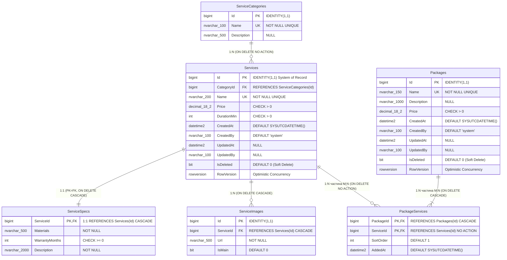
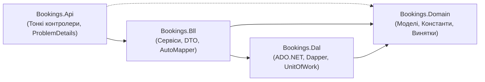

# Практичне заняття №01: Проєктування баз даних для мікросервісної архітектури

Навчальний проєкт із проєктування незалежних баз даних за патерном **Database per Service** для предметної області **«Детейлінг-студія»**.

---

## 1. Предметна область та три незалежні контексти (Bounded Contexts)

### Короткий опис домену
Детейлінг-студія надає професійні послуги з комплексного догляду за автомобілями: багатофазна мийка, відновлювальне та абразивне полірування кузова, нанесення захисних керамічних покриттів і хімчистка салону. Адміністратори студії приймають попередні записи клієнтів, фіксують прийом авто, ведуть автомобіль через етапи робіт та контролюють розрахунки. Клієнти обирають послуги або комплексні пакети з каталогу, а після завершення візиту залишають відгуки та переглядають звіти майстрів.

### Три незалежні контексти (кожен — окрема БД) та їхні сутності
Кожна сутність у системі належить **рівно одному контексту** (єдине джерело істини — *System of Record*):

1. **Контекст «Записи» (`Bookings`)** — база даних `DetailingBookings` (SQL Server, ADO.NET + Dapper):
   - **Сутності контексту:** `Clients`, `Appointments`, `AppointmentDetails`, `AppointmentItems`, `Payments`, `AppointmentStatusHistory`.
   - *Примітка:* каталог `Services` належить Каталогу; у `AppointmentItems` зберігається лише зовнішній `ServiceId` (без FK) та знімок цін.
2. **Контекст «Каталог послуг» (`Catalog`)** — база даних `DetailingCatalog` (SQL Server, EF Core Code First):
   - **Сутності контексту:** `ServiceCategories`, `Services`, `ServiceSpecs`, `ServiceImages`, `Packages`, `PackageServices`.
3. **Контекст «Відгуки та звіти» (`Reviews`)** — база даних `detailing_reviews` (MongoDB, MongoDB.Driver):
   - **Сутності контексту:** `reviews`, `workReports`, `discussions`, `messages`.

| № | Контекст | СКБД та назва БД | Майбутній стек у .NET | Зона відповідальності |
| :-: | :--- | :--- | :--- | :--- |
| **1** | **Записи (`Bookings`)** | SQL Server: `DetailingBookings` | ADO.NET + Dapper | Клієнти, записи на візит (`Appointments`), деталі авто (1:1), позиції замовлення зі знімками цін (M:N), платежі, історія переходів між статусами та 6 збережених процедур. |
| **2** | **Каталог послуг (`Catalog`)** | SQL Server: `DetailingCatalog` | EF Core (Code First) | Категорії послуг (`ServiceCategories`), послуги (`Services`), технічні специфікації (1:1 `ServiceSpecs`), фотогалерея (1:N `ServiceImages`) та пакетні пропозиції (M:N `Packages` $\leftrightarrow$ `PackageServices`). |
| **3** | **Відгуки та звіти (`Reviews`)** | MongoDB: `detailing_reviews` | MongoDB.Driver | Відгуки клієнтів з гнучкою схемою (`reviews`), поліморфні технологічні звіти майстрів (`workReports`), теми обговорень (`discussions`) та потік повідомлень (`messages`). |

### Жорсткі архітектурні принципи проєкту
- **Жодних міжбазових `FOREIGN KEY`**, спільних таблиць або міжбазових `JOIN`. Посилання на сутність іншого контексту зберігається як звичайний стовпець/поле з її Id (`ServiceId`, `AppointmentId`) без фізичного зовнішнього ключа на іншу базу.
- **Кожна сутність належить рівно одному контексту** (жодна сутність не дублюється між контекстами як власна таблиця чи колекція).
- **Повна ідемпотентність усіх скриптів**: повторне виконання будь-якого скрипту (`00_create_db.sql`, `schema.sql`, `procedures.sql`, `seed.sql`, `collections.js`, `seed.js`) не призводить до помилок і не створює дублікатів.

### Структура репозиторію (Лаб. 01 + Лаб. 02)

```text
<корінь репозиторію>/
├── README.md                   ★ опис домену, запуск, розгортання БД, таблиця дублювання, Лаб. 01–02
├── .gitignore                  ★ ігнорування службових файлів та артефактів збірки (bin/, obj/, .vs/)
├── docker-compose.yml          ★ середовище SQL Server 2022 + MongoDB
├── Platform.slnx               ★ єдиний файл рішення (.NET 9 XML Solution)
├── Platform.AppHost/           ★ оркестрація .NET Aspire (AppHost.cs, ресурс "BookingsDb")
├── Services/                   ★ мікросервіси платформи
│   └── Bookings/               ★ Проєкт №1: Тришарова архітектура (ADO.NET + Dapper)
│       ├── Bookings.Api/       ★ презентаційний рівень (тонкі контролери, IExceptionHandler -> ProblemDetails, Serilog)
│       ├── Bookings.Bll/       ★ бізнес-логіка (сервіси, DTO, AutoMapper BookingProfile, транзакції UoW)
│       ├── Bookings.Dal/       ★ доступ до даних (ClientRepository на чистому ADO.NET, Dapper-репозиторії, TVP, UnitOfWork)
│       ├── Bookings.Domain/    ★ доменні сутності, константи переходів статусів та доменні винятки
│       └── Bookings.Tests/     ★ модульні та інтеграційні тести (xUnit, NSubstitute, WebApplicationFactory)
├── docs/                       ★ ERD-діаграми, опис контекстів, ADR, приклади документів
│   ├── domain.md               ★ опис домену (2-3 речення), 3 контексти, сутності, агрегати
│   ├── duplication-policy.md   ★ детальна таблиця політики дублювання даних між сервісами
│   ├── decisions.md            ★ архітектурні рішення (ADR-01..ADR-09)
│   ├── erd/                    ★ ERD-діаграми (DBML та Mermaid Markdown)
│   └── samples/                ★ приклади документів MongoDB (JSON)
└── db/                         ★ SQL- і MongoDB-скрипти (Лаб. 01)
    ├── p1/                     ★ Проєкт №1: schema.sql · procedures.sql · seed.sql · tests.sql
    ├── p2/                     ★ Проєкт №2: schema.sql · seed.sql · tests.sql
    └── p3/                     ★ Проєкт №3 (MongoDB): collections.js · seed.js · queries.js
```

---

## 2. Вимоги до середовища

Для розгортання та перевірки проєкту підтримуються два варіанти:

### Варіант А: Локально встановлені інструменти
- **Microsoft SQL Server 2019 / 2022** (Developer, Express або LocalDB)
- **MongoDB Community Server 6.0 / 7.0+**
- Клієнтські утиліти: **`sqlcmd`** (або SSMS / Azure Data Studio) та **`mongosh`** (MongoDB Shell)

### Варіант Б: Через Docker Compose (рекомендовано для швидкого старту)
У корені репозиторію міститься файл [`docker-compose.yml`](file:///d:/detailing-db/docker-compose.yml), який піднімає контейнери **SQL Server 2022** (порт `1433`) та **MongoDB 7.0** (порт `27017`).

> [!NOTE]
> Згідно з політикою відсутності секретів у репозиторії, пароль адміністратора SQL Server передається через змінну оточення `MSSQL_SA_PASSWORD`.

Запуск контейнерів у PowerShell:
```powershell
$env:MSSQL_SA_PASSWORD = "ChangeMe_StrongPass123!"
docker compose up -d
```

Запуск контейнерів у Bash / Linux / macOS:
```bash
MSSQL_SA_PASSWORD="ChangeMe_StrongPass123!" docker compose up -d
```

---

## 3. Покрокове розгортання з нуля

### 3.1. Розгортання Проєкту №1: `DetailingBookings` (SQL Server, папка `db/p1/`)

Порядок запуску:
`schema.sql` $\rightarrow$ `procedures.sql` $\rightarrow$ `seed.sql` $\rightarrow$ `tests.sql`.
*(Примітка: `schema.sql` містить вбудовану ідемпотентну перевірку створення бази, тому може запускатися самостійно, або після `00_create_db.sql`).*

#### Команди для локального SQL Server LocalDB / Express (Windows Authentication):
```powershell
sqlcmd -S "(localdb)\MSSQLLocalDB" -E -f 65001 -i db/p1/schema.sql
sqlcmd -S "(localdb)\MSSQLLocalDB" -E -f 65001 -d DetailingBookings -i db/p1/procedures.sql
sqlcmd -S "(localdb)\MSSQLLocalDB" -E -f 65001 -d DetailingBookings -i db/p1/seed.sql
sqlcmd -S "(localdb)\MSSQLLocalDB" -E -f 65001 -d DetailingBookings -i db/p1/tests.sql
```
*(Якщо використовується повноцінний екземпляр SQL Server за замовчуванням, замініть `"(localdb)\MSSQLLocalDB"` на `localhost`).*

#### Команди для SQL Server у Docker (SQL Authentication):
```powershell
sqlcmd -S localhost,1433 -U sa -P "$env:MSSQL_SA_PASSWORD" -C -f 65001 -i db/p1/schema.sql
sqlcmd -S localhost,1433 -U sa -P "$env:MSSQL_SA_PASSWORD" -C -f 65001 -d DetailingBookings -i db/p1/procedures.sql
sqlcmd -S localhost,1433 -U sa -P "$env:MSSQL_SA_PASSWORD" -C -f 65001 -d DetailingBookings -i db/p1/seed.sql
sqlcmd -S localhost,1433 -U sa -P "$env:MSSQL_SA_PASSWORD" -C -f 65001 -d DetailingBookings -i db/p1/tests.sql
```

---

### 3.2. Розгортання Проєкту №2: `DetailingCatalog` (SQL Server, папка `db/p2/`)

Порядок запуску:
`schema.sql` $\rightarrow$ `seed.sql` $\rightarrow$ `tests.sql`.

#### Команди для локального SQL Server LocalDB / Express (Windows Authentication):
```powershell
sqlcmd -S "(localdb)\MSSQLLocalDB" -E -f 65001 -i db/p2/schema.sql
sqlcmd -S "(localdb)\MSSQLLocalDB" -E -f 65001 -d DetailingCatalog -i db/p2/seed.sql
sqlcmd -S "(localdb)\MSSQLLocalDB" -E -f 65001 -d DetailingCatalog -i db/p2/tests.sql
```

#### Команди для SQL Server у Docker (SQL Authentication):
```powershell
sqlcmd -S localhost,1433 -U sa -P "$env:MSSQL_SA_PASSWORD" -C -f 65001 -i db/p2/schema.sql
sqlcmd -S localhost,1433 -U sa -P "$env:MSSQL_SA_PASSWORD" -C -f 65001 -d DetailingCatalog -i db/p2/seed.sql
sqlcmd -S localhost,1433 -U sa -P "$env:MSSQL_SA_PASSWORD" -C -f 65001 -d DetailingCatalog -i db/p2/tests.sql
```

---

### 3.3. Розгортання Проєкту №3: `detailing_reviews` (MongoDB, папка `db/p3/`)

Порядок запуску:
`collections.js` $\rightarrow$ `seed.js` $\rightarrow$ `queries.js`.

```powershell
mongosh "mongodb://localhost:27017/detailing_reviews" db/p3/collections.js
mongosh "mongodb://localhost:27017/detailing_reviews" db/p3/seed.js
mongosh "mongodb://localhost:27017/detailing_reviews" db/p3/queries.js
```

---

## 4. Як перевірити індекси, обмеження та відсутність міжбазових FK

### 4.1. Перевірка зовнішніх ключів (відсутність міжбазових посилань у SQL Server)
Системне представлення `sys.foreign_keys` зберігає лише внутрішньобазові ключі (SQL Server навіть синтаксично не підтримує міжбазові FK), а також переконуємося у відсутності тригерів чи синонімів на інші БД:

```sql
-- Виконати по черзі в DetailingBookings та DetailingCatalog:
SELECT
    DB_NAME()                                   AS CurrentDatabase,
    fk.name                                     AS ForeignKeyName,
    OBJECT_NAME(fk.parent_object_id)            AS ParentTable,
    OBJECT_NAME(fk.referenced_object_id)        AS ReferencedTable,
    fk.delete_referential_action_desc           AS OnDeleteAction
FROM sys.foreign_keys fk
ORDER BY ParentTable, ForeignKeyName;

-- Перевірка відсутності синонімів на інші бази даних:
SELECT name, base_object_name FROM sys.synonyms;
```

### 4.2. Перевірка створених індексів (включно з фільтрованими) у SQL Server
```sql
SELECT
    OBJECT_NAME(i.object_id) AS TableName,
    i.name                   AS IndexName,
    i.type_desc              AS IndexType,
    i.is_unique              AS IsUnique,
    i.has_filter             AS IsFiltered,
    i.filter_definition      AS FilterDefinition
FROM sys.indexes i
WHERE OBJECTPROPERTY(i.object_id, 'IsUserTable') = 1
  AND i.name IS NOT NULL
ORDER BY TableName, IndexName;
```

### 4.3. Перевірка обмежень `CHECK`, `UNIQUE` та `DEFAULT` у SQL Server
```sql
SELECT
    OBJECT_NAME(parent_object_id) AS TableName,
    name                          AS ConstraintName,
    type_desc                     AS ConstraintType,
    definition                    AS ConstraintExpression
FROM sys.check_constraints
UNION ALL
SELECT
    OBJECT_NAME(parent_object_id) AS TableName,
    name                          AS ConstraintName,
    type_desc                     AS ConstraintType,
    definition                    AS ConstraintExpression
FROM sys.default_constraints
ORDER BY TableName, ConstraintType, ConstraintName;
```

### 4.4. Перевірка індексів та `$jsonSchema`-валідаторів у MongoDB (`mongosh`)
```javascript
use detailing_reviews;

// Перегляд усіх індексів по колекціях:
db.reviews.getIndexes();
db.messages.getIndexes();
db.workReports.getIndexes();

// Перегляд налаштованих правил $jsonSchema:
db.getCollectionInfos().map(c => ({ name: c.name, options: c.options }));
```

---

## 5. Таблиця політики дублювання даних

Детальний опис наведено у файлі [`docs/duplication-policy.md`](file:///d:/detailing-db/docs/duplication-policy.md).

| Поле | Де зберігається | Джерело | Політика |
| :--- | :--- | :--- | :--- |
| `AppointmentItems.ServiceName, UnitPrice` | БД Записів (`DetailingBookings`) | `Service` (Каталог) | знімок на момент запису, не оновлюється |
| `Services.Name, Price, DurationMin` | БД Записів (`DetailingBookings`) | `Service` (Каталог) | копія для читання, оновлюється подіями з Каталогу |
| `reviews.serviceName` | MongoDB (`detailing_reviews`) | `Service` (Каталог) | копія, оновлюється подіями з Каталогу |
| `discussions.targetName` | MongoDB (`detailing_reviews`) | `Service` / `Package` (Каталог) | копія, оновлюється подіями з Каталогу |
| `reviews.verifiedVisit` | MongoDB (`detailing_reviews`) | `Appointments` (БД Записів) | знімок на момент публікації відгуку |
| `reviews.author.fullName, carInfo` | MongoDB (`detailing_reviews`) | `Clients`, `AppointmentDetails` (БД Записів) | знімок на момент публікації відгуку |
| `workReports.serviceName` | MongoDB (`detailing_reviews`) | `Service` (Каталог) | знімок на момент звіту |
| `workReports.carPlateNumber` | MongoDB (`detailing_reviews`) | `AppointmentDetails` (БД Записів) | знімок на момент звіту |
| `workReports.appointmentId, reviews.appointmentId, reviews.author.clientId` | MongoDB (`detailing_reviews`) | `Appointments`, `Clients` (БД Записів) | лише ідентифікатор, без FK |
| `AppointmentItems.ServiceId, reviews.serviceId, workReports.serviceId, discussions.targetId` | БД Записів (`DetailingBookings`), MongoDB (`detailing_reviews`) | `Service`, `Package` (Каталог) | лише ідентифікатор, без FK |

---

## 6. Обґрунтування вибору первинних ключів (PK)

1. **`BIGINT IDENTITY(1,1)` для основних таблиць SQL Server (`DetailingBookings`, `DetailingCatalog`):**
   - У межах кожного мікросервісного контексту є лише **одне джерело вставки** (єдина точка запису — *Single Writer*), тому централізована генерація ключів засобами СКБД є безпечною й не створює колізій.
   - Тип `BIGINT` займає **8 байтів** (проти 16 байтів у `UNIQUEIDENTIFIER`), що робить кластерний індекс (`Clustered PK`) та всі некластерні індекси (які включають кластерний ключ як покажчик рядка) компактними в оперативній пам'яті (`Buffer Pool`).
   - Послідовне зростання значень `IDENTITY` гарантує додавання нових записів у кінець B-дерева індексу без дорогих операцій поділу сторінок (*Page Splits*) та фрагментації.
2. **`BIGINT` без `IDENTITY` для `DetailingBookings.dbo.Services`:**
   - Ця таблиця є локальною реплікою довідника з `DetailingCatalog`, тому вона повинна зберігати ті самі `Id`, які були згенеровані в Каталозі.
3. **`ObjectId` для колекцій MongoDB (`detailing_reviews`):**
   - Стандартний 12-байтовий тип `_id` у MongoDB (4 байти timestamp + 5 байтів випадкового значення процесу + 3 байти лічильника) може генеруватися на боці клієнтського драйвера без додаткового round-trip до сервера, підтримує природне хронологічне сортування та ідеально підходить для документно-орієнтованої моделі.

---

## 7. Контрольні питання та відповіді

### 1. Що таке Bounded Context (обмежений контекст) у DDD і як він пов'язаний із Database per Service?
**Відповідь:** *Bounded Context* — це чітка семантична та архітектурна межа, всередині якої доменна модель і термінологія (Ubiquitous Language) мають однозначний зміст. Наприклад, сутність «Послуга» (`Service`) у контексті **Catalog** — це маркетингова картка з описом матеріалів, гарантією, пакетами та фотогалереєю, тоді як у контексті **Bookings** — це лише елемент розрахунку вартості й тривалості візиту. Патерн *Database per Service* фізично закріплює межі Bounded Context на рівні сховища даних, щоб жоден сервіс не міг напряму читати або змінювати чужі таблиці в обхід бізнес-логіки власника контексту.

### 2. Чому в мікросервісній архітектурі не роблять міжбазових Foreign Keys та спільних таблиць?
**Відповідь:** Міжбазові зовнішні ключі та спільні таблиці створюють сильне зв'язування (*Tight Coupling*) на рівні схеми та інфраструктури:
1. Неможливо незалежно розгорнути, змінити схему або масштабувати одну базу без блокування іншої.
2. Неможливо розмістити бази на різних фізичних серверах або використати різні СКБД (Polyglot Persistence, як SQL Server + MongoDB у нашому проєкті).
3. Падіння або блокування таблиці в одному сервісі зупинить транзакції в іншому сервісі.

### 3. Чим відрізняється «знімок» (Snapshot) від «копії для читання» (Read-Model Copy)?
**Відповідь:**
- **Знімок (Snapshot)** фіксує стан даних на конкретний момент часу в минулому і **ніколи не оновлюється** після створення. Приклад: `AppointmentItems.ServiceName` та `UnitPrice` фіксують ціну, за якою клієнт оформив замовлення; подальше подорожчання послуги в Каталозі не має змінювати історію замовлень.
- **Копія для читання (Read-Model Copy)** підтримується в актуальному стані шляхом асинхронної синхронізації через інтеграційні події (*Eventual Consistency*). Приклад: локальна таблиця `Services` у БД `DetailingBookings` або поле `reviews.serviceName` у MongoDB оновлюються при зміні послуги в Каталозі.

### 4. Коли в MongoDB слід обирати Embedding (вкладення), а коли Referencing (посилання)?
**Відповідь:**
- **Embedding (вкладення)** обирають, коли дочірні дані мають зв'язок `1:1` або обмежений `1:Few` (їх кількість фіксована і невелика), вони завжди читаються разом із батьківським документом і не потребують окремого оновлення. Приклад: об'єкт `author`, масив `comments[]` (2–3 останні відповіді) у `reviews`, а також `checklist[]` та `materialsUsed[]` у `workReports`.
- **Referencing (посилання)** обирають, коли зв'язок є `1:Many` з необмеженим зростанням (*Unbounded Array*), або коли дочірні елементи активно додаються й пагінуються окремо. Приклад: колекція `messages` посилається на `discussions` через `discussionId`, щоб гілка на тисячі повідомлень не перевищила ліміт BSON-документа (16 МБ).

### 5. Для чого використовується тип `ROWVERSION` у SQL Server і як він працює?
**Відповідь:** `ROWVERSION` (раніше відомий як `TIMESTAMP`) — це 8-байтовий бінарний лічильник у межах бази даних, який SQL Server автоматично змінює при кожному `INSERT` або `UPDATE` рядка. Він використовується для **оптимістичного блокування (Optimistic Concurrency Control)**: застосунок зчитує рядок разом із `RowVersion`, а під час збереження змін додає умову `WHERE Id = @Id AND RowVersion = @OriginalRowVersion`. Якщо інший користувач встиг змінити рядок раніше, `RowVersion` вже інший, `UPDATE` змінить `0` рядків, і застосунок виявить конфлікт без утримання довгих блокувань на час роздумів користувача.

### 6. Порівняйте `GUID (UNIQUEIDENTIFIER)` та `BIGINT IDENTITY` як первинні ключі в SQL Server.
**Відповідь:**
- **`BIGINT IDENTITY` (8 байтів):** компактний, легко читається в логах і URL, монотонно зростає, тому не фрагментує кластерний індекс B-Tree. Ідеальний вибір, коли база має єдину точку генерації ключів (один сервіс-власник БД).
- **`GUID / UNIQUEIDENTIFIER` (16 байтів):** удвічі більший за розміром (роздуває кластерний і всі некластерні індекси), а випадковий `NEWID()` вставляє рядки в довільні місця B-Tree, викликаючи сильні *Page Splits* та фрагментацію (хоча це частково пом'якшується через `NEWSEQUENTIALID()` або UUIDv7 у .NET 9+). Виправданий лише тоді, коли ідентифікатори обов'язково потрібно генерувати офлайн або на багатьох незалежних вузлах до звернення в БД.

---

## 8. ERD-діаграми (Entity Relationship Diagrams)

### 8.1. ER-діаграма Проєкту №1: `DetailingBookings` (SQL Server)


### 8.2. ER-діаграма Проєкту №2: `DetailingCatalog` (SQL Server)



---

## 9. Додаткова документація у репозиторії
- [`docs/domain.md`](file:///d:/detailing-db/docs/domain.md) — опис предметної області, 3 незалежних контекстів, сутностей, агрегатів та патернів MongoDB (embedding, referencing, hybrid, поліморфізм).
- [`docs/duplication-policy.md`](file:///d:/detailing-db/docs/duplication-policy.md) — детальна таблиця політики дублювання та синхронізації даних між контекстами.
- [`docs/decisions.md`](file:///d:/detailing-db/docs/decisions.md) — архітектурні рішення (ADR): PK, каскади, конкурентність, коди помилок та прийняті припущення.
- ER-діаграми у форматі DBML:
  - Проєкт №1 (`DetailingBookings`): [`docs/erd/project1.dbml`](file:///d:/detailing-db/docs/erd/project1.dbml)
  - Проєкт №2 (`DetailingCatalog`): [`docs/erd/project2.dbml`](file:///d:/detailing-db/docs/erd/project2.dbml)

---

## 10. Практичне заняття №02: Тришарова архітектура на базі ADO.NET та Dapper

### 10.1. Архітектура мікросервісу `Bookings`

Мікросервіс **Записи (`Bookings`)** побудований за класичною тришаровою архітектурою з виділеним ядром домену (`Bookings.Domain`):



1. **`Bookings.Domain` (без зовнішніх NuGet-залежностей):**
   - Доменні сутності (`Client`, `Appointment`, `AppointmentDetails`, `AppointmentItem`, `CatalogService`, `Payment`, `StatusHistoryEntry`).
   - Матриця дозволених переходів статусів (`AppointmentStatuses.IsAllowedTransition`, `CanBeCancelled`).
   - Доменні винятки (`ValidationException`, `NotFoundException`, `BusinessConflictException`).
2. **`Bookings.Dal` (рівень доступу до даних — ADO.NET + Dapper):**
   - **`ClientRepository` (`IClientRepository`):** реалізований **виключно на чистому ADO.NET** (`SqlCommand`, типізовані `SqlParameter` із `SqlDbType` та довжиною, ручне читання з `SqlDataReader`). Не спадкує `IGenericRepository`.
   - **`BaseDapperRepository<T, TKey>`:** базова реалізація `IGenericRepository<T, TKey>` на Dapper із підтримкою м'якого видалення (`IsDeleted = 1`).
   - **`AppointmentRepository`:** Dapper Multi-Mapping (`splitOn: "AppointmentId"`) для завантаження агрегата `Appointment` + `AppointmentDetails` + `AppointmentItems`, передача табличного параметра (`TVP dbo.AppointmentItemTableType`) через `DataTable.AsTableValuedParameter` та виклик процедур (`usp_CreateAppointment`, `usp_ChangeStatus`, `usp_DeliverCar`, `usp_CancelAppointment`, `usp_GetClientAppointments`).
   - **`PaymentRepository` та `CatalogServiceRepository`:** спеціалізовані Dapper-репозиторії для платежів (`usp_RegisterPayment`) та локальної Read-Model копії каталогу (`MERGE` upsert).
   - **`RepositoryBase`:** спільний базовий клас, який транслює помилки SQL Server (`50001`..`50005`, `2601`/`2627`, `547`) у типізовані доменні винятки.
   - **`UnitOfWork` (`IUnitOfWork`):** керує єдиним `SqlConnection` та спільною транзакцією `SqlTransaction` між ADO.NET та Dapper репозиторіями.
3. **`Bookings.Bll` (рівень бізнес-логіки):**
   - DTO (`ClientDto`, `AppointmentDto`, `CreateAppointmentDto`, `RegisterPaymentDto`, `PagedResult<T>` тощо).
   - Профіль AutoMapper (`BookingProfile`).
   - Сервіси (`ClientService`, `AppointmentService`, `PaymentService`, `CatalogQueryService`), які координують транзакції через `IUnitOfWork` (`BeginTransactionAsync` / `CommitAsync` / `RollbackAsync`).
4. **`Bookings.Api` (презентаційний рівень):**
   - Тонкі контролери (`ClientsController`, `AppointmentsController`, `PaymentsController`, `CatalogServicesController`) без бізнес-логіки та SQL.
   - Глобальний обробник помилок `DomainExceptionHandler : IExceptionHandler`, що повертає відповіді у форматі **RFC 7807 `ProblemDetails`** (`400`, `404`, `409`, `500`).
   - Структурне логування **Serilog** та документація **Swagger / OpenAPI**.
5. **`Platform.AppHost` (.NET Aspire):**
   - Єдина точка оркестрації рішення, яка підключає ресурс бази даних `"BookingsDb"` та передає його сервісу `Bookings.Api` через `.WithReference(bookingsDb)`.

---

### 10.2. Налаштування конфігурації, збірка, запуск тестів та старт сервісу

#### 1. Налаштування рядка підключення та ключа AutoMapper (без секретів у `appsettings.json`):
У файлі `appsettings.json` збережено лише плейсхолдер `<SET_VIA_ENV_ConnectionStrings__BookingsDb>`, а для локальної розробки (`Development`) у `appsettings.Development.json` використано підключення до `LocalDB` через Windows Authentication (`Trusted_Connection=True`).

Для перевизначення рядка підключення та ліцензійного ключа AutoMapper через змінні середовища:
```powershell
# PowerShell:
$env:ConnectionStrings__BookingsDb = "Server=(localdb)\MSSQLLocalDB;Database=DetailingBookings;Trusted_Connection=True;TrustServerCertificate=True;"
$env:AutoMapper__LicenseKey = "<YOUR_AUTOMAPPER_KEY_IF_APPLICABLE>"
```

#### 2. Збірка всього рішення `Platform.slnx`:
```powershell
dotnet build Platform.slnx
```

#### 3. Запуск модульних та інтеграційних тестів (`Bookings.Tests`):
```powershell
dotnet test Platform.slnx
```

#### 4. Запуск `Bookings.Api` напряму:
```powershell
dotnet run --project Services/Bookings/Bookings.Api
```
Після запуску інтерфейс **Swagger UI** доступний за адресою `http://localhost:<port>/swagger` (наприклад, `http://localhost:5188/swagger`).

#### 5. Запуск через оркестратор `.NET Aspire` (`Platform.AppHost`):
```powershell
dotnet run --project Platform.AppHost
```
У виводі консолі `Platform.AppHost` з'явиться посилання на **Aspire Dashboard** з токеном авторизації:
```text
Login to the dashboard at https://localhost:17145/login?t=<token>
```
Перейдіть за цим посиланням у браузері: у вкладці **Resources** відображатимуться ресурс бази даних `BookingsDb` та сервіс `bookings-api` із прямим посиланням (Endpoint URL) на його Swagger та логи/трейси у вкладках **Console** / **Structured** / **Traces**.

---

### 10.3. Приклади HTTP-запитів (`curl`)

*(У прикладах нижче замініть `http://localhost:5188` на фактичний порт, виведений у консолі під час запуску або в колонці Endpoints на Aspire Dashboard).*

#### 1. Створення нового клієнта (`POST /api/clients` — чистий ADO.NET, `201 Created`):
```bash
curl -i -X POST "http://localhost:5188/api/clients" \
  -H "Content-Type: application/json" \
  -d '{
    "email": "dmytro.detailing@example.com",
    "fullName": "Дмитро Ковальчук",
    "phone": "+380671112233",
    "createdBy": "admin"
  }'
```

#### 2. Отримання клієнта за ID (`GET /api/clients/1` — `200 OK`):
```bash
curl -i -X GET "http://localhost:5188/api/clients/1"
```

#### 3. Створення нового запису з переліком послуг через TVP (`POST /api/appointments` — `201 Created`):
```bash
curl -i -X POST "http://localhost:5188/api/appointments" \
  -H "Content-Type: application/json" \
  -d '{
    "clientId": 1,
    "scheduledAt": "2026-10-20T10:00:00Z",
    "carBrand": "BMW",
    "carModel": "X5",
    "plateNumber": "AA7777XX",
    "comment": "Комплексна детейлінг-мийка та полірування",
    "createdBy": "admin",
    "items": [
      { "serviceId": 1, "quantity": 1, "discount": 0 },
      { "serviceId": 3, "quantity": 1, "discount": 200 }
    ]
  }'
```

#### 4. Перегляд запису разом із деталями авто (1:1) та позиціями (1:N) (`GET /api/appointments/1` — Dapper Multi-Mapping):
```bash
curl -i -X GET "http://localhost:5188/api/appointments/1"
```

#### 5. Пагінована вибірка записів клієнта з фільтром за статусом (`GET /api/appointments/client/1`):
```bash
curl -i -X GET "http://localhost:5188/api/appointments/client/1?status=Booked&pageNumber=1&pageSize=10"
```

#### 6. Допустима зміна статусу запису (`PATCH /api/appointments/1/status` — `Booked -> CarReceived`, `204 NoContent`):
```bash
curl -i -X PATCH "http://localhost:5188/api/appointments/1/status" \
  -H "Content-Type: application/json" \
  -d '{
    "newStatus": "CarReceived",
    "changedBy": "master_oleg"
  }'
```

#### 7. Реєстрація оплати (`POST /api/appointments/1/payments` — `204 NoContent`):
```bash
curl -i -X POST "http://localhost:5188/api/appointments/1/payments" \
  -H "Content-Type: application/json" \
  -d '{
    "amount": 1500.00,
    "method": "Card"
  }'
```

#### 8. Видача авто клієнту (`POST /api/appointments/1/deliver` — `204 NoContent`):
```bash
curl -i -X POST "http://localhost:5188/api/appointments/1/deliver?changedBy=admin"
```

#### 9. Запит неіснуючого запису (`GET /api/appointments/9999` $\rightarrow$ `404 Not Found` у форматі RFC 7807 `ProblemDetails` із `traceId`):
```bash
curl -i -X GET "http://localhost:5188/api/appointments/9999"
```
Відповідь:
```json
{
  "type": "https://tools.ietf.org/html/rfc7231#section-6.5.4",
  "title": "Ресурс не знайдено (Not Found)",
  "status": 404,
  "detail": "Запис з ID #9999 не знайдено.",
  "instance": "/api/appointments/9999",
  "traceId": "00-7a1c8e4d9f12b3456789abcdef012345-89abcdef01234567-00"
}
```

#### 10. Недопустимий перехід статусу (`PATCH /api/appointments/1/status` $\rightarrow$ `409 Conflict` у форматі RFC 7807 `ProblemDetails`):
Спроба перевести запис зі статусу `InProgress` (або `Booked`) одразу в `Delivered`:
```bash
curl -i -X PATCH "http://localhost:5188/api/appointments/1/status" \
  -H "Content-Type: application/json" \
  -d '{
    "newStatus": "Delivered",
    "changedBy": "admin"
  }'
```
Відповідь:
```json
{
  "type": "https://tools.ietf.org/html/rfc7231#section-6.5.8",
  "title": "Конфлікт бізнес-логіки або стану (Business Conflict)",
  "status": 409,
  "detail": "Недопустимий перехід статусу для запису #1: з [Booked] у [Delivered].",
  "instance": "/api/appointments/1/status",
  "traceId": "00-9b2d4f6a1c3e57890123456789abcdef-123456789abcdef0-00"
}
```

---

### 10.4. Місце для знімків екрана (Swagger UI та .NET Aspire Dashboard)

> **Знімок 1 — Інтерфейс Swagger UI (`Bookings.Api`):**
> `<!-- Вставте скріншот Swagger UI: docs/screenshots/swagger-bookings-api.png -->`
>
> **Знімок 2 — Панель ресурсів та розподілених трейсів у `.NET Aspire Dashboard` (`Platform.AppHost`):**
> `<!-- Вставте скріншот Aspire Dashboard: docs/screenshots/aspire-dashboard.png -->`

---

### 10.5. Контрольні питання до Практичного заняття №02

#### 1. У чому полягає різниця між чистим ADO.NET (`SqlCommand` + `SqlDataReader`) та мікро-ORM Dapper? Коли доцільно використовувати кожен підхід?
**Відповідь:**
- **Чистий ADO.NET** надає максимально низькорівневий контроль над командою (`SqlCommand`), параметрами (`SqlParameter` із явним `SqlDbType`, розміром та напрямком `Output`) і потоковим читанням (`SqlDataReader`). Він не має накладних витрат на рефлексію чи кешування делегатів мапінгу, але вимагає значного обсягу шаблонного коду (*boilerplate*) з ручною перевіркою `IsDBNull` та індексів колонок (`GetOrdinal`).
- **Dapper** — це надбудова (розширення до `IDbConnection`) поверх ADO.NET, яка автоматизує прив'язку параметрів та мапінг рядків результату в C#-об'єкти (включно з Multi-Mapping для зв'язків 1:1 / 1:N) за допомогою компіляції IL-емітерів. Dapper зменшує обсяг коду в 3–5 разів за майже ідентичної швидкодії, тому є стандартом для більшості репозиторіїв у цьому мікросервісі, тоді як чистий ADO.NET використано в `ClientRepository` для демонстрації базового контракту драйвера БД.

#### 2. Чому важливо явно вказувати `SqlDbType` та довжину (`Size`) рядкових параметрів у ADO.NET і Dapper замість автоматичного виведення типів?
**Відповідь:** Якщо передавати рядковий параметр без фіксованої довжини, провайдер `Microsoft.Data.SqlClient` може визначити довжину параметра за довжиною конкретного переданого рядка (наприклад, `NVARCHAR(12)`, а наступного разу `NVARCHAR(19)`). Для SQL Server це різні сигнатури запиту, що призводить до **Plan Cache Pollution** (засмічення кешу планів виконання сотнями дублікатів одного й того самого запиту) та додаткових витрат CPU на перекомпіляцію плану. Явне задання `SqlDbType.NVarChar, 255` (або `DbType.String, size: 255` у `DynamicParameters`) гарантує повторне використання єдиного скомпільованого плану виконання.

#### 3. Як патерн Unit of Work (`IUnitOfWork`) забезпечує атомарність операцій між різними репозиторіями (зокрема між ADO.NET та Dapper)?
**Відповідь:** У нашій реалізації `UnitOfWork` створює єдиний екземпляр `SqlConnection` на область видимості HTTP-запиту (`Scoped`) і передає всім репозиторіям (`ClientRepository`, `AppointmentRepository`, `PaymentRepository`, `CatalogServiceRepository`) посилання на це з'єднання та делегат `Func<SqlTransaction?>` для отримання поточної транзакції. Коли сервіс BLL викликає `BeginTransactionAsync()`, усі подальші команди як у `SqlCommand` (ADO.NET), так і в `CommandDefinition` (Dapper) прикріплюються до тієї самої `SqlTransaction`. Якщо будь-який крок завершується помилкою, виклик `RollbackAsync()` скасовує зміни в усіх таблицях одночасно, не потребуючи розподілених транзакцій (`TransactionScope` / MSDTC).

#### 4. Як реалізовано передачу списку замовлених послуг (M:N) у збережену процедуру `usp_CreateAppointment` за один мережевий виклик?
**Відповідь:** Замість виконання циклу окремих `INSERT` для кожного рядка замовлення з коду C# (що створювало б $N$ мережевих round-trip'ів до БД), використано **Table-Valued Parameter (TVP)** типу `dbo.AppointmentItemTableType`. У `AppointmentRepository.CreateViaProcedureAsync` колекція позицій пакується в `DataTable` зі стовпцями `(ServiceId, Quantity, Discount)` і передається в Dapper через розширення `tvpTable.AsTableValuedParameter("dbo.AppointmentItemTableType")`. Збережена процедура за один раз валідує всі послуги, знімає історичний знімок `ServiceName` та `UnitPrice` із локальної репліки `dbo.Services` і вставляє всі позиції в `dbo.AppointmentItems`.

#### 5. Чому контролери в `Bookings.Api` не містять блоків `try/catch`, і як клієнт API отримує структуровану інформацію про помилки?
**Відповідь:** Перевірка та перехоплення винятків у кожному методі контролера порушує принцип DRY і захаращує презентаційний шар. Замість цього реалізовано двоступеневий конвеєр обробки помилок:
1. У шарі DAL (`RepositoryBase.TranslateSqlException`) специфічні для СУБД винятки `SqlException` (коди `50001`..`50005`, `2601`, `2627`, `547`) перетворюються на технологічно нейтральні доменні винятки (`NotFoundException`, `BusinessConflictException`, `ValidationException`).
2. У шарі API глобальний сервіс `DomainExceptionHandler : IExceptionHandler` перехоплює ці винятки та серіалізує їх у стандартний формат **RFC 7807 `ProblemDetails`** (`Content-Type: application/problem+json`) із відповідними HTTP-кодами (`400 Bad Request`, `404 Not Found`, `409 Conflict`, `500 Internal Server Error`).
