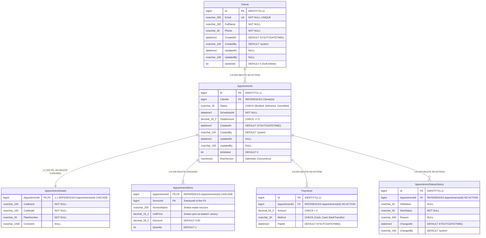
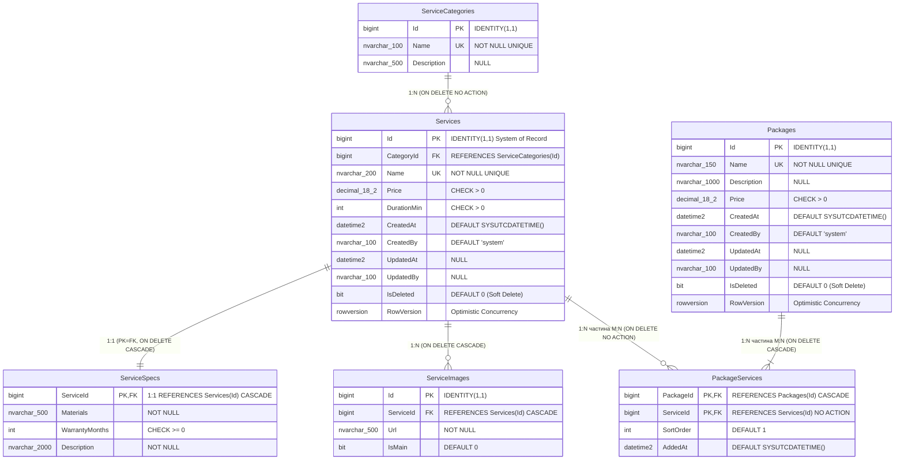

# Практичне заняття №01: Проєктування баз даних для мікросервісної архітектури

Навчальний проєкт із проєктування незалежних баз даних за патерном **Database per Service** для предметної області **«Детейлінг-студія»**.

---

## 1. Предметна область та три незалежні контексти (Bounded Contexts)

### Короткий опис домену
Детейлінг-студія надає професійні послуги з комплексного догляду за автомобілями: багатофазна мийка, відновлювальне та абразивне полірування кузова, нанесення захисних керамічних покриттів і хімчистка салону. Адміністратори студії приймають попередні записи клієнтів, фіксують прийом авто, ведуть автомобіль через етапи робіт та контролюють розрахунки. Клієнти обирають послуги або комплексні пакети з каталогу, а після завершення візиту залишають відгуки та переглядають звіти майстрів.

### Три незалежні контексти (кожен — окрема БД) та їхні сутності
Кожна сутність у системі належить **рівно одному контексту** (єдине джерело істини — *System of Record*):

1. **Контекст «Записи» (`Bookings`)** — база даних `DetailingBookings` (SQL Server, ADO.NET + Dapper):
   - **Сутності контексту:** `Clients`, `Appointments`, `AppointmentDetails`, `AppointmentItems`, `Payments`, `AppointmentStatusHistory`.
   - *Примітка:* каталог `Services` належить Каталогу; у `AppointmentItems` зберігається лише зовнішній `ServiceId` (без FK) та знімок цін.
2. **Контекст «Каталог послуг» (`Catalog`)** — база даних `DetailingCatalog` (SQL Server, EF Core Code First):
   - **Сутності контексту:** `ServiceCategories`, `Services`, `ServiceSpecs`, `ServiceImages`, `Packages`, `PackageServices`.
3. **Контекст «Відгуки та звіти» (`Reviews`)** — база даних `detailing_reviews` (MongoDB, MongoDB.Driver):
   - **Сутності контексту:** `reviews`, `workReports`, `discussions`, `messages`.

| № | Контекст | СКБД та назва БД | Майбутній стек у .NET | Зона відповідальності |
| :-: | :--- | :--- | :--- | :--- |
| **1** | **Записи (`Bookings`)** | SQL Server: `DetailingBookings` | ADO.NET + Dapper | Клієнти, записи на візит (`Appointments`), деталі авто (1:1), позиції замовлення зі знімками цін (M:N), платежі, історія переходів між статусами та 6 збережених процедур. |
| **2** | **Каталог послуг (`Catalog`)** | SQL Server: `DetailingCatalog` | EF Core (Code First) | Категорії послуг (`ServiceCategories`), послуги (`Services`), технічні специфікації (1:1 `ServiceSpecs`), фотогалерея (1:N `ServiceImages`) та пакетні пропозиції (M:N `Packages` $\leftrightarrow$ `PackageServices`). |
| **3** | **Відгуки та звіти (`Reviews`)** | MongoDB: `detailing_reviews` | MongoDB.Driver | Відгуки клієнтів з гнучкою схемою (`reviews`), поліморфні технологічні звіти майстрів (`workReports`), теми обговорень (`discussions`) та потік повідомлень (`messages`). |

### Жорсткі архітектурні принципи проєкту
- **Жодних міжбазових `FOREIGN KEY`**, спільних таблиць або міжбазових `JOIN`. Посилання на сутність іншого контексту зберігається як звичайний стовпець/поле з її Id (`ServiceId`, `AppointmentId`) без фізичного зовнішнього ключа на іншу базу.
- **Кожна сутність належить рівно одному контексту** (жодна сутність не дублюється між контекстами як власна таблиця чи колекція).
- **Повна ідемпотентність усіх скриптів**: повторне виконання будь-якого скрипту (`00_create_db.sql`, `schema.sql`, `procedures.sql`, `seed.sql`, `collections.js`, `seed.js`) не призводить до помилок і не створює дублікатів.

### Структура репозиторію (відповідно до вимог перевірки Лаб. 01)

```text
<корінь репозиторію>/
├── README.md                   ★ опис домену, запуск, розгортання БД, таблиця дублювання
├── .gitignore                  ★ ігнорування службових файлів
├── docker-compose.yml          ★ середовище SQL Server 2022 + MongoDB
├── docs/                       ★ ERD-діаграми, опис контекстів, приклади документів
│   ├── domain.md               ★ опис домену (2-3 речення), 3 контексти, сутності, агрегати
│   ├── duplication-policy.md   ★ детальна таблиця політики дублювання даних між сервісами
│   ├── decisions.md            ★ архітектурні рішення (ADR): PK, каскади, конкурентність
│   ├── erd/                    ★ ERD-діаграми (DBML та Mermaid Markdown)
│   │   ├── project1.dbml
│   │   ├── project1.md
│   │   ├── project2.dbml
│   │   └── project2.md
│   └── samples/                ★ приклади документів MongoDB (JSON)
│       ├── reviews.json
│       ├── workReports.json
│       ├── discussions.json
│       └── messages.json
└── db/                         ★ SQL- і MongoDB-скрипти
    ├── p1/                     ★ Проєкт №1: schema.sql · procedures.sql · seed.sql
    │   ├── 00_create_db.sql    ★ створення бази DetailingBookings (також вбудовано в schema.sql)
    │   ├── schema.sql          ★ таблиці, зв'язки 1:1, 1:N, M:N, PK, FK, CHECK, індекси, ROWVERSION
    │   ├── procedures.sql      ★ 6 збережених процедур (транзакції, TVP, обробка помилок)
    │   ├── seed.sql            ★ ідемпотентні демо-дані для всіх статусів
    │   └── tests.sql           ★ тести бізнес-сценаріїв та обмежень
    ├── p2/                     ★ Проєкт №2: schema.sql · seed.sql
    │   ├── 00_create_db.sql    ★ створення бази DetailingCatalog (також вбудовано в schema.sql)
    │   ├── schema.sql          ★ схема за конвенціями EF Core (1:1, 1:N, M:N, IsDeleted)
    │   ├── seed.sql            ★ категорії, послуги, специфікації, фото, пакети
    │   └── tests.sql           ★ тести цілісності, каскадів та м'якого видалення
    └── p3/                     ★ Проєкт №3 (MongoDB): collections.js · seed.js
        ├── collections.js      ★ валідатори $jsonSchema та індекси для 4 колекцій
        ├── seed.js             ★ ідемпотентне наповнення (upsert) зрілими даними
        ├── queries.js          ★ 5 аналітичних та пошукових запитів ($group, $lookup)
        └── samples/            ★ JSON-приклади документів (reviews, workReports, etc.)
```

---

## 2. Вимоги до середовища

Для розгортання та перевірки проєкту підтримуються два варіанти:

### Варіант А: Локально встановлені інструменти
- **Microsoft SQL Server 2019 / 2022** (Developer, Express або LocalDB)
- **MongoDB Community Server 6.0 / 7.0+**
- Клієнтські утиліти: **`sqlcmd`** (або SSMS / Azure Data Studio) та **`mongosh`** (MongoDB Shell)

### Варіант Б: Через Docker Compose (рекомендовано для швидкого старту)
У корені репозиторію міститься файл [`docker-compose.yml`](file:///d:/detailing-db/docker-compose.yml), який піднімає контейнери **SQL Server 2022** (порт `1433`) та **MongoDB 7.0** (порт `27017`).

> [!NOTE]
> Згідно з політикою відсутності секретів у репозиторії, пароль адміністратора SQL Server передається через змінну оточення `MSSQL_SA_PASSWORD`.

Запуск контейнерів у PowerShell:
```powershell
$env:MSSQL_SA_PASSWORD = "ChangeMe_StrongPass123!"
docker compose up -d
```

Запуск контейнерів у Bash / Linux / macOS:
```bash
MSSQL_SA_PASSWORD="ChangeMe_StrongPass123!" docker compose up -d
```

---

## 3. Покрокове розгортання з нуля

### 3.1. Розгортання Проєкту №1: `DetailingBookings` (SQL Server, папка `db/p1/`)

Порядок запуску:
`schema.sql` $\rightarrow$ `procedures.sql` $\rightarrow$ `seed.sql` $\rightarrow$ `tests.sql`.
*(Примітка: `schema.sql` містить вбудовану ідемпотентну перевірку створення бази, тому може запускатися самостійно, або після `00_create_db.sql`).*

#### Команди для локального SQL Server LocalDB / Express (Windows Authentication):
```powershell
sqlcmd -S "(localdb)\MSSQLLocalDB" -E -f 65001 -i db/p1/schema.sql
sqlcmd -S "(localdb)\MSSQLLocalDB" -E -f 65001 -d DetailingBookings -i db/p1/procedures.sql
sqlcmd -S "(localdb)\MSSQLLocalDB" -E -f 65001 -d DetailingBookings -i db/p1/seed.sql
sqlcmd -S "(localdb)\MSSQLLocalDB" -E -f 65001 -d DetailingBookings -i db/p1/tests.sql
```
*(Якщо використовується повноцінний екземпляр SQL Server за замовчуванням, замініть `"(localdb)\MSSQLLocalDB"` на `localhost`).*

#### Команди для SQL Server у Docker (SQL Authentication):
```powershell
sqlcmd -S localhost,1433 -U sa -P "$env:MSSQL_SA_PASSWORD" -C -f 65001 -i db/p1/schema.sql
sqlcmd -S localhost,1433 -U sa -P "$env:MSSQL_SA_PASSWORD" -C -f 65001 -d DetailingBookings -i db/p1/procedures.sql
sqlcmd -S localhost,1433 -U sa -P "$env:MSSQL_SA_PASSWORD" -C -f 65001 -d DetailingBookings -i db/p1/seed.sql
sqlcmd -S localhost,1433 -U sa -P "$env:MSSQL_SA_PASSWORD" -C -f 65001 -d DetailingBookings -i db/p1/tests.sql
```

---

### 3.2. Розгортання Проєкту №2: `DetailingCatalog` (SQL Server, папка `db/p2/`)

Порядок запуску:
`schema.sql` $\rightarrow$ `seed.sql` $\rightarrow$ `tests.sql`.

#### Команди для локального SQL Server LocalDB / Express (Windows Authentication):
```powershell
sqlcmd -S "(localdb)\MSSQLLocalDB" -E -f 65001 -i db/p2/schema.sql
sqlcmd -S "(localdb)\MSSQLLocalDB" -E -f 65001 -d DetailingCatalog -i db/p2/seed.sql
sqlcmd -S "(localdb)\MSSQLLocalDB" -E -f 65001 -d DetailingCatalog -i db/p2/tests.sql
```

#### Команди для SQL Server у Docker (SQL Authentication):
```powershell
sqlcmd -S localhost,1433 -U sa -P "$env:MSSQL_SA_PASSWORD" -C -f 65001 -i db/p2/schema.sql
sqlcmd -S localhost,1433 -U sa -P "$env:MSSQL_SA_PASSWORD" -C -f 65001 -d DetailingCatalog -i db/p2/seed.sql
sqlcmd -S localhost,1433 -U sa -P "$env:MSSQL_SA_PASSWORD" -C -f 65001 -d DetailingCatalog -i db/p2/tests.sql
```

---

### 3.3. Розгортання Проєкту №3: `detailing_reviews` (MongoDB, папка `db/p3/`)

Порядок запуску:
`collections.js` $\rightarrow$ `seed.js` $\rightarrow$ `queries.js`.

```powershell
mongosh "mongodb://localhost:27017/detailing_reviews" db/p3/collections.js
mongosh "mongodb://localhost:27017/detailing_reviews" db/p3/seed.js
mongosh "mongodb://localhost:27017/detailing_reviews" db/p3/queries.js
```

---

## 4. Як перевірити індекси, обмеження та відсутність міжбазових FK

### 4.1. Перевірка зовнішніх ключів (відсутність міжбазових посилань у SQL Server)
Системне представлення `sys.foreign_keys` зберігає лише внутрішньобазові ключі (SQL Server навіть синтаксично не підтримує міжбазові FK), а також переконуємося у відсутності тригерів чи синонімів на інші БД:

```sql
-- Виконати по черзі в DetailingBookings та DetailingCatalog:
SELECT
    DB_NAME()                                   AS CurrentDatabase,
    fk.name                                     AS ForeignKeyName,
    OBJECT_NAME(fk.parent_object_id)            AS ParentTable,
    OBJECT_NAME(fk.referenced_object_id)        AS ReferencedTable,
    fk.delete_referential_action_desc           AS OnDeleteAction
FROM sys.foreign_keys fk
ORDER BY ParentTable, ForeignKeyName;

-- Перевірка відсутності синонімів на інші бази даних:
SELECT name, base_object_name FROM sys.synonyms;
```

### 4.2. Перевірка створених індексів (включно з фільтрованими) у SQL Server
```sql
SELECT
    OBJECT_NAME(i.object_id) AS TableName,
    i.name                   AS IndexName,
    i.type_desc              AS IndexType,
    i.is_unique              AS IsUnique,
    i.has_filter             AS IsFiltered,
    i.filter_definition      AS FilterDefinition
FROM sys.indexes i
WHERE OBJECTPROPERTY(i.object_id, 'IsUserTable') = 1
  AND i.name IS NOT NULL
ORDER BY TableName, IndexName;
```

### 4.3. Перевірка обмежень `CHECK`, `UNIQUE` та `DEFAULT` у SQL Server
```sql
SELECT
    OBJECT_NAME(parent_object_id) AS TableName,
    name                          AS ConstraintName,
    type_desc                     AS ConstraintType,
    definition                    AS ConstraintExpression
FROM sys.check_constraints
UNION ALL
SELECT
    OBJECT_NAME(parent_object_id) AS TableName,
    name                          AS ConstraintName,
    type_desc                     AS ConstraintType,
    definition                    AS ConstraintExpression
FROM sys.default_constraints
ORDER BY TableName, ConstraintType, ConstraintName;
```

### 4.4. Перевірка індексів та `$jsonSchema`-валідаторів у MongoDB (`mongosh`)
```javascript
use detailing_reviews;

// Перегляд усіх індексів по колекціях:
db.reviews.getIndexes();
db.messages.getIndexes();
db.workReports.getIndexes();

// Перегляд налаштованих правил $jsonSchema:
db.getCollectionInfos().map(c => ({ name: c.name, options: c.options }));
```

---

## 5. Таблиця політики дублювання даних

Детальний опис наведено у файлі [`docs/duplication-policy.md`](file:///d:/detailing-db/docs/duplication-policy.md).

| Поле | Де зберігається | Джерело | Політика |
| :--- | :--- | :--- | :--- |
| `AppointmentItems.ServiceName, UnitPrice` | БД Записів (`DetailingBookings`) | `Service` (Каталог) | знімок на момент запису, не оновлюється |
| `Services.Name, Price, DurationMin` | БД Записів (`DetailingBookings`) | `Service` (Каталог) | копія для читання, оновлюється подіями з Каталогу |
| `reviews.serviceName` | MongoDB (`detailing_reviews`) | `Service` (Каталог) | копія, оновлюється подіями з Каталогу |
| `discussions.targetName` | MongoDB (`detailing_reviews`) | `Service` / `Package` (Каталог) | копія, оновлюється подіями з Каталогу |
| `reviews.verifiedVisit` | MongoDB (`detailing_reviews`) | `Appointments` (БД Записів) | знімок на момент публікації відгуку |
| `reviews.author.fullName, carInfo` | MongoDB (`detailing_reviews`) | `Clients`, `AppointmentDetails` (БД Записів) | знімок на момент публікації відгуку |
| `workReports.serviceName` | MongoDB (`detailing_reviews`) | `Service` (Каталог) | знімок на момент звіту |
| `workReports.carPlateNumber` | MongoDB (`detailing_reviews`) | `AppointmentDetails` (БД Записів) | знімок на момент звіту |
| `workReports.appointmentId, reviews.appointmentId, reviews.author.clientId` | MongoDB (`detailing_reviews`) | `Appointments`, `Clients` (БД Записів) | лише ідентифікатор, без FK |
| `AppointmentItems.ServiceId, reviews.serviceId, workReports.serviceId, discussions.targetId` | БД Записів (`DetailingBookings`), MongoDB (`detailing_reviews`) | `Service`, `Package` (Каталог) | лише ідентифікатор, без FK |

---

## 6. Обґрунтування вибору первинних ключів (PK)

1. **`BIGINT IDENTITY(1,1)` для основних таблиць SQL Server (`DetailingBookings`, `DetailingCatalog`):**
   - У межах кожного мікросервісного контексту є лише **одне джерело вставки** (єдина точка запису — *Single Writer*), тому централізована генерація ключів засобами СКБД є безпечною й не створює колізій.
   - Тип `BIGINT` займає **8 байтів** (проти 16 байтів у `UNIQUEIDENTIFIER`), що робить кластерний індекс (`Clustered PK`) та всі некластерні індекси (які включають кластерний ключ як покажчик рядка) компактними в оперативній пам'яті (`Buffer Pool`).
   - Послідовне зростання значень `IDENTITY` гарантує додавання нових записів у кінець B-дерева індексу без дорогих операцій поділу сторінок (*Page Splits*) та фрагментації.
2. **`BIGINT` без `IDENTITY` для `DetailingBookings.dbo.Services`:**
   - Ця таблиця є локальною реплікою довідника з `DetailingCatalog`, тому вона повинна зберігати ті самі `Id`, які були згенеровані в Каталозі.
3. **`ObjectId` для колекцій MongoDB (`detailing_reviews`):**
   - Стандартний 12-байтовий тип `_id` у MongoDB (4 байти timestamp + 5 байтів випадкового значення процесу + 3 байти лічильника) може генеруватися на боці клієнтського драйвера без додаткового round-trip до сервера, підтримує природне хронологічне сортування та ідеально підходить для документно-орієнтованої моделі.

---

## 7. Контрольні питання та відповіді

### 1. Що таке Bounded Context (обмежений контекст) у DDD і як він пов'язаний із Database per Service?
**Відповідь:** *Bounded Context* — це чітка семантична та архітектурна межа, всередині якої доменна модель і термінологія (Ubiquitous Language) мають однозначний зміст. Наприклад, сутність «Послуга» (`Service`) у контексті **Catalog** — це маркетингова картка з описом матеріалів, гарантією, пакетами та фотогалереєю, тоді як у контексті **Bookings** — це лише елемент розрахунку вартості й тривалості візиту. Патерн *Database per Service* фізично закріплює межі Bounded Context на рівні сховища даних, щоб жоден сервіс не міг напряму читати або змінювати чужі таблиці в обхід бізнес-логіки власника контексту.

### 2. Чому в мікросервісній архітектурі не роблять міжбазових Foreign Keys та спільних таблиць?
**Відповідь:** Міжбазові зовнішні ключі та спільні таблиці створюють сильне зв'язування (*Tight Coupling*) на рівні схеми та інфраструктури:
1. Неможливо незалежно розгорнути, змінити схему або масштабувати одну базу без блокування іншої.
2. Неможливо розмістити бази на різних фізичних серверах або використати різні СКБД (Polyglot Persistence, як SQL Server + MongoDB у нашому проєкті).
3. Падіння або блокування таблиці в одному сервісі зупинить транзакції в іншому сервісі.

### 3. Чим відрізняється «знімок» (Snapshot) від «копії для читання» (Read-Model Copy)?
**Відповідь:**
- **Знімок (Snapshot)** фіксує стан даних на конкретний момент часу в минулому і **ніколи не оновлюється** після створення. Приклад: `AppointmentItems.ServiceName` та `UnitPrice` фіксують ціну, за якою клієнт оформив замовлення; подальше подорожчання послуги в Каталозі не має змінювати історію замовлень.
- **Копія для читання (Read-Model Copy)** підтримується в актуальному стані шляхом асинхронної синхронізації через інтеграційні події (*Eventual Consistency*). Приклад: локальна таблиця `Services` у БД `DetailingBookings` або поле `reviews.serviceName` у MongoDB оновлюються при зміні послуги в Каталозі.

### 4. Коли в MongoDB слід обирати Embedding (вкладення), а коли Referencing (посилання)?
**Відповідь:**
- **Embedding (вкладення)** обирають, коли дочірні дані мають зв'язок `1:1` або обмежений `1:Few` (їх кількість фіксована і невелика), вони завжди читаються разом із батьківським документом і не потребують окремого оновлення. Приклад: об'єкт `author`, масив `comments[]` (2–3 останні відповіді) у `reviews`, а також `checklist[]` та `materialsUsed[]` у `workReports`.
- **Referencing (посилання)** обирають, коли зв'язок є `1:Many` з необмеженим зростанням (*Unbounded Array*), або коли дочірні елементи активно додаються й пагінуються окремо. Приклад: колекція `messages` посилається на `discussions` через `discussionId`, щоб гілка на тисячі повідомлень не перевищила ліміт BSON-документа (16 МБ).

### 5. Для чого використовується тип `ROWVERSION` у SQL Server і як він працює?
**Відповідь:** `ROWVERSION` (раніше відомий як `TIMESTAMP`) — це 8-байтовий бінарний лічильник у межах бази даних, який SQL Server автоматично змінює при кожному `INSERT` або `UPDATE` рядка. Він використовується для **оптимістичного блокування (Optimistic Concurrency Control)**: застосунок зчитує рядок разом із `RowVersion`, а під час збереження змін додає умову `WHERE Id = @Id AND RowVersion = @OriginalRowVersion`. Якщо інший користувач встиг змінити рядок раніше, `RowVersion` вже інший, `UPDATE` змінить `0` рядків, і застосунок виявить конфлікт без утримання довгих блокувань на час роздумів користувача.

### 6. Порівняйте `GUID (UNIQUEIDENTIFIER)` та `BIGINT IDENTITY` як первинні ключі в SQL Server.
**Відповідь:**
- **`BIGINT IDENTITY` (8 байтів):** компактний, легко читається в логах і URL, монотонно зростає, тому не фрагментує кластерний індекс B-Tree. Ідеальний вибір, коли база має єдину точку генерації ключів (один сервіс-власник БД).
- **`GUID / UNIQUEIDENTIFIER` (16 байтів):** удвічі більший за розміром (роздуває кластерний і всі некластерні індекси), а випадковий `NEWID()` вставляє рядки в довільні місця B-Tree, викликаючи сильні *Page Splits* та фрагментацію (хоча це частково пом'якшується через `NEWSEQUENTIALID()` або UUIDv7 у .NET 9+). Виправданий лише тоді, коли ідентифікатори обов'язково потрібно генерувати офлайн або на багатьох незалежних вузлах до звернення в БД.

---

## 8. ERD-діаграми (Entity Relationship Diagrams)

### 8.1. ER-діаграма Проєкту №1: `DetailingBookings` (SQL Server)



### 8.2. ER-діаграма Проєкту №2: `DetailingCatalog` (SQL Server)



---

## 9. Додаткова документація у репозиторії
- [`docs/domain.md`](file:///d:/detailing-db/docs/domain.md) — опис предметної області, 3 незалежних контекстів, сутностей, агрегатів та патернів MongoDB (embedding, referencing, hybrid, поліморфізм).
- [`docs/duplication-policy.md`](file:///d:/detailing-db/docs/duplication-policy.md) — детальна таблиця політики дублювання та синхронізації даних між контекстами.
- [`docs/decisions.md`](file:///d:/detailing-db/docs/decisions.md) — архітектурні рішення (ADR): PK, каскади, конкурентність, коди помилок та прийняті припущення.
- ER-діаграми у форматі DBML:
  - Проєкт №1 (`DetailingBookings`): [`docs/erd/project1.dbml`](file:///d:/detailing-db/docs/erd/project1.dbml)
  - Проєкт №2 (`DetailingCatalog`): [`docs/erd/project2.dbml`](file:///d:/detailing-db/docs/erd/project2.dbml)
