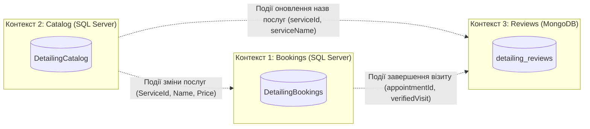

# Доменна модель: Детейлінг-студія (Database per Service)

## Опис предметної області

Детейлінг-студія надає професійні послуги з комплексного догляду за автомобілями: багатофазна мийка, відновлювальне та абразивне полірування, нанесення захисних керамічних покриттів і хімчистка салону. Адміністратори студії приймають попередні записи клієнтів, фіксують прийом авто, контролюють проходження етапів робіт та розрахунки. Клієнти обирають окремі послуги або пакетні пропозиції з каталогу, а після обслуговування залишають відгуки, переглядають звіти майстрів і беруть участь в обговореннях.

---

## Обмежені контексти (Bounded Contexts)

Система розділена на три незалежні мікросервісні контексти за патерном **Database per Service**. Кожен контекст володіє власною базою даних, а прямі зв'язки (Foreign Keys) чи спільні таблиці між базами суворо заборонені.

---

### 1. Контекст «Записи та операційна діяльність» (`Bookings`)

- **СКБД та база даних:** Microsoft SQL Server, `DetailingBookings`
- **Майбутній технологічний стек:** ADO.NET + Dapper (високий контроль над SQL-запитами, збереженими процедурами та транзакціями)
- **Відповідальність:** Управління клієнтською базою для запису, планування візитів, ведення автомобіля по життєвому циклу статусів виконання робіт, фіксація вартості послуг на момент замовлення та облік оплат.
- **Сутності контексту:**
  - `Clients` — клієнти студії (контактні дані, email, телефон).
  - `Appointments` — замовлення/записи на обслуговування (час візиту, поточний статус, підсумкова сума, оптимістичне блокування `RowVersion`).
  - `AppointmentDetails` — деталі автомобіля в межах конкретного запису (марка, модель, державний номер, побажання клієнта); зв'язок `1:1` із `Appointments`.
  - `AppointmentItems` — перелік замовлених послуг у записі зі знімком ціни (`UnitPrice`) і назви (`ServiceName`) на момент оформлення; зв'язок `M:N` між `Appointments` та локальним довідником `Services`.
  - `Services` — локальна read-model (репліка) довідника послуг із Каталогу без `IDENTITY` (синхронізується подіями).
  - `Payments` — платежі клієнта за конкретним записом (готівка, картка, безготівковий переказ).
  - `AppointmentStatusHistory` — журнал аудиту переходів між статусами замовлення.
- **Агрегати та корені агрегатів (Aggregate Roots):**
  1. **Агрегат `Appointment` (Корінь: `Appointments`)** — об'єднує `AppointmentDetails`, `AppointmentItems`, `Payments` та `AppointmentStatusHistory`. Усі інваріанти (розрахунок `TotalAmount`, перевірка повної оплати перед видачею авто, допустимість переходу статусів) контролюються через корінь агрегата в межах транзакції.
  2. **Агрегат `Client` (Корінь: `Clients`)** — самостійний корінь агрегата; видалення клієнта не каскадується на історію записів (використовується `IsDeleted`).
  3. **Локальна проєкція `Service` (`Services`)** — довідкова таблиця-репліка для перевірки доступності послуг та формування знімків під час створення запису.

---

### 2. Контекст «Каталог послуг та пакетів» (`Catalog`)

- **СКБД та база даних:** Microsoft SQL Server, `DetailingCatalog`
- **Майбутній технологічний стек:** Entity Framework Core (Code First)
- **Відповідальність:** Ведення прайс-листа, категорій, технологічних специфікацій (матеріали, гарантія), медіа-галереї послуг та комплексних акційних пакетів.
- **Сутності контексту:**
  - `ServiceCategories` (`ServiceCategory`) — категорії послуг («Мийка», «Полірування», «Захист», «Салон»).
  - `Services` (`Service`) — послуги студії з базовою ціною та орієнтовною тривалістю виконання.
  - `ServiceSpecs` (`ServiceSpec`) — розширена технічна специфікація послуги (використовувані матеріали, термін гарантії у місяцях, детальний технологічний опис); зв'язок `1:1` із `Services`.
  - `ServiceImages` (`ServiceImage`) — фотографії прикладів виконання послуги з ознакою головного фото (`IsMain`); зв'язок `1:N` із `Services`.
  - `Packages` (`Package`) — комплексні пакети послуг (`Basic`, `Premium`, `Ceramic Pro`) з фіксованою пакетною ціною.
  - `PackageServices` (`PackageService`) — проміжна сутність `M:N` між `Packages` та `Services` із додатковими атрибутами порядку сортування (`SortOrder`) та часу додавання (`AddedAt`).
- **Агрегати та корені агрегатів (Aggregate Roots):**
  1. **Агрегат `Service` (Корінь: `Services`)** — включає `ServiceSpecs` (1:1) та колекцію `ServiceImages` (1:N).
  2. **Агрегат `Package` (Корінь: `Packages`)** — включає елементи комплектації `PackageServices` (які логічно посилаються на `ServiceId`).
  3. **Агрегат `ServiceCategory` (Корінь: `ServiceCategories`)** — класифікатор каталогу.

---

### 3. Контекст «Відгуки, фотозвіти майстрів та обговорення» (`Reviews`)

- **СКБД та база даних:** MongoDB, `detailing_reviews`
- **Відповідальність:** Збір клієнтських відгуків з медіафайлами, збереження поліморфних технологічних звітів майстрів по виконаних роботах та ведення публічних гілок обговорень послуг і пакетів.
- **Колекції (сутності) контексту:**
  - `reviews` — відгуки клієнтів з оцінкою `1..5`, вкладеним автором (`author`), коротким масивом останніх коментарів (`comments[]`), прапорцем підтвердженого візиту (`verifiedVisit`), денормалізованою назвою послуги (`serviceName`) та опціональними полями (`photosBefore`, `photosAfter`, `videoUrl`, `pros`, `cons`).
  - `workReports` — звіти майстрів про виконану роботу з вкладеними чек-листами (`checklist[]`), витраченими матеріалами (`materialsUsed[]`) та специфічними для конкретної послуги параметрами (наприклад, `layers` і `curingHours` для кераміки або `stainsRemoved` і `dryingTimeHours` для хімчистки).
  - `discussions` — теми обговорень (прив'язані до послуги або пакета з Каталогу).
  - `messages` — окрема колекція повідомлень у темах обговорень (з посиланням `discussionId`), оскільки кількість повідомлень у популярній темі може необмежено зростати.
- **Агрегати (документні межі):**
  1. **Документний агрегат `Review` (`reviews`)** — об'єднує сам відгук, вкладені метадані автора та 2-3 останні коментарі-відповіді адміністрації/клієнтів.
  2. **Документний агрегат `WorkReport` (`workReports`)** — повністю самодостатній документ звіту майстра з чек-листом і матеріалами.
  3. **Агрегат `Discussion` (`discussions`) + окремий потік `Message` (`messages`)** — розділені через патерн *Document Referencing* для уникнення перевищення ліміту BSON-документа (16 МБ) при великій кількості коментарів.
