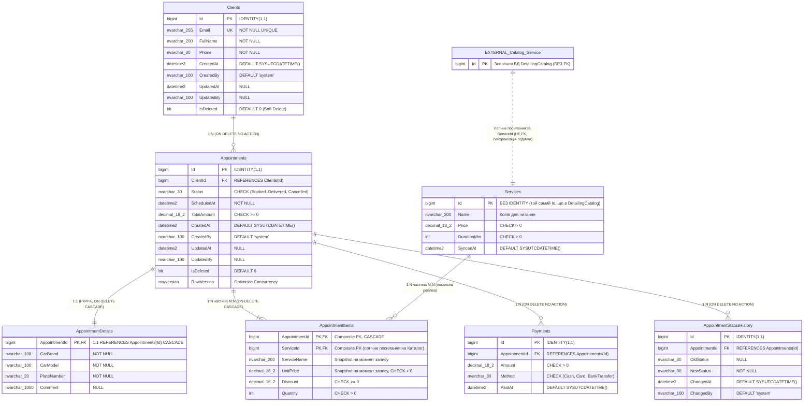

# ER-діаграма Проєкту №1: `DetailingBookings` (SQL Server)

Нижче наведено ER-діаграму бази даних `DetailingBookings` (контекст **Bookings**).

> [!IMPORTANT]
> Таблиця `Services` у базі `DetailingBookings` є локальною read-model копією довідника з бази `DetailingCatalog` (`Id` **без `IDENTITY`**). Зв'язок із зовнішнім контекстом `Catalog` показаний пунктирною лінією (`..`), оскільки міжбазовий `FOREIGN KEY` між мікросервісами суворо заборонений.

## Типи зв'язків у схемі `DetailingBookings`

| Батьківська сутність | Дочірня сутність | Кардинальність | Ключі | Поведінка при видаленні |
| :--- | :--- | :--- | :--- | :--- |
| `Clients` | `Appointments` | `1:N` | `Appointments.ClientId -> Clients.Id` | `ON DELETE NO ACTION` (використовується `IsDeleted`) |
| `Appointments` | `AppointmentDetails` | `1:1` | `AppointmentDetails.AppointmentId (PK = FK) -> Appointments.Id` | `ON DELETE CASCADE` |
| `Appointments` $\leftrightarrow$ `Services` | `AppointmentItems` | `M:N` | Складений PK `(AppointmentId, ServiceId)` | `ON DELETE CASCADE` від `Appointments` |
| `Appointments` | `Payments` | `1:N` | `Payments.AppointmentId -> Appointments.Id` | `ON DELETE NO ACTION` |
| `Appointments` | `AppointmentStatusHistory` | `1:N` | `AppointmentStatusHistory.AppointmentId -> Appointments.Id` | `ON DELETE NO ACTION` |
| `DetailingCatalog.Services` | `DetailingBookings.Services` | Логічна репліка | Спільне значення `Id` (без `IDENTITY` у Bookings) | Міжбазовий FK **відсутній** (пунктир `..`) |
