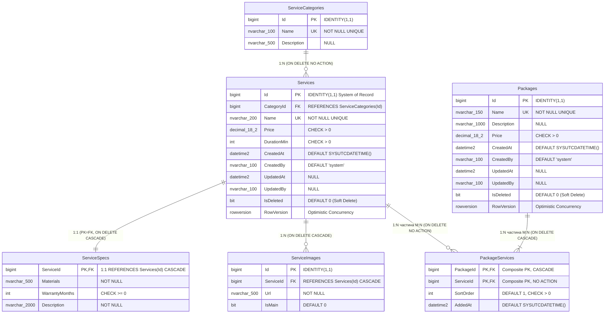

# ER-діаграма Проєкту №2: `DetailingCatalog` (SQL Server)

Нижче наведено ER-діаграму бази даних `DetailingCatalog` (контекст **Catalog**), спроєктованої під подальше використання з **Entity Framework Core (Code First)**.

## Типи зв'язків у схемі `DetailingCatalog`

| Батьківська сутність | Дочірня сутність | Кардинальність | Ключі | Поведінка при видаленні |
| :--- | :--- | :--- | :--- | :--- |
| `ServiceCategories` | `Services` | `1:N` | `Services.CategoryId -> ServiceCategories.Id` | `ON DELETE NO ACTION` |
| `Services` | `ServiceSpecs` | `1:1` | `ServiceSpecs.ServiceId (PK = FK) -> Services.Id` | `ON DELETE CASCADE` |
| `Services` | `ServiceImages` | `1:N` | `ServiceImages.ServiceId -> Services.Id` | `ON DELETE CASCADE` |
| `Packages` $\leftrightarrow$ `Services` | `PackageServices` | `M:N` | Складений PK `(PackageId, ServiceId)` + атрибути `SortOrder`, `AddedAt` | `CASCADE` від `Packages`, `NO ACTION` від `Services` |
